# 图-数据流图

> **这份文档回答：一条消息从进来到出去，数据在每一步长什么样、怎么变。**
>
> 不关心"谁在第几行调谁"（那是 [`图-时序图.md`](./图-时序图.md)），只关心**数据结构的变化**。
>
> 每张图都能对上源码里的实际类。状态标记：✅ 已实现 · ⬜ 空实现

---

## 目录

1. [两条主链路](#一两条主链路)
2. [入站：外部世界 → DSH](#二入站外部世界--dsh)
3. [出站：DSH → 外部世界](#三出站dsh--外部世界)
4. [贯穿全程的两样东西](#四贯穿全程的两样东西)
5. [断点在哪](#五断点在哪)

---

## 一、两条主链路

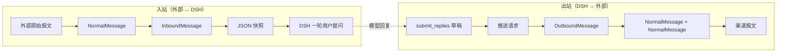

两条链路中间只靠 **`sessionId`** 和 **`pending` 池里那条原始入站消息** 关联。

---

## 二、入站：外部世界 → DSH

### 2.1 总览

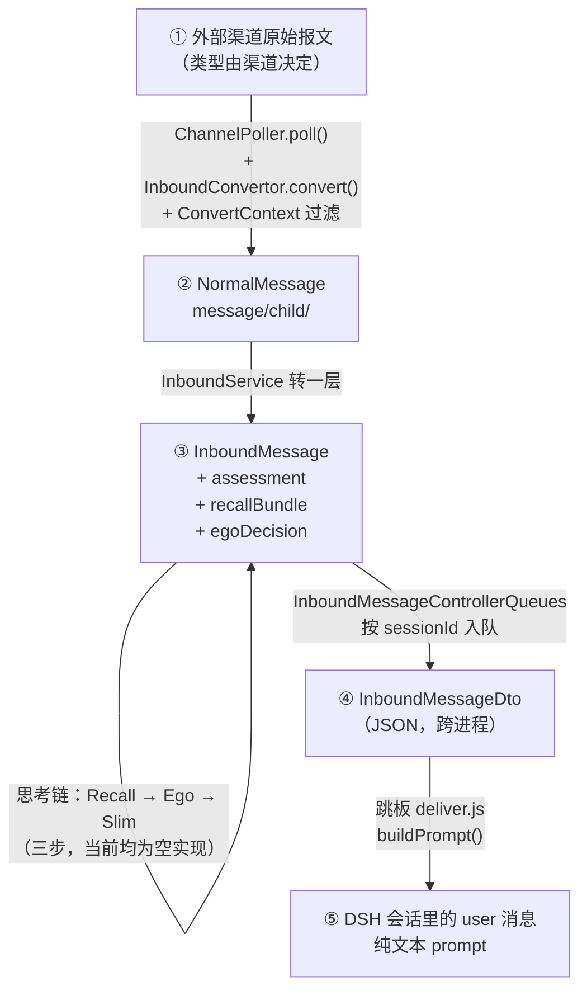

**五个形态，四次变形。** 其中 ②→③→④ 是"加字段"，只有 ①→② 和 ④→⑤ 是"换形状"。

### 2.2 ① → ②：原始报文变成 NormalMessage

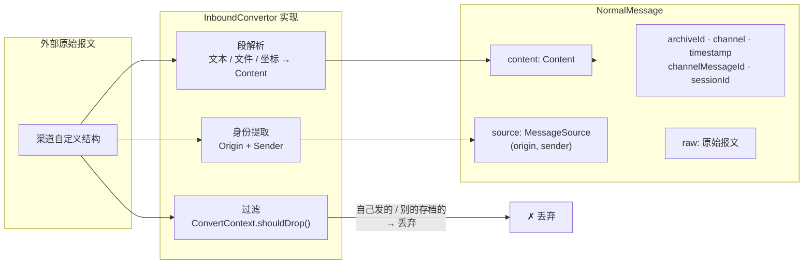

**`ConvertContext` 决定了什么该丢**：

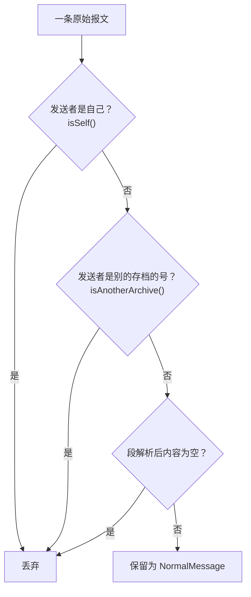

> **`Content` 的四种形态**：`Text`（纯文本）、`FileRef`（文件引用，含 `FileKind`）、`Coordinate`（坐标）、`Multi`（多段组合）。
> 拼进提示词时统一走 `Content.plainText()`：文件变成 `[图片]` / `[语音]` / `[视频]` / `[文件]`，坐标变成 `[坐标: x, y, z]`。

### 2.3 ② → ③：NormalMessage 包成 InboundMessage

`InboundService.toInbound()` 做的事很少——**复制全部字段**，然后交给下一步。

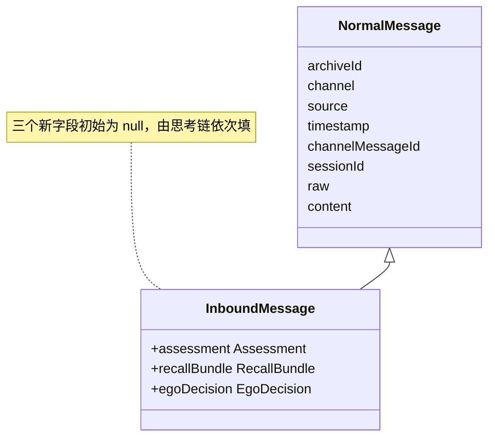

### 2.4 ③ 在前处理链里的三次变形

前处理三步，顺序本身有意义：

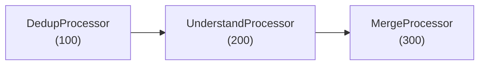

| 步骤 | 对数据做什么 |
|---|---|
| Dedup | 不改形状，只决定留哪些 |
| Understand | **填 `assessment`** |
| Merge | 多条合成一条 |

**第一步：DedupProcessor——不变形，只做取舍**

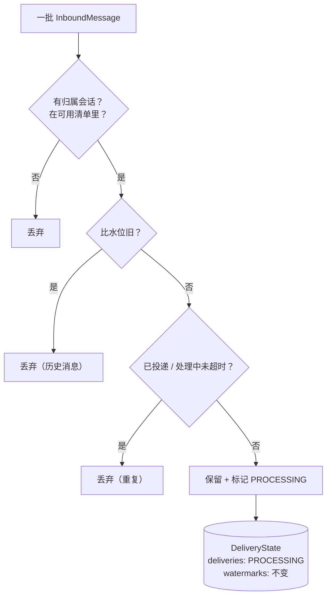

**DeliveryState 的键与状态**：

| 存储 | 键 | 值 |
|---|---|---|
| `deliveries` | `archiveId:channelMessageId` | `{status, updatedAt}` |
| `watermarks` | `archiveId:chatKey`（如 `1:{channel}:{chatType}:{chatId}`） | 最大时间戳（秒） |

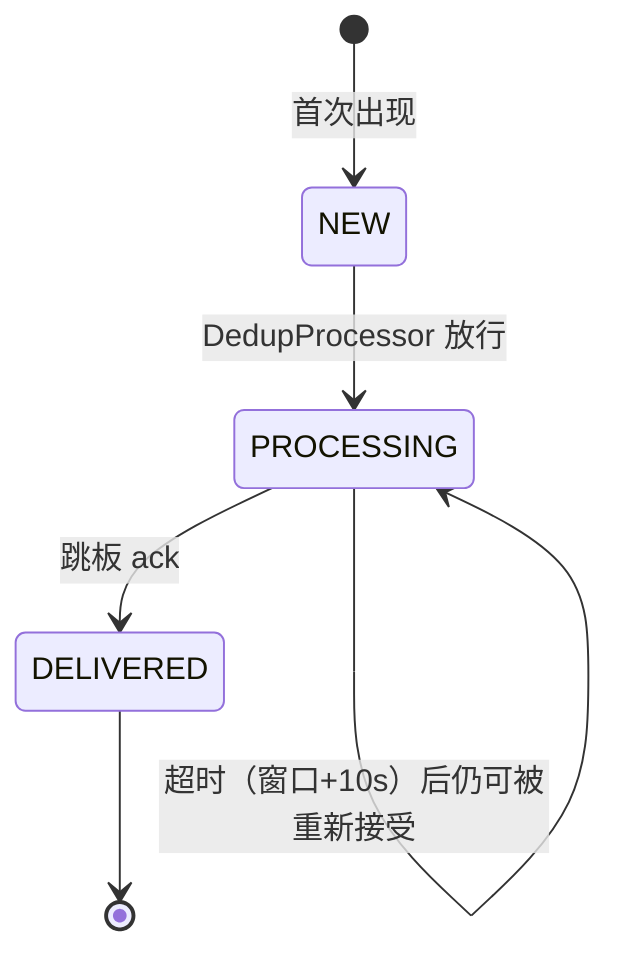

**第二步：UnderstandProcessor——第一次填上下文**

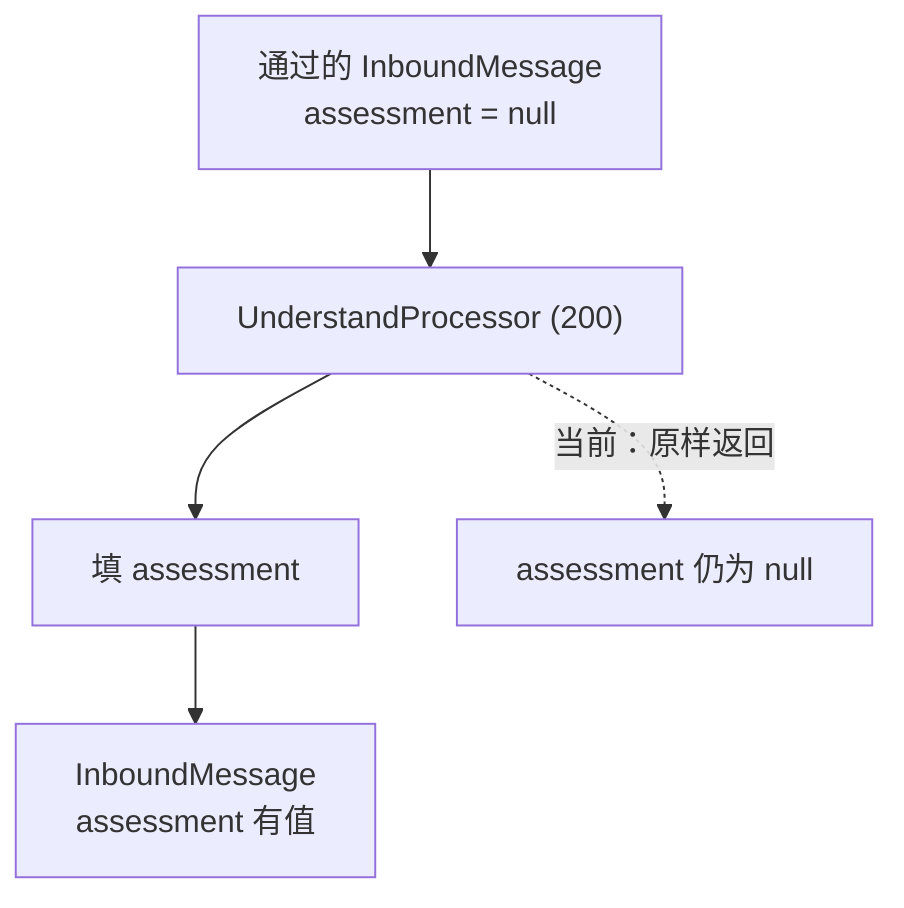

**要填的 `Assessment` 字段**：

| 字段 | 含义 |
|---|---|
| `urgency` | 急不急 |
| `arousalGuess` / `valenceGuess` | 情绪唤醒度 / 效价的粗估 |
| `addressedToMe` | 是不是在跟我说话 |
| `isLateNight` | 是不是深夜 |
| `text` | 原文 |

> 这一步排在合并**之前**，所以 `assessment` 是**逐条**消息填的，不是合并后填的。

**第三步：MergeProcessor——多条合成一条**

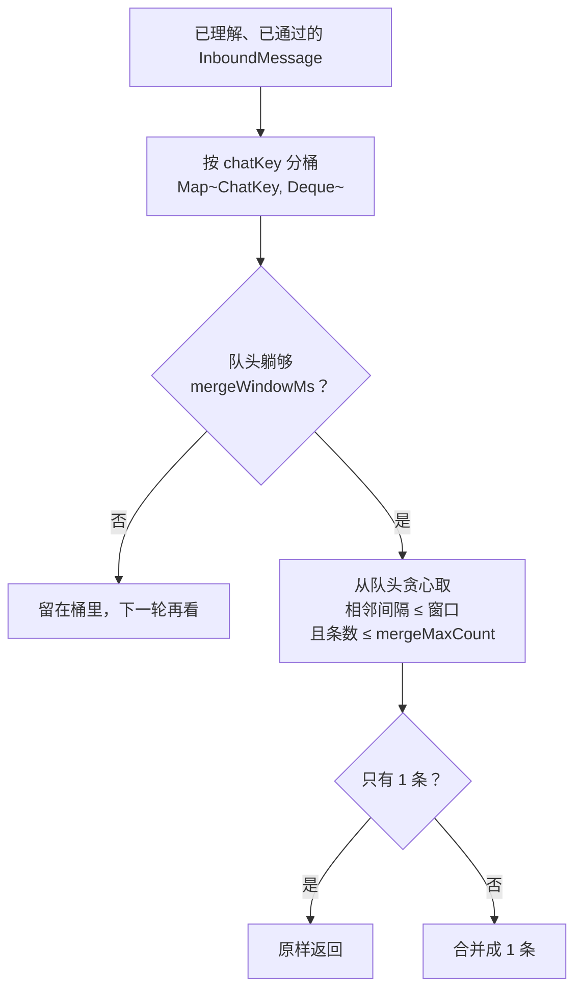

**合并后的字段来源**（全部取**最后一条**）：

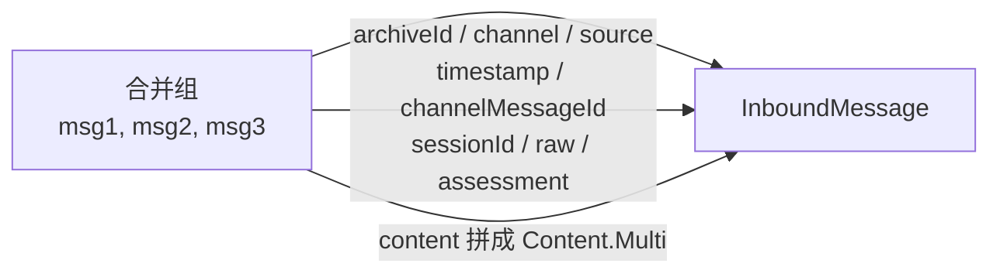

| 字段 | 取值 |
|---|---|
| `archiveId` `channel` `source` `timestamp` `channelMessageId` `sessionId` `raw` | **最后一条**的 |
| `assessment` | **最后一条**的（每条都已独立理解过） |
| `content` | 所有条的 `Content` 装进 `Content.Multi`（1 条时不包） |
| `recallBundle` `egoDecision` | 仍为 null（还没跑思考链） |

> **合并的后果**：多条原始消息的 `channelMessageId` 只剩最后一条的。ack 时推进的水位也是最后一条的时间戳——前面的消息靠"比水位旧就丢"自然失效。

### 2.5 ③ → ④：进入思考链，再填两个字段

`assessment` 在前处理阶段（`UnderstandProcessor`）已经填好，思考链负责剩下的两个：

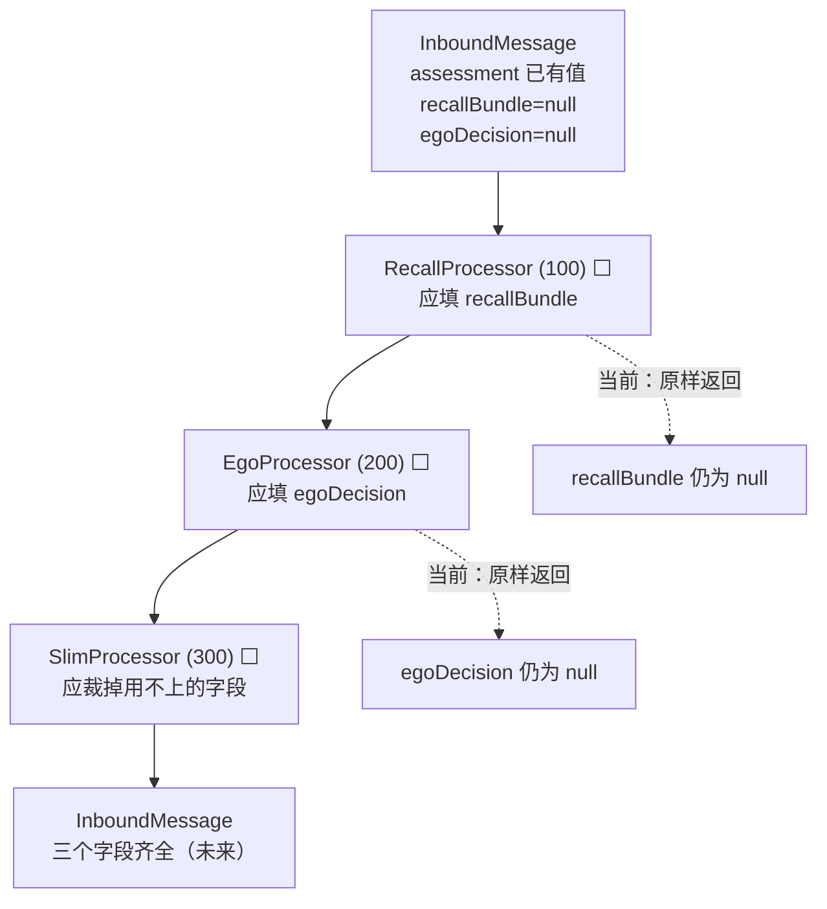

**三个上下文分处两个阶段**：

| 字段 | 谁填 | 在哪个阶段 |
|---|---|---|
| `assessment` | `UnderstandProcessor` | 前处理（order 200） |
| `recallBundle` | `RecallProcessor` | 思考（order 100） |
| `egoDecision` | `EgoProcessor` | 思考（order 200） |

**当前三个处理器都是 `return in`，所以到这一步 `recallBundle` 与 `egoDecision` 仍是 null。** `InboundMessageDto` 里对应位置也就是 `null`。

三个字段的形状：

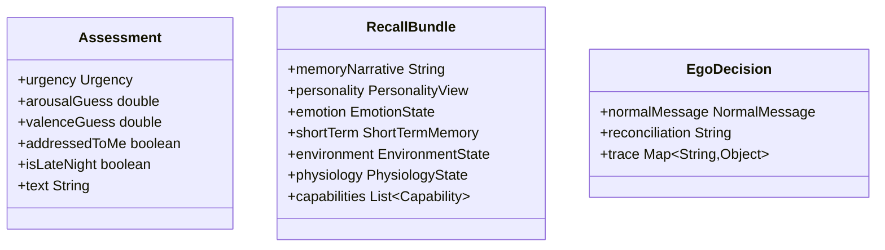

### 2.6 ③ → ④：序列化成 JSON

`InboundMessageDto.from(msg)` 把领域对象压成扁平结构：

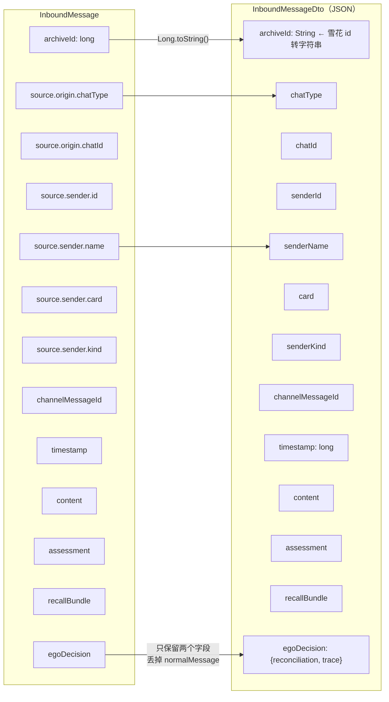

**两处刻意的转换**：

1. **雪花 id 一律转字符串**——JS 的 `Number` 只有 53 位精度，雪花 id 是 64 位，直接给数字会丢精度。
2. **`EgoDecision` 只导出 `reconciliation` + `trace`**，`normalMessage` 不外发。

### 2.7 ④ → ⑤：跳板把 JSON 变成 DSH 的一轮提问

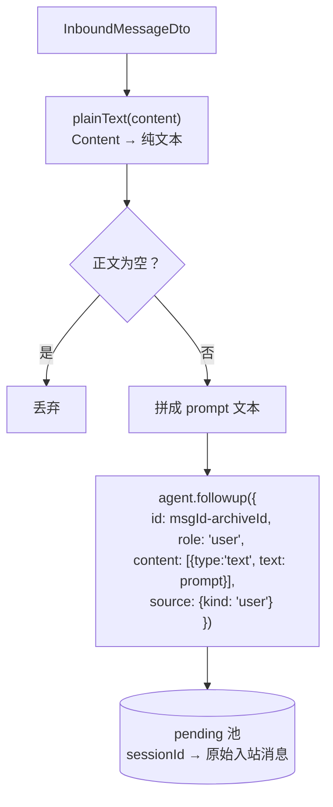

**prompt 的确切形状**：

```
【来自外部聊天】群聊 20001，发送者 用户10002：
今天好累啊

（回复必须调用 submit_replies 工具，否则对方收不到。）
```

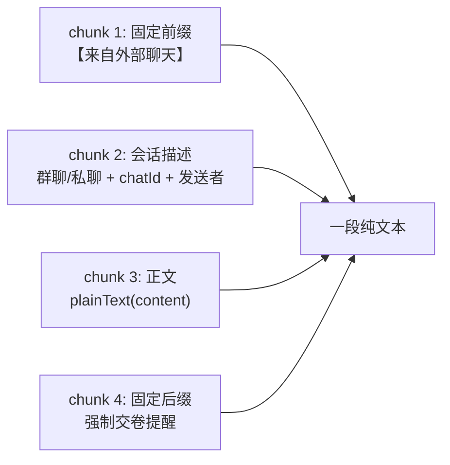

**注意**：`content` 在这里被**压成纯文本**。`FileRef` 变成 `[图片]` 这类占位符，原始 URL / 路径都不进 prompt。

---

## 三、出站：DSH → 外部世界

### 3.1 总览

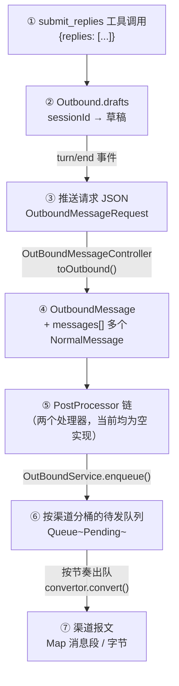

### 3.2 ① → ②：工具调用变成草稿

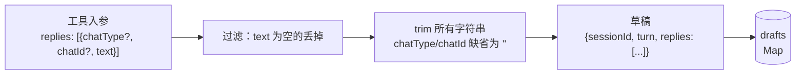

**`sessionId` 从哪来**：`exec.session.id` → `exec.sessionId` → `exec.agent.session.id`，三种写法依次尝试。

### 3.3 ② → ③：turn/end 时判断「这一轮该不该发」

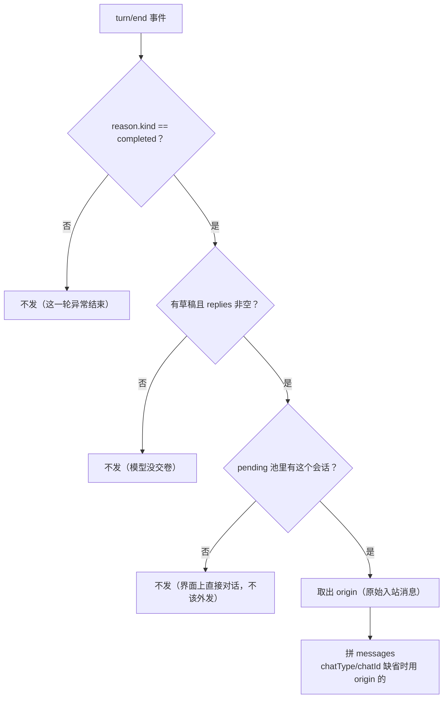

**这一步是「回复发给谁」的唯一判据**：

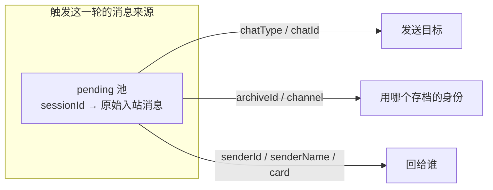

`pending` 里没有 = 这一轮是人在 DSH 界面上直接说的，**一个字都不外发**。

### 3.4 ③ → ④：推送请求还原成领域对象

```mermaid
flowchart TD
    subgraph REQ["OutboundMessageRequest"]
        R1["archiveId"]
        R2["sessionId"]
        R3["inbound: InboundRef<br/>（原始入站消息的身份）"]
        R4["messages: [{chatType, chatId, text}]"]
    end

    subgraph OBJ["OutboundMessage"]
        O1["inboundMessage: InboundMessage"]
        O2["messages: List<NormalMessage>"]
        O3["source: 说话的是我这个存档"]
    end

    R3 -->|"toInbound()<br/>只填定位字段，<br/>不回灌上下文"| O1
    R4 -->|"每条一个 NormalMessage<br/>content = Content.Text"| O2
    O1 -->|"origin 的会话"| O3
```

**`toInbound()` 只还原身份，不还原上下文**——`assessment` / `recallBundle` / `egoDecision` 都不回灌，因为那是"上一轮"的分析结果，这一轮已经用完了。

### 3.5 ⑤ → ⑥：进入发送队列

```mermaid
flowchart TD
    POST["PostService 后处理链<br/>ExpressProcessor ⬜ / ObserveProcessor ⬜"]
    POST --> SPLIT["OutBoundService.enqueue()<br/>把 OutboundMessage.messages 逐条拆开"]
    SPLIT --> Q["按 channel 分桶<br/>Map<ChannelKind, Queue<Pending>>"]
    Q --> TICK["每 500ms 检查"]
    TICK --> DUE{"该渠道到发送间隔了吗？"}
    DUE -->|"否"| SKIP["这轮跳过"]
    DUE -->|"是"| POLL["peek 队头一条"]
    POLL --> SEND["convertor.convert()<br/>+ sender.send()"]
    SEND --> RESULT{"发送成功？"}
    RESULT -->|"是"| DONE["出队"]
    RESULT -->|"否"| DISCARD["出队 + 记 WARN<br/>（不重试）"]
```

**分桶粒度是渠道**：`Map<ChannelKind, Queue<Pending>>`。
**每轮每个桶最多发一条**，间隔由 `sender.suggestedSendIntervalMs()` 决定。

### 3.6 ⑥ → ⑦：NormalMessage 变成渠道报文

```mermaid
flowchart LR
    subgraph NM["NormalMessage"]
        N1["content: Content"]
        N2["source.origin.chatType"]
        N3["source.origin.chatId"]
    end

    subgraph SEND["SendContext"]
        S1["archiveId"]
        S2["link: Link（含 baseUrl / token）"]
        S3["chatType / chatId"]
    end

    subgraph OUT["渠道报文"]
        O1["Map 消息段数组"]
    end

    N1 -->|"OutboundConvertor.convert()"| O1
    N2 --> S3
    N3 --> S3
    S2 -->|"ChannelSender.send()"| O1
```

**`Content` 到渠道报文的映射**（`onebot` 实现的例子）：

| Content | 渠道报文 |
|---|---|
| `Text(value)` | `{type:"text", data:{text: value}}` |
| `FileRef` + `FileKind.IMAGE` | `{type:"image", data:{file:"base64://..."}}`（读本地文件转 base64） |
| `Multi(parts)` | 逐段递归，拼成数组 |
| `Coordinate` | 不发送（跳过） |

---

## 四、贯穿全程的两样东西

### 4.1 `sessionId` —— 把入站和出站缝在一起的唯一线索

```mermaid
flowchart TD
    A["入站：InboundMessage.sessionId<br/>（来自存档绑定的会话）"]
    B["队列：按 sessionId 分桶"]
    C["跳板：followup 投进这个会话"]
    D["pending 池：sessionId → 原始消息"]
    E["出站：turn/end 的 session.id"]
    F["回推：请求里的 sessionId"]
    G["ack：用 sessionId 清整轮缓存"]

    A --> B --> C
    C --> D
    D -->|"查询"| E
    E -->|"比对"| F
    F --> G
```

**cat 侧的 `sessionId` 从哪来**：`Archive.session.sessionId`（存档绑定的 DSH 会话），在 `ConvertContext` 里传给转换器，落进每条消息。

### 4.2 `channelMessageId` —— 去重与 acks 的依据

```mermaid
flowchart LR
    A["渠道报文里的消息号"] --> B["NormalMessage.channelMessageId"]
    B --> C[("DeliveryState.deliveries<br/>键 = archiveId:channelMessageId")]
    B --> D["MergeProcessor<br/>合并后只剩最后一条的"]
    D --> E["ack 请求"]
    E --> C
```

---

## 五、断点在哪

诚实地说，这条链路**目前有三处是断的**：

```mermaid
flowchart TD
    A["外部消息"] --> B["NormalMessage ✅"]
    B --> C["InboundMessage ✅"]
    C --> D["Dedup ✅"]
    D --> U["Understand<br/>空实现"]
    U --> E["Merge ✅"]
    E --> F["思考链<br/>三个处理器空实现"]
    F -.->|"⚠ 没有上下文注入"| G["InboundMessageDto<br/>assessment/recallBundle/egoDecision 为 null"]
    G --> H["DSH 收到 prompt ✅"]
    H --> I["模型交卷 ✅"]
    I --> J["推送 ✅"]
    J --> K["PostProcessor<br/>两个处理器空实现"]
    K -.->|"⚠ 没有润色与回顾"| L["按渠道发送 ✅"]

    style U fill:#fff3cd
    style F fill:#fff3cd
    style K fill:#fff3cd
```

| 断点 | 后果 |
|---|---|
| `UnderstandProcessor` 空实现 | `assessment` 恒为 null，合并与后续环节拿不到"这条消息重不重要" |
| 思考链三个处理器空实现 | DSH 收到的 prompt 里**没有人格、没有记忆、没有情绪、没有三我裁决**，只有原始消息文本 |
| 后处理两个处理器空实现 | 回复**不润色、不拆条、不记入记忆**，原样发出去 |

**这三处是第二阶段的主要工作。**

---

## 文档地图

| 想知道 | 看哪个 |
|---|---|
| 系统长什么样、术语是什么 | [`架构总览.md`](./架构总览.md) |
| 每个类有哪些字段和方法 | [`接口文档-cat.md`](./接口文档-cat.md) · [`接口文档-跳板.md`](./接口文档-跳板.md) |
| 包和类怎么摆、谁依赖谁 | [`图-类关系图.md`](./图-类关系图.md) |
| **一条消息的数据怎么变**（本文） | `图-数据流图.md` |
| 谁调谁、什么顺序 | [`图-时序图.md`](./图-时序图.md) |
| 下一步写什么 | [`开发计划-短期.md`](./开发计划-短期.md) |
