# 图-时序图

> **这份文档回答：谁在第几步调谁、是同步还是异步、失败会怎样。**
>
> 不关心数据长什么样（那是 [`图-数据流图.md`](./图-数据流图.md)），只关心**调用的先后与依赖**。
>
> 每个场景末尾都有「失败时」小节，写清楚异常走向。

---

## 目录

| # | 场景 | 触发者 |
|---|---|---|
| 1 | [启动装配](#场景-1启动装配) | DSH 加载插件 |
| 2 | [心跳：告诉 cat「我能服务哪些会话」](#场景-2心跳告诉-cat我能服务哪些会话) | 定时器 |
| 3 | [入站：外部消息进 DSH](#场景-3入站外部消息进-dsh) | 定时器 |
| 4 | [外部消息触发的一轮：人设与历史的接管](#场景-4外部消息触发的一轮人设与历史的接管) | 模型开始推理 |
| 5 | [出站：交卷并推回 cat](#场景-5出站交卷并推回-cat) | 模型调用工具 |
| 6 | [cat 侧发送：从队列到外部渠道](#场景-6cat-侧发送从队列到外部渠道) | 定时器 |
| 7 | [失败出站清理](#场景-7失败出站清理) | 定时器 |
| 8 | [日程工具被拦截](#场景-8日程工具被拦截) | 模型尝试调工具 |
| 9 | [一次完整的往返](#场景-9一次完整的往返) | —— |

---

## 场景 1：启动装配

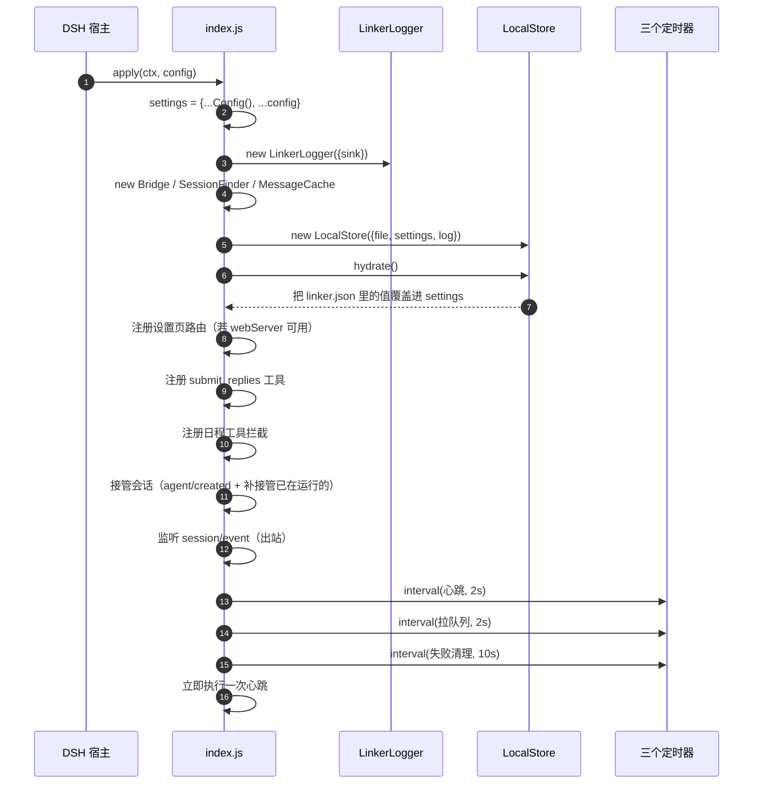

**关键点**：

- `apply()` **不能是 async**——cordis 不等它。启动逻辑包在末尾的自执行块里。
- `settings` 是**普通对象副本**，`LocalStore.hydrate()` 直接改它的键。之后运行时读配置必须走 `store.get(key)`，`Config` 的默认值不会跟着更新。

**失败时**：

| 失败点 | 后果 |
|---|---|
| `webServer` 服务不存在 | 设置页不可用，其余照常 |
| `ctx.tools` 不存在 | 模型无法交卷，出站不可用 |
| `ctx.interval` 不存在 | 打完日志后 `return`，整个插件不工作 |

---

## 场景 2：心跳：告诉 cat「我能服务哪些会话」

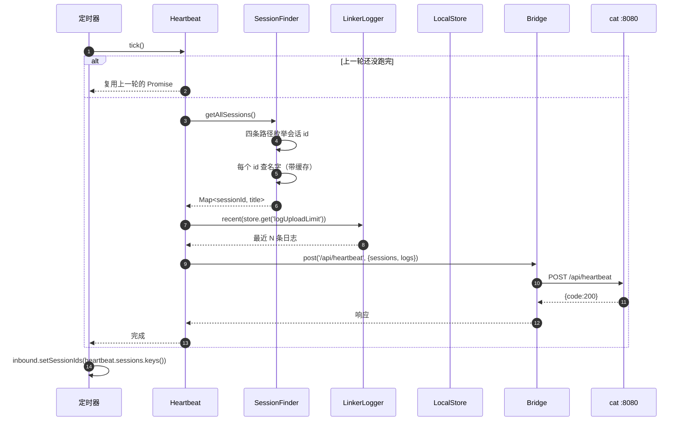

**枚举的四条路径**（任一条拿到都算）：

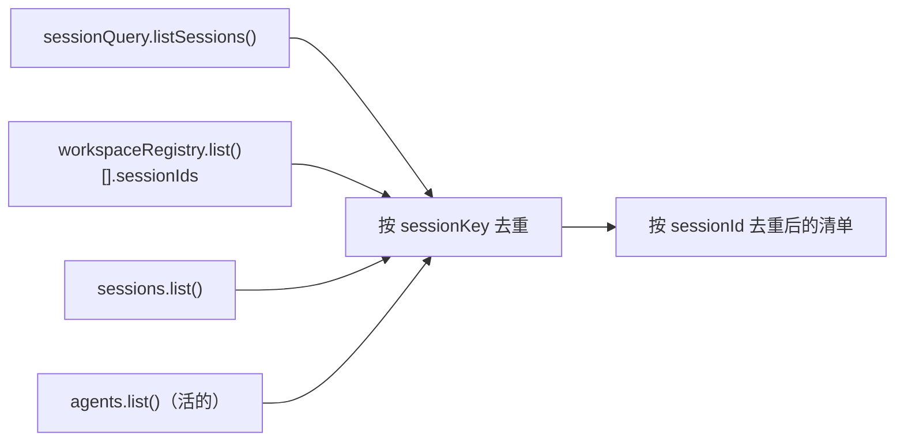

**取名字的四条路径**（依次尝试，拿到即止）：

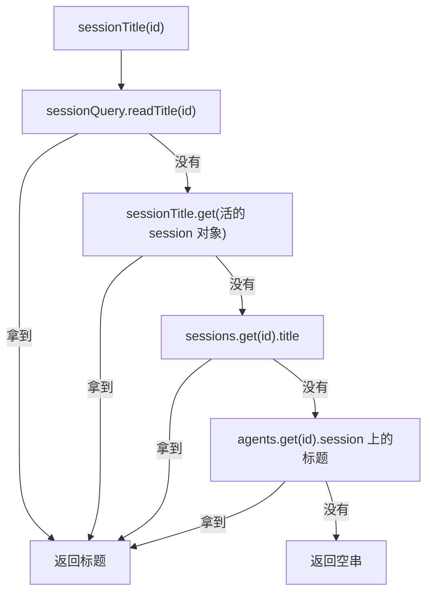

> 拿不到名字的会话**照样上报**——会话本身是存在的，只是还没被起名。

**失败时**：

| 失败点 | 后果 |
|---|---|
| cat 连不上 | 打一次「心跳上报失败」日志后静默（`failed` 标志避免刷屏） |
| 某个枚举路径抛错 | 只记日志，继续走下一条路径 |
| 取名字失败 | 上报空标题，不影响会话被发现 |

---

## 场景 3：入站：外部消息进 DSH

### 3.1 跳板侧：拉取 → ack → 投递

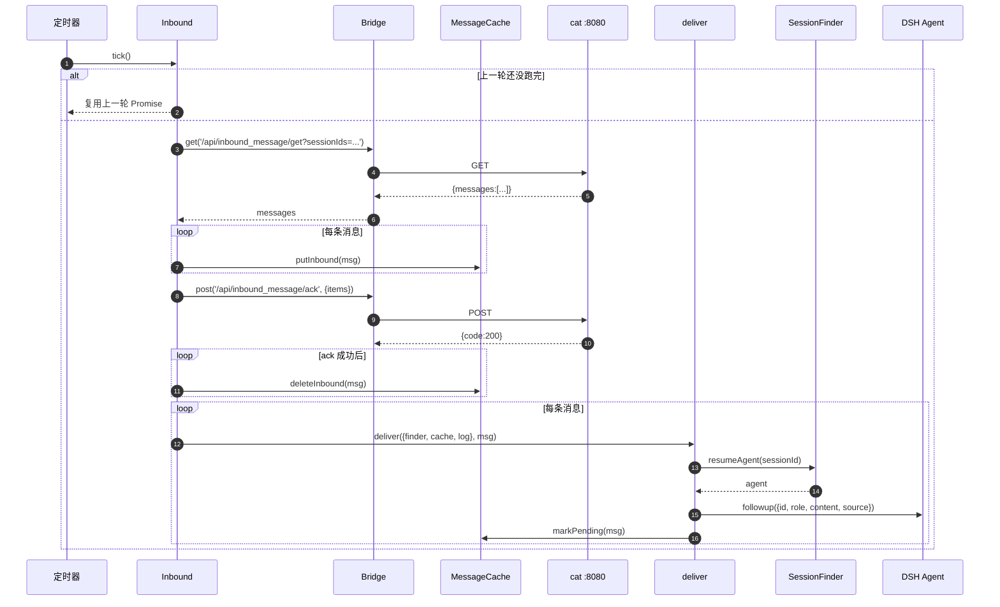

**顺序上最关键的一点**：

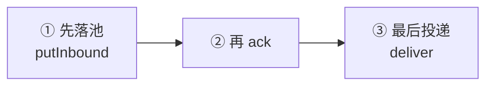

> **先落池再 ack，再投递。** ack 在前意味着：即使后面会话打不开，cat 那边也已经推进了水位——这条消息不会重投。代价是「会话不存在」时消息会丢，跳板只记日志。

### 3.2 cat 侧：轮询 → 转换 → 入队

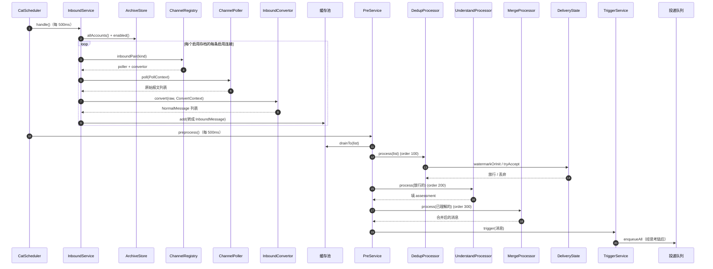

**前处理三步的顺序**：

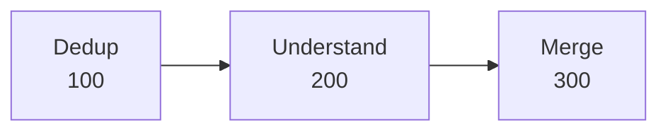

**注意两个 Service 是各自独立的定时器**：`InboundService` 和 `PreService` 都每 500ms 跑一次，但它们跑在同一个线程池的不同任务里。缓存池就是它们的交接点。

**失败时**：

| 失败点 | 后果 |
|---|---|
| `poller.poll()` 抛 `PollException` | 单个存档的这条连接跳过，记 WARN，其他存档照常 |
| `convertor.convert()` 里某条解析失败 | 该条返回 null 被过滤，其余保留 |
| `dedup` 把消息全丢光 | `PreService` 早退，不调 `TriggerService` |
| `TriggerService` 抛错 | 整个 `preprocess` 抛到 `CatScheduler`，记 WARN，下轮继续 |

---

## 场景 4：外部消息触发的一轮：人设与历史的接管

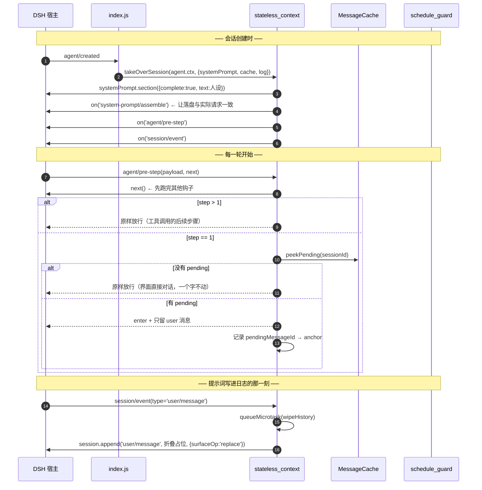

**为什么必须推到 `queueMicrotask`**：

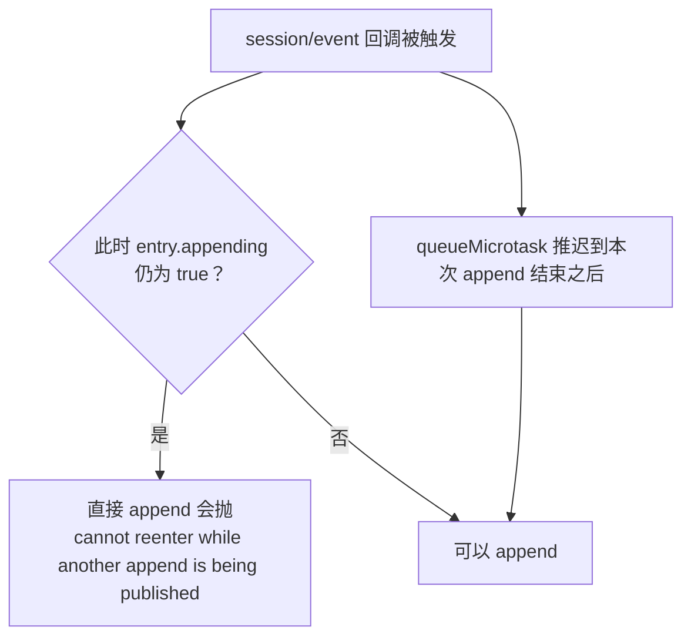

**三个硬约束**：

| # | 约束 | 违反后果 |
|---|---|---|
| 1 | 不能碰 surface 节点 0 | 那是 system prompt，强行 replace 会被 DSH 拒绝 |
| 2 | 不能在回调里直接 append | 撞上 "cannot reenter" |
| 3 | 只有 step 1 才抹 | 工具调用会把一轮拆成多个 step，每步都抹会把上一步的工具结果一起抹掉 |

**`schedule_guard` 用同一个判据**：

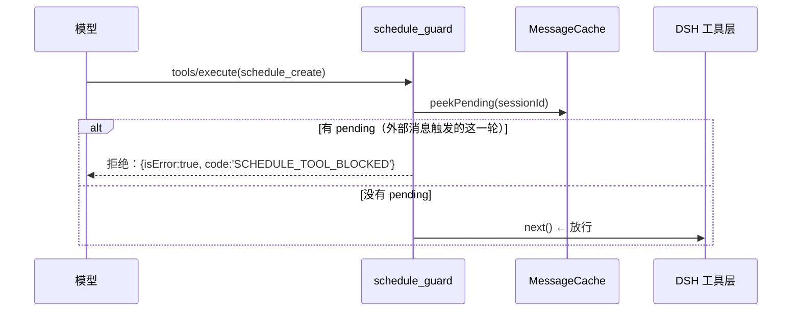

**失败时**：

| 失败点 | 后果 |
|---|---|
| `takeOverSession` 抛错 | 记日志，该会话不接管（不用无状态），正常对话仍可用 |
| `agent.session` 拿不到 | 本轮不抹历史，但照常 enter |
| `wipeHistory` 抛错 | 记日志，本轮照常进行（只多留了历史） |

---

## 场景 5：出站：交卷并推回 cat

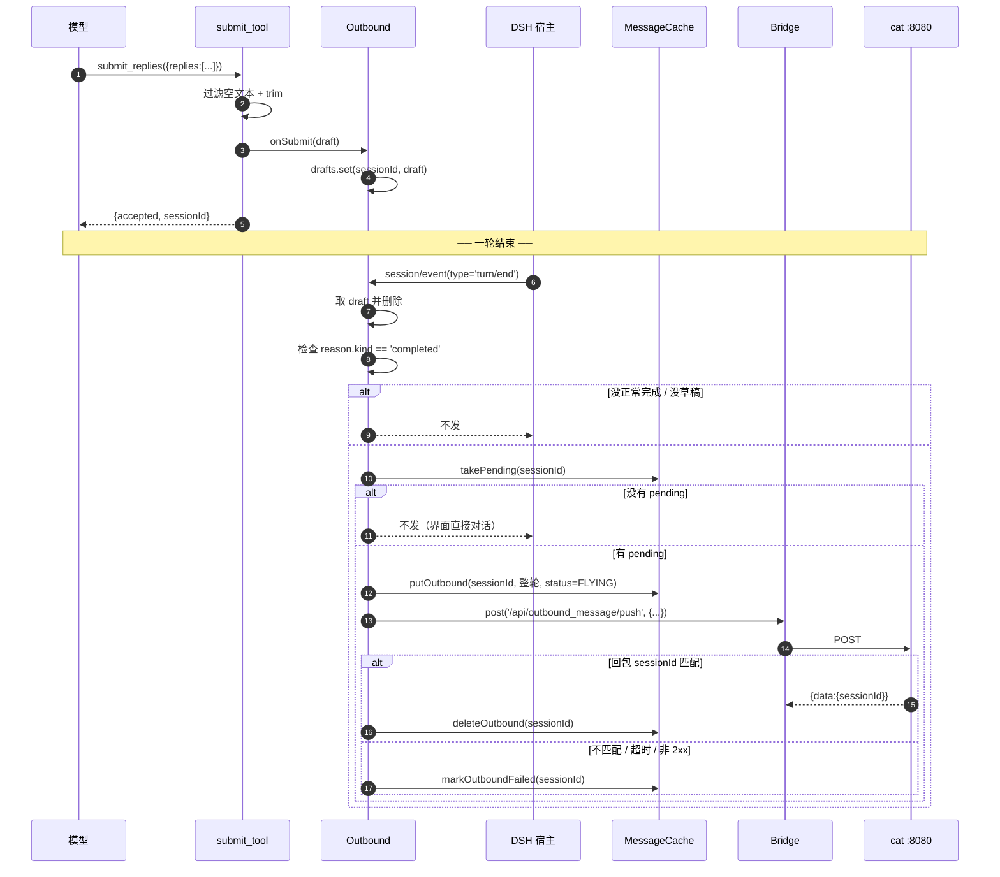

**判断链**（任何一环不满足都不发）：

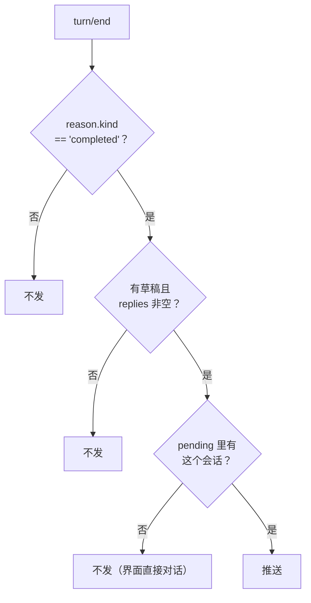

**一轮一个 ack**：

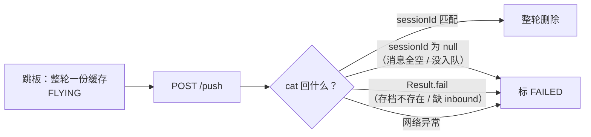

**cat 侧 `push()` 的处理**：

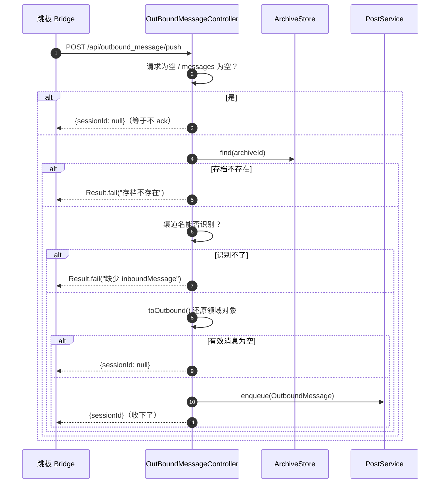

**注意**：`enqueue` 只是**放进缓存**就返回 ack，真正的发送在后处理链和发送队列里异步完成。跳板收到 ack 就清缓存，不等实际发出。

**失败时**：

| 失败点 | 后果 |
|---|---|
| 模型没调 `submit_replies` | 没有草稿，这一轮什么都不发 |
| `turn/end` 的 reason 不是 completed | 不发 |
| `push` 网络异常 | 标 `FAILED`，留在出站池等清理 |
| cat 回了 `Result.fail` | 同上，标 `FAILED` |
| cat 内部 `enqueue` 之后出错 | ack 已返回，跳板已清缓存，这条丢了 |

---

## 场景 6：cat 侧发送：从队列到外部渠道

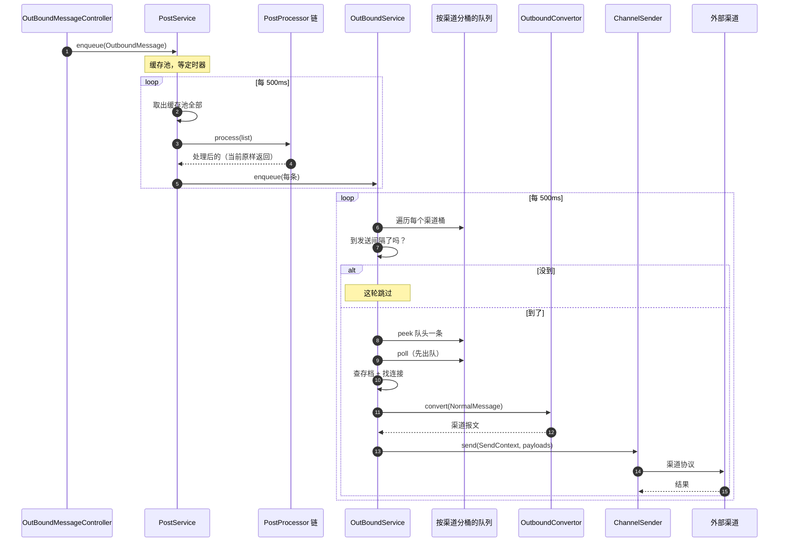

**发送是先出队再发**：

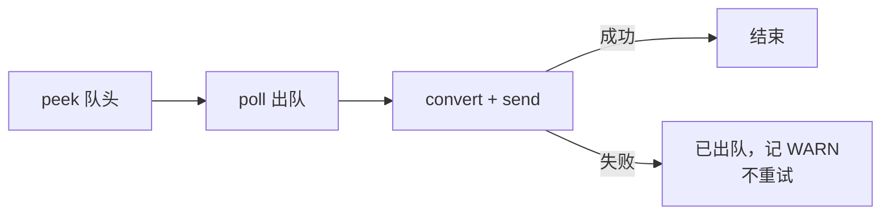

**失败时**：

| 失败点 | 后果 |
|---|---|
| 存档已被删 | 记 WARN，这条丢 |
| 找不到启用中的连接 | 记 WARN，这条丢 |
| 渠道没有可用的出站实现 | 记 debug，这条丢 |
| `sender.send()` 返回 0 | 记 WARN「发送失败，已丢弃」 |
| 渠道没有出站实现 | `intervalOf()` 返回 `Long.MAX_VALUE`，这个桶永远不发 |

---

## 场景 7：失败出站清理

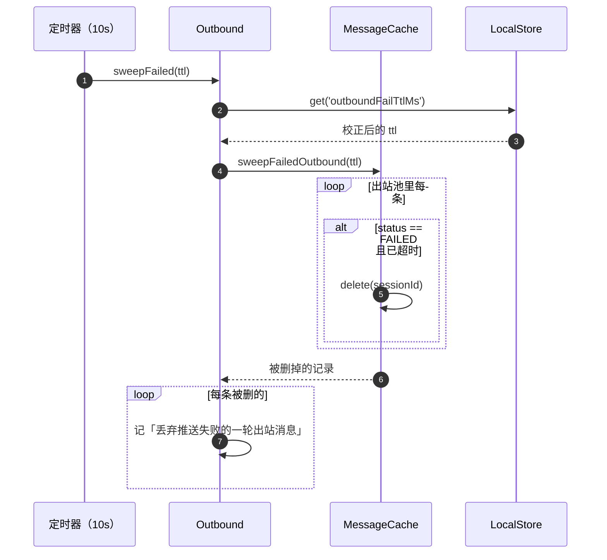

**只清 `FAILED`，不碰 `FLYING`**：

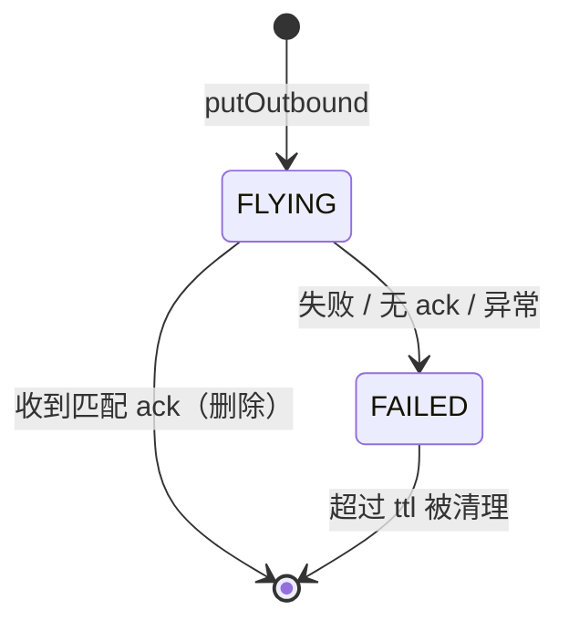

> **当前不做重推。** `FAILED` 留着的意义只是「出问题时能在缓存里看到现场」，过了 ttl 就丢。

---

## 场景 8：日程工具被拦截

已并入 [场景 4](#场景-4外部消息触发的一轮人设与历史的接管) 末尾的 `tools/execute` 时序图。

---

## 场景 9：一次完整的往返

把上面所有场景串起来，按真实发生顺序：

```mermaid
sequenceDiagram
    autonumber
    participant EXT as 外部世界
    participant CAT as cat
    participant LINK as 跳板
    participant DSH as DSH 宿主
    participant M as 模型

    Note over EXT,M: ── ① 外部消息进来 ──
    CAT->>EXT: poller.poll()（每 500ms）
    CAT->>CAT: convert → Dedup → Understand → Merge
    CAT->>CAT: 思考链 Recall → Ego → Slim（当前空实现）
    CAT->>CAT: 入队（按 sessionId）

    Note over EXT,M: ── ② 跳板拉取并投递 ──
    LINK->>CAT: GET /api/inbound_message/get
    CAT-->>LINK: messages
    LINK->>LINK: putInbound → ack
    LINK->>CAT: POST /api/inbound_message/ack
    LINK->>DSH: resumeAgent + followup(prompt)
    LINK->>LINK: markPending

    Note over EXT,M: ── ③ 模型推理 ──
    DSH->>LINK: agent/pre-step
    LINK->>LINK: peekPending → 有 → 抹历史
    DSH->>M: 带人设的 prompt
    M->>M: 思考

    Note over EXT,M: ── ④ 交卷并推回 ──
    M->>LINK: submit_replies
    DSH->>LINK: turn/end
    LINK->>LINK: takePending → putOutbound(FLYING)
    LINK->>CAT: POST /api/outbound_message/push
    CAT-->>LINK: {sessionId}
    LINK->>LINK: deleteOutbound

    Note over EXT,M: ── ⑤ cat 发送 ──
    CAT->>CAT: PostService → PostProcessor 链
    CAT->>CAT: OutBoundService 按渠道分桶
    CAT->>EXT: convertor.convert + sender.send
```

**三个异步交接点**（图中虚线处）：

```mermaid
flowchart TD
    A["cat 入队"] -.->|"等跳板来拉"| B["跳板 GET"]
    C["DSH turn/end"] -.->|"等 PostService 定时器"| D["后处理链"]
    E["OutBoundService 出队"] -.->|"等渠道发送间隔"| F["sender.send"]
```

每一处都是**「放进去就走」**，没有人等待下一环节完成。

---

## 文档地图

| 想知道 | 看哪个 |
|---|---|
| 系统长什么样、术语是什么 | [`架构总览.md`](./架构总览.md) |
| 每个类有哪些字段和方法 | [`接口文档-cat.md`](./接口文档-cat.md) · [`接口文档-跳板.md`](./接口文档-跳板.md) |
| 包和类怎么摆、谁依赖谁 | [`图-类关系图.md`](./图-类关系图.md) |
| 一条消息的数据怎么变 | [`图-数据流图.md`](./图-数据流图.md) |
| **谁调谁、什么顺序**（本文） | `图-时序图.md` |
| 下一步写什么 | [`开发计划-短期.md`](./开发计划-短期.md) |
