# 图-类关系图

> **这份文档回答：包怎么分、谁依赖谁、每个类在系统里站在什么位置。**
>
> 写新类之前先看这里，确定它该放哪个包。
>
> 全仓 146 个 Java 类（cat）、20 个 JS 模块（跳板）。
>
> 状态标记：✅ 有完整实现 · 🟡 有壳但核心没写 · ⬜ 空实现 / 只有签名

---

## 目录

1. [系统组成](#一系统组成)
2. [跳板的模块关系](#二跳板的模块关系)
3. [cat 的包结构](#三cat-的包结构)
4. [按包展开](#四按包展开)
5. [依赖方向](#五依赖方向)
6. [新增类时该放哪](#六新增类时该放哪)

---

## 一、系统组成

系统由两个独立进程组成，通过 HTTP 相连，调用方向单一。

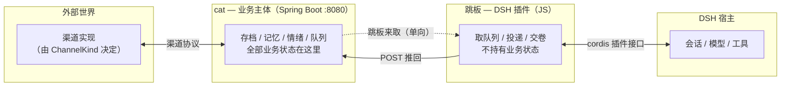

**边界约定**：

| 进程 | 语言 | 职责 | 不该管 |
|---|---|---|---|
| **cat** | Java | 存档、渠道抽象、消息管线、队列、日志 | DSH 的会话/工作区概念 |
| **跳板** | JS | 心跳、入站投递、出站交卷、无状态上下文 | 任何业务判断 |

**cat 不认识具体渠道。** 它只定义 `ChannelKind` 枚举与四个契约接口，由 `channel/` 下的实现去对接真实世界。换一个渠道 = 新增一个实现包，核心层零改动。

---

## 二、跳板的模块关系

### 2.1 文件树

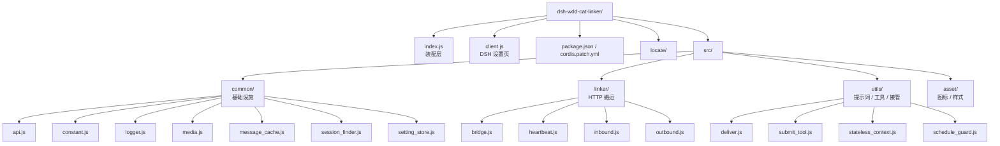

### 2.2 依赖图

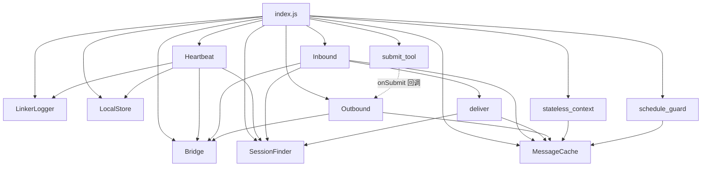

### 2.3 分层规则

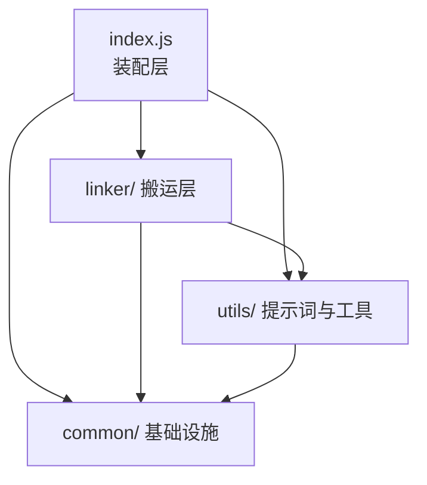

| 层 | 允许依赖 | 禁止依赖 |
|---|---|---|
| `common/` | node 内置 + `constant.js` | `linker/`、`utils/` |
| `linker/` | `common/`、`utils/` | 模块之间互相依赖（串联由 `index.js` 完成） |
| `utils/` | `common/` | `linker/`（`deliver.js` 只接收 `{finder, cache, log}`，不持有 `Inbound` 实例） |
| `index.js` | 全部 | — |

### 2.4 模块状态

| 模块 | 状态 | 一句话 |
|---|---|---|
| `index.js` | ✅ | 装配；三个定时器（心跳、拉队列、失败清理） |
| `bridge.js` | ✅ | 唯一的 HTTP 出口，带超时与 JSON 校验 |
| `heartbeat.js` | ✅ | 枚举会话 + 上报日志，single-flight |
| `inbound.js` | ✅ | 取 → 落池 → ack → 逐条 `deliver` |
| `outbound.js` | ✅ | 交卷 → `turn/end` → 推送 → 一轮一条 ack |
| `deliver.js` | ✅ | 拼提示词 + 恢复会话 + followup + 标 pending |
| `stateless_context.js` | ✅ | 人设注入 + 每轮抹历史（pending 判定） |
| `submit_tool.js` | ✅ | `submit_replies` 工具定义 |
| `schedule_guard.js` | ✅ | 拦截内置日程工具（只拦不转发） |
| `message_cache.js` | ✅ | 三个池：inbound / pending / outbound |
| `session_finder.js` | ✅ | 四条枚举路径 + 四条取名路径 + 恢复 |
| `setting_store.js` | ✅ | SPEC 是配置唯一权威；落盘 `data/linker.json` |
| `logger.js` | ✅ | 内存环形缓冲 200 条 |
| `media.js` | ✅ | `plainText` / `summarize` |
| `constant.js` | ✅ | 三个技术常量 |
| `client.js` | ✅ | DSH 设置页（九个字段 + 连通性探测） |

---

## 三、cat 的包结构

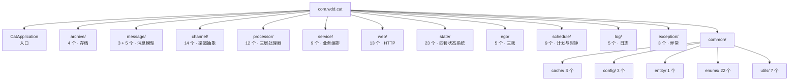

**状态总览**：

| 包 | 类数 | 状态 |
|---|---|---|
| `archive/` | 4 | ✅ 全部实现 |
| `message/` | 8 | ✅ 模型完整；`Assessment` / `RecallBundle` 只有形状 |
| `channel/` | 14 | ✅ 抽象与实现齐全 |
| `processor/` | 12 | 🟡 前处理 2 个实现，其余 6 个空实现 |
| `service/` | 9 | 🟡 6 个实现，`ReflexService` / `ScheduleService` 空 |
| `state/` | 23 | ⬜ 只有数据形状与接口签名 |
| `ego/` | 5 | ⬜ 只有数据形状与接口签名 |
| `schedule/` | 9 | ⬜ 只有 `IgnorePolicy` 是"正确的空" |
| `web/` | 13 | ✅ 全部实现 |
| `log/` | 5 | ✅ 全部实现 |
| `exception/` | 3 | ✅ 全部实现 |
| `common/` | 36 | ✅ 大部分实现，4 个工具类空 |

**三个包的区别容易搞错**：

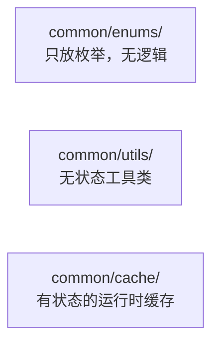

`state/` **不是** `common/` 的子包——它描述一个存档的内在状态，和 `ego/`、`schedule/` 平级。

---

## 四、按包展开

### 4.1 `archive/` — 存档（4 个，全部 ✅）

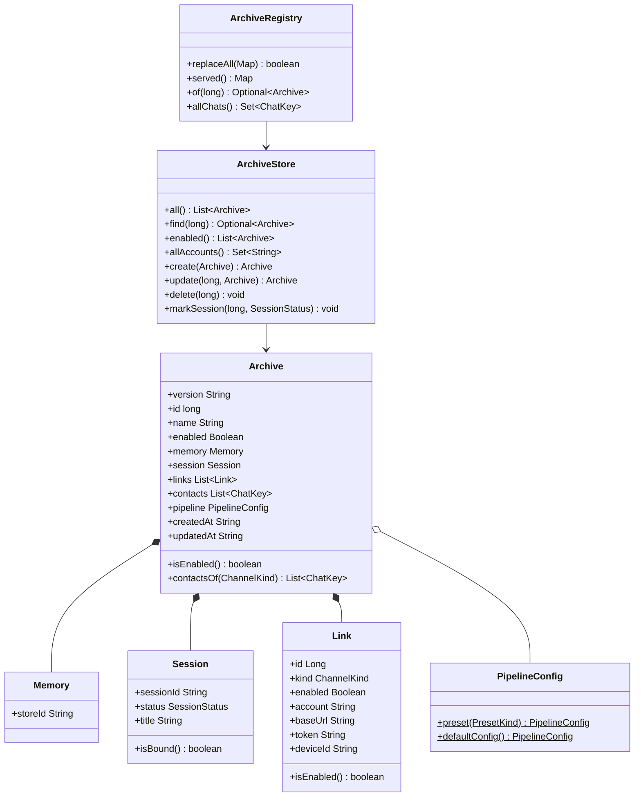

`Archive.Link` 的构造器会校验：`kind` 必须是 `EXTERNAL` 家族，否则抛 `IllegalArgumentException`。

### 4.2 `message/` — 消息模型

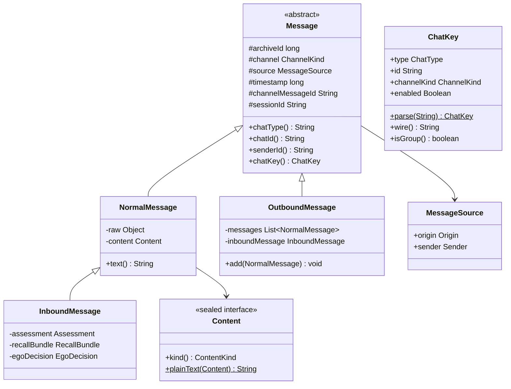

`Content` 的四个实现：

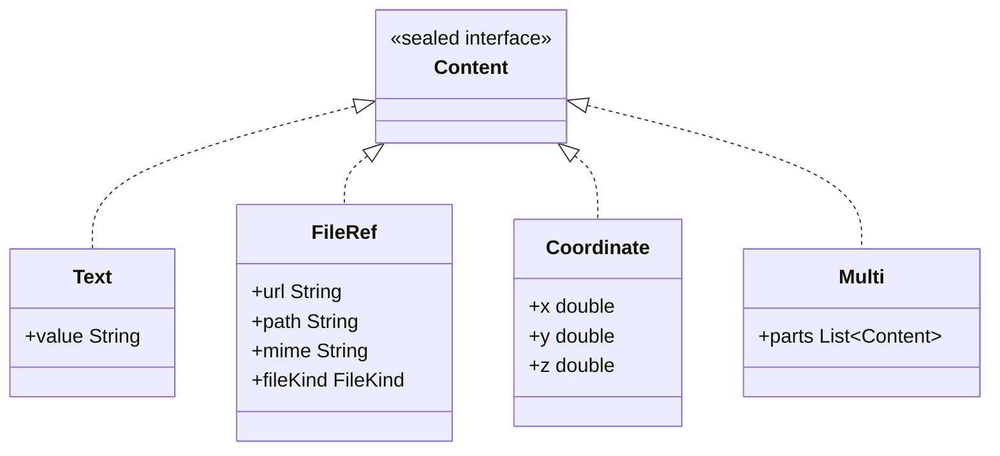

`message/child/` 子包：`Assessment`、`RecallBundle`、`InboundMessage`、`NormalMessage`、`OutboundMessage`。

### 4.3 `channel/` — 渠道抽象（14 个，全部 ✅）

**四个契约接口**：

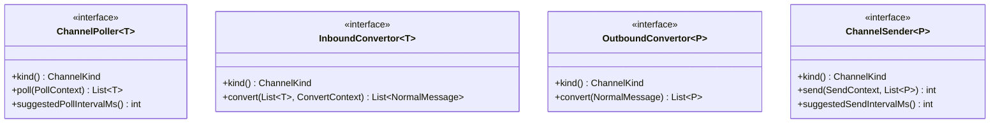

**三个上下文（record）**：

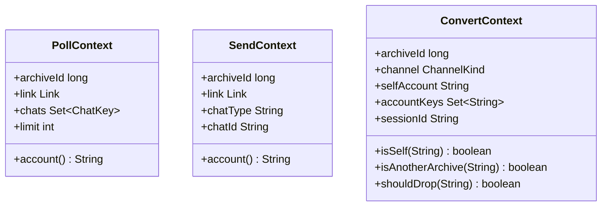

**注册表与实现**：

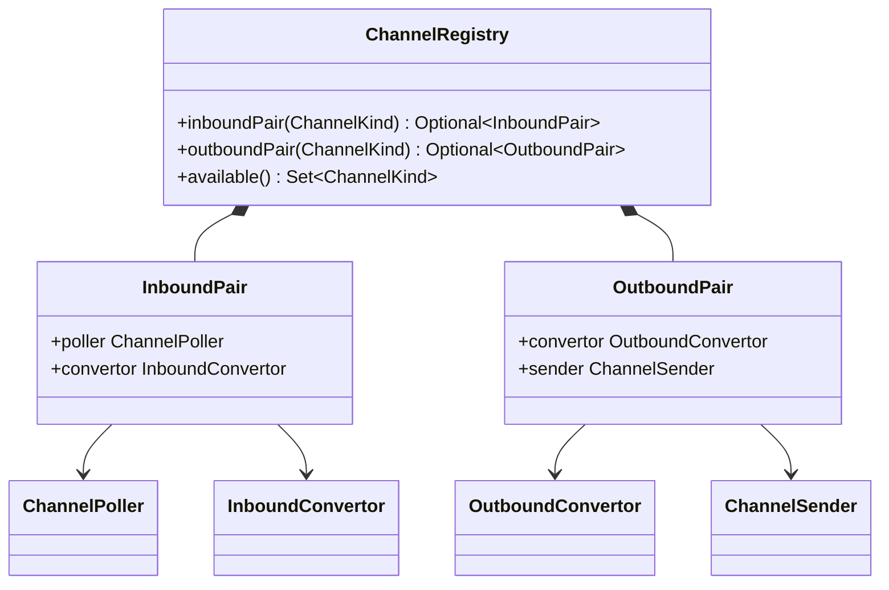

**`onebot/` 子包 —— 一个外部渠道的具体实现**：

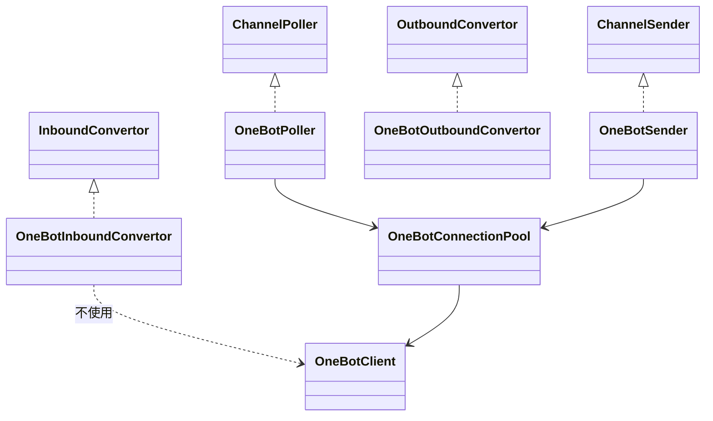

**核心不依赖它。** `ChannelRegistry` 只按 `kind()` 配对，从不 import `onebot` 包里的任何类。删掉整个 `onebot/` 目录，其余代码照常编译——只是 `ChannelKind.EXTERNAL_QQ` 变成"入站出站都不可用"。

### 4.4 `processor/` — 三层处理器（12 个）

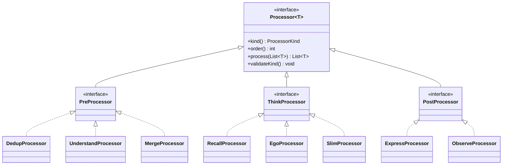

| 实现 | 层 | order | 状态 |
|---|---|---|---|
| `DedupProcessor` | 前处理 | 100 | ✅ 会话不可用 / 已投递 / 处理中 / 比水位旧 → 丢 |
| `UnderstandProcessor` | 前处理 | 200 | ⬜ 应填 `assessment` |
| `MergeProcessor` | 前处理 | 300 | ✅ 桶内躺够窗口 + 相邻间隔 ≤ 窗口 → 合并 |
| `RecallProcessor` | 思考 | 100 | ⬜ 应填 `recallBundle` |
| `EgoProcessor` | 思考 | 200 | ⬜ 应填 `egoDecision` |
| `SlimProcessor` | 思考 | 300 | ⬜ 应裁掉用不上的字段 |
| `ExpressProcessor` | 后处理 | 100 | ⬜ |
| `ObserveProcessor` | 后处理 | 200 | ⬜ |

**`order()` 必须自己排序**：Spring 注入的 `List<T>` 顺序不保证，三个 Service 都在 `@PostConstruct` 里 `sort(Comparator.comparingInt(Processor::order))`。

### 4.5 `service/` — 业务链路（9 个）

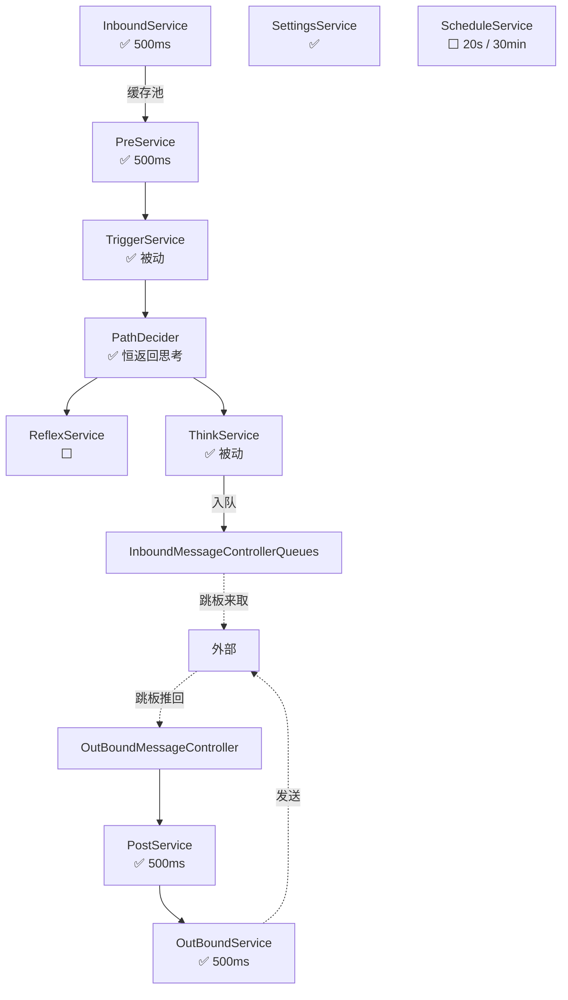

`service/tool/` 子包：`DecisionContext`（record）、`PathDecider`（✅）、`ReflexRule`（⬜ 空类）。

### 4.6 `state/` — 四套状态系统（23 个，**全部空壳**）

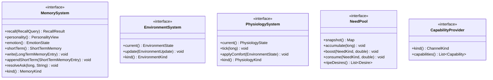

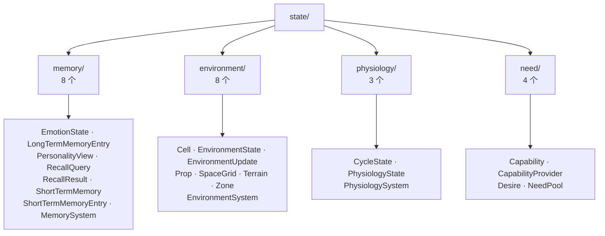

四个包下都各有一个 `impl/` 子目录，**里面只有一个 `.README.md`，没有任何实现类**。

### 4.7 `ego/` — 三我（5 个，**全部空壳**）

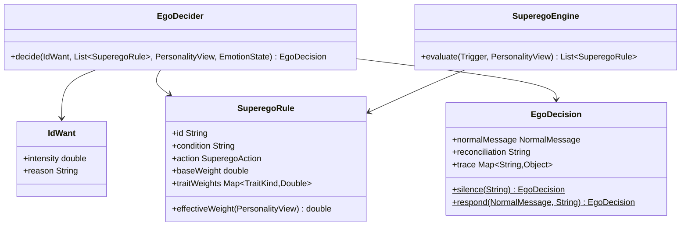

### 4.8 `schedule/` — 计划与时钟（9 个）

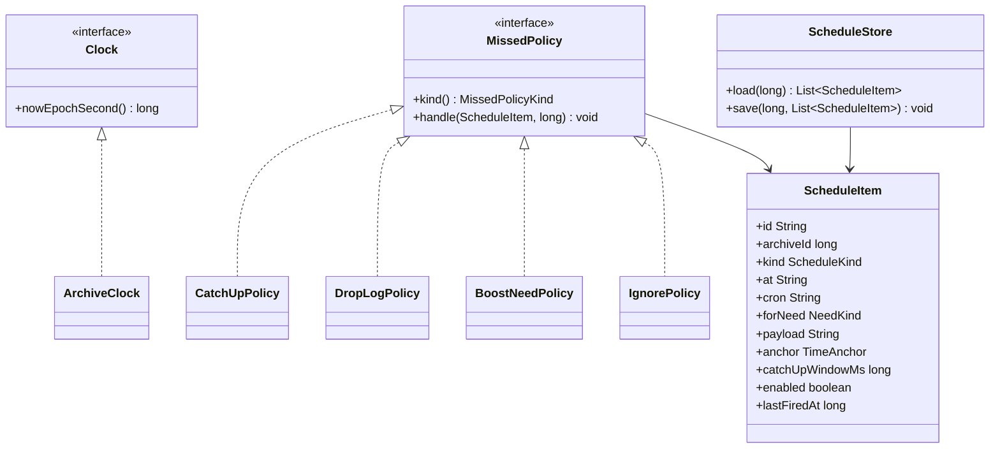

| 实现 | 状态 |
|---|---|
| `ArchiveClock` | ⬜ `nowEpochSecond()` 恒返回 0 |
| `CatchUpPolicy` | ⬜ 方法体全是 TODO |
| `DropLogPolicy` | ⬜ 方法体全是 TODO |
| `BoostNeedPolicy` | ⬜ 方法体全是 TODO |
| `IgnorePolicy` | ✅ 刻意留空——"什么都不做"就是它的行为 |
| `ScheduleStore` | ⬜ `load` / `save` 都是 TODO |

### 4.9 `web/` — HTTP 接口（13 个，全部 ✅）

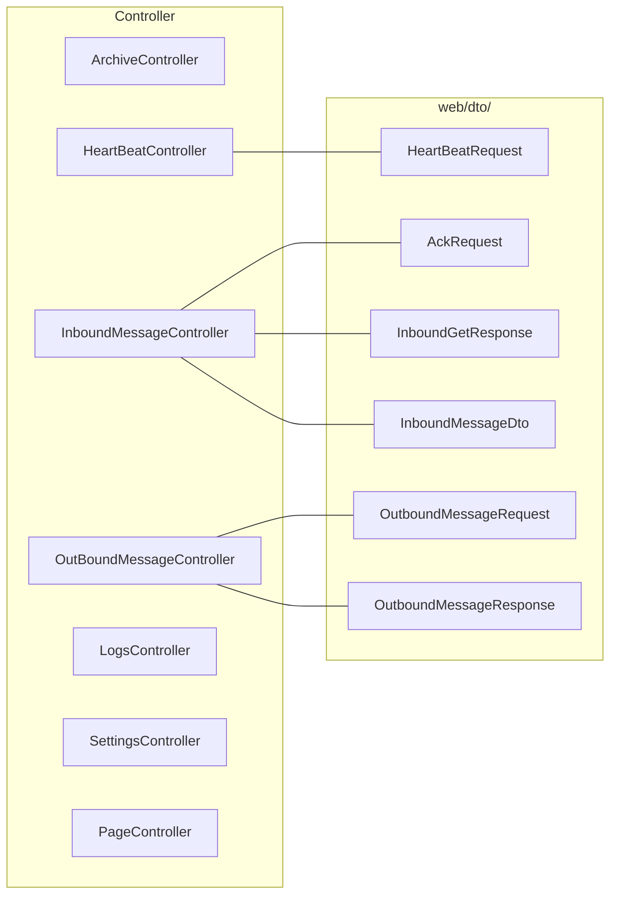

| 端点 | 方法 | 说明 |
|---|---|---|
| `/api/archives` | GET | 存档列表 |
| `/api/archives/candidates` | GET | 候选：可用会话 + 可用外部渠道 |
| `/api/archives/{id}` | GET | 单个存档 |
| `/api/archives` | POST | 新建 / 更新 |
| `/api/archives/{id}` | DELETE | 删除（移进 `data/rubbish/`） |
| `/api/heartbeat` | POST | 心跳：会话清单 + 日志 |
| `/api/health` | GET | 存活检查 |
| `/api/inbound_message/get` | GET | 按 sessionIds 取待投递消息 |
| `/api/inbound_message/ack` | POST | 确认投递，推进水位 |
| `/api/outbound_message/push` | POST | 接收一轮回复，返回 sessionId |
| `/api/logs` | GET | 两源合并日志 |
| `/api/settings` | GET / POST / DELETE | 读 / 写 / 全部恢复默认 |
| `/api/settings/reset/{key}` | POST | 单项恢复默认 |

`PageController` 另把 `/`、`/settings`、`/archives`、`/logs` 重定向到 `static/` 下的 HTML。

### 4.10 `log/` — 日志（5 个，全部 ✅）

```mermaid
flowchart TD
    EVT["logback 日志事件"] --> APP["LogBufferAppender"]
    APP --> BUF["LogBuffer<br/>200 条环形"]
    HOLDER["LogBufferHolder<br/>@PostConstruct"] -.->|"bind()"| APP
    LINK["LinkerLogReader<br/>150 条"] -.->|"心跳上报"| HB["HeartBeatController"]
    BUF --> LC["LogsController"]
    LINK --> LC
    MDC["MdcScope<br/>chatKey / itemId"] -.-> APP
```

`MdcScope` 已实现，**目前没有调用方**。

### 4.11 `common/` — 基础设施

```mermaid
flowchart TD
    CM["common/"]

    CM --> CACHE["cache/"]
    CM --> CFG["config/"]
    CM --> ENT["entity/"]
    CM --> ENUM["enums/"]
    CM --> UTIL["utils/"]

    CACHE --> C1["AvailableSessions ✅<br/>心跳上报的会话清单"]
    CACHE --> C2["DeliveryState ✅<br/>投递状态 + 水位"]
    CACHE --> C3["InboundMessageControllerQueues ✅<br/>按 sessionId 分桶"]

    CFG --> F1["EditAbleDefaultConfig ✅<br/>字段 + ITEMS + 反射写入"]
    CFG --> F2["UnEditAbleDefaultConfig ✅<br/>目录 / 周期 / 日志容量"]
    CFG --> F3["WebCorsConfig ✅"]

    ENT --> E1["Result~T~ ✅<br/>code / message / data"]

    UTIL --> U1["SnowflakeId ✅"]
    UTIL --> U2["JsonCodec ✅"]
    UTIL --> U3["CatScheduler ✅"]
    UTIL --> U4["ForwardExpander ⬜"]
    UTIL --> U5["MediaSupport ⬜"]
    UTIL --> U6["TextSupport ⬜"]
    UTIL --> U7["TimeSupport ⬜"]
```

`enums/` 下 22 个枚举：`BasicEmotion`、`ChannelKind`、`ContentKind`、`EnvironmentKind`、`FileKind`、`IntentKind`、`LongTermMemoryKind`、`MemoryKind`、`MissedPolicyKind`、`NeedKind`、`ObserveKind`、`PhysiologyKind`、`PresetKind`、`ProcessorKind`、`ScheduleKind`、`ShortTermEntryKind`、`SuperegoAction`、`ThinkingPath`、`TimeAnchor`、`TraitKind`、`UnderstandKind`、`Urgency`。

---

## 五、依赖方向

```mermaid
flowchart TD
    WEB["web/<br/>Controller"]
    SVC["service/<br/>编排"]
    PRC["processor/<br/>处理步骤"]
    CAP["channel/ · state/ · ego/ · schedule/<br/>能力与状态"]
    DOM["archive/ · message/<br/>领域模型"]
    COM["common/<br/>被所有层依赖"]
    CROSS["log/ · exception/<br/>横切"]

    WEB --> SVC
    SVC --> PRC
    PRC --> CAP
    CAP --> DOM
    DOM --> COM
    SVC --> COM
    CAP --> COM
    CROSS -.-> WEB
    CROSS -.-> SVC
```

**三条硬约束**：

| # | 约束 | 理由 |
|---|---|---|
| 1 | **`channel/` 不依赖 `archive/`** | 渠道实现只拿到 `PollContext` / `SendContext` 里已备好的 `Link`，不自己查存档 |
| 2 | **`processor/` 不依赖 `service/`** | 处理器只处理传入的 `List<T>`，不触发别的 Service |
| 3 | **`state/` 与 `ego/` 互不依赖** | `EgoDecider` 收的是 `PersonalityView` / `EmotionState` 这些值对象，不是 `MemorySystem` 接口 |

---

## 六、新增类时该放哪

| 你要加的东西 | 放哪 | 同类型参考 |
|---|---|---|
| 一个新的数据形状（无行为） | 对应领域的包 | `ChatKey`、`PollContext` |
| 一个新的枚举 | `common/enums/` | `ChannelKind` |
| 一个纯函数工具 | `common/utils/` | `SnowflakeId` |
| 一个有状态的运行时缓存 | `common/cache/` | `DeliveryState` |
| 一个新的渠道实现 | `channel/{名字}/`，实现四个契约 | `channel/onebot/` |
| 一个新的处理步骤 | `processor/{层}/`，实现 `process` 并写 `order` | `DedupProcessor` |
| 一个新的业务编排 | `service/` | `PreService` |
| 一个新的 HTTP 接口 | `web/`，请求/响应放 `web/dto/` | `ArchiveController` |
| 一个新的可配置项 | `EditAbleDefaultConfig` 加字段 + `ITEMS` 加一项 | `mergeWindowMs` |
| 一个新的不可配置常量 | `UnEditAbleDefaultConfig` | `TICK_MS` |

---

## 文档地图

| 想知道 | 看哪个 |
|---|---|
| 系统长什么样、术语是什么 | [`架构总览.md`](./架构总览.md) |
| 每个类有哪些字段和方法 | [`接口文档-cat.md`](./接口文档-cat.md) · [`接口文档-跳板.md`](./接口文档-跳板.md) |
| **包和类怎么摆、谁依赖谁**（本文） | `图-类关系图.md` |
| 一条消息的数据怎么变 | [`图-数据流图.md`](./图-数据流图.md) |
| 谁调谁、什么顺序 | [`图-时序图.md`](./图-时序图.md) |
| 下一步写什么 | [`开发计划-短期.md`](./开发计划-短期.md) |
| 怎么跑起来 | [`使用部署教程.md`](./使用部署教程.md) |
