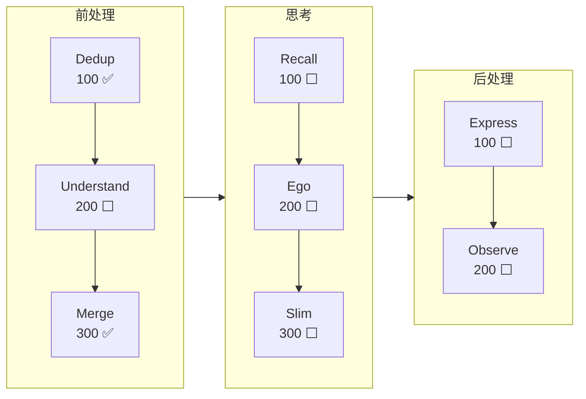
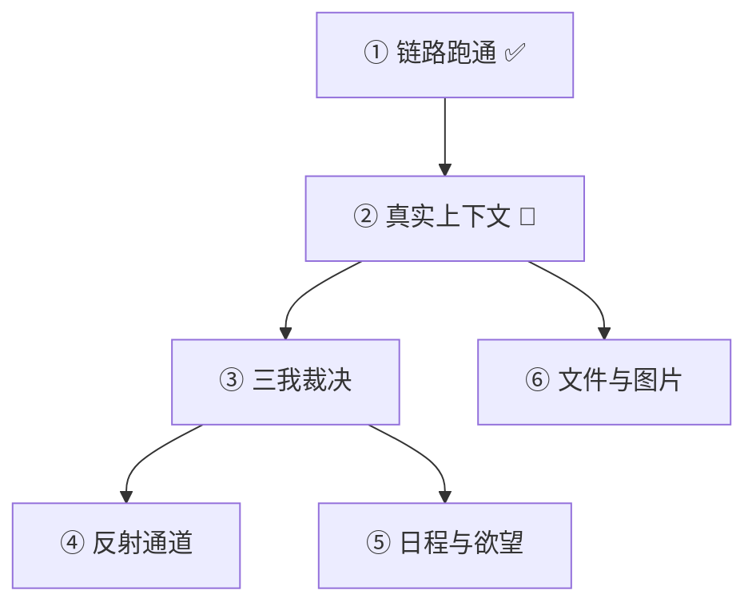

# 开发计划 · 短期

> **这份文档是索引**：六个阶段各自一份，这里只回答「现在到哪了、下一步做什么」。
>
> 更远的方向见 [`开发计划-长期.md`](./开发计划-长期.md)。
> 系统长什么样见 [`架构总览.md`](./架构总览.md)。

---

## 铁律

这四条优先级最高，任何阶段都不许违反。

| # | 铁律 | 为什么 |
|---|---|---|
| **1** | **每一步都能跑通消息往返** | 真正的风险是"代码写了一堆、单测全绿，链路从没跑通过" |
| **2** | **一次只改一小块** | 方便定位问题，出错时知道是哪步坏的 |
| **3** | **改完立刻验证** | 单测 + 手动 curl + 真实链路，都过了才进下一步 |
| **4** | **先跑起来，再谈架构** | 架构是给跑得通的东西用的，不是反过来 |

---

## 六个阶段

| # | 主题 | 文档 | 状态 |
|---|---|---|---|
| 一 | 链路跑通 | [短期01-链路跑通.md](./短期01-链路跑通.md) | ✅ **已完成** |
| 二 | 真实上下文 | [短期02-真实上下文.md](./短期02-真实上下文.md) | 🚧 进行中 |
| 三 | 三我裁决 | [短期03-三我裁决.md](./短期03-三我裁决.md) | ⏳ 未开始 |
| 四 | 反射通道 | [短期04-反射通道.md](./短期04-反射通道.md) | ⏳ 未开始 |
| 五 | 日程与欲望 | [短期05-日程与欲望.md](./短期05-日程与欲望.md) | ⏳ 未开始 |
| 六 | 文件与图片 | [短期06-文件与图片.md](./短期06-文件与图片.md) | ⏳ 未开始 |

> **原来的"⑦ 工具调用"已并入第二阶段。**
> 工具调用的实质是"模型能主动请求存档做事"，而这件事的两半——**动作渠道的下发**（心跳回包带能力清单）和**动作项的接收与执行**（`submit_replies` 交卷里带动作项，Observe 按动作记账）——都必须在处理器链有数据之前就位，否则记忆写不进去、第二阶段无法验收。单独留一个最后的阶段，等于让前五个阶段都在"只读不写"的状态下跑，不成立。

---

## 当前状态

### 已经跑通的

**外加**：存档增删改查与落盘、设置页读写与热更新、日志两源合并与页面、渠道抽象与注册、失败出站清理、无状态上下文接管、日程工具拦截。

### 空着的

| 位置 | 内容 | 后果 |
|---|---|---|
| `UnderstandProcessor`（前处理 order 200） | 消息理解 | `assessment` 恒为 null |
| `RecallProcessor`（思考 order 100） | 记忆召回 | `recallBundle` 恒为 null |
| `EgoProcessor`（思考 order 200） | 三我裁决 | `egoDecision` 恒为 null |
| `SlimProcessor`（思考 order 300） | 上下文瘦身 | 不裁剪 |
| `ExpressProcessor`（后处理 order 100） | 润色拆条 | 回复原样发出 |
| `ObserveProcessor`（后处理 order 200） | 回顾记账 | 不记入记忆 |
| `MemorySystem` | 记忆系统 | **一个实现都没有** |
| `CapabilityService` | 能力清单 | **不存在**，心跳回包是空的 |
| `state/` 整个包 | 四套状态系统 | 无数据可读 |
| `ego/` 整个包 | 三我 | 无裁决逻辑 |
| `schedule/` 大部分 | 计划与存档时钟 | 无主动行为 |
| `ReflexService` | 反射链路 | 所有消息都走思考 |

### 处理器链的当前形态

---

## 下一步

**做 [`短期02-真实上下文.md`](./短期02-真实上下文.md)。**

它要解决的问题是：处理器链里有六处空实现，但**缺的不是算法，是数据**——没有记忆库可查、没有情绪可算、没有能力可选。

所以第二阶段做四件事：

| 做什么 | 为什么 |
|---|---|
| 写 `FishMemory` | `MemorySystem` 从"没有实现"变成"能读写查"，全局单例按 `archiveId` 现算路径 |
| `Content` 加两种记忆形态 | 跳板要知道 `ADD_SHORT_TERM_MEMORY` / `ADD_LONG_TERM_MEMORY` 的 item 长什么样 |
| `CapabilityProvider` 读能力表 | 让 `RecallBundle.capabilities` 第一次有内容 |
| `ObserveProcessor` 按渠道分派 | 让记忆能自己长，不靠手改文件 |

**验收标准**：*存档说的话跟着它自己的记忆变。*

---

## 阶段之间不总是串行

- ② 是三、五的前置——没有记忆和状态，三我裁决无数据可用
- ④ 不依赖 ②，随时可插
- ⑥ 只依赖 ①，可以在任何时候插队
- ⑤ 依赖 ② 已完成的能力表下发，且 `ADD_DATE` 已在通路里跑通

---

## 文档地图

| 想知道 | 看哪个 |
|---|---|
| 系统长什么样、术语是什么 | [`架构总览.md`](./架构总览.md) |
| cat 里每个类和方法干什么 | [`接口文档-cat.md`](./接口文档-cat.md) |
| 跳板里每个模块导出什么 | [`接口文档-跳板.md`](./接口文档-跳板.md) |
| 包和类怎么摆、谁依赖谁 | [`图-类关系图.md`](./图-类关系图.md) |
| 一条消息的数据怎么变 | [`图-数据流图.md`](./图-数据流图.md) |
| 谁调谁、什么顺序 | [`图-时序图.md`](./图-时序图.md) |
| **下一步写什么**（本文） | `开发计划-短期.md` |
| 远期往哪走 | [`开发计划-长期.md`](./开发计划-长期.md) |
| 怎么跑起来 | [`使用部署教程.md`](./使用部署教程.md) |
