# 架构总览

> **这份文档回答：这套系统是什么、术语怎么定义、分了几层、为什么这样分。**
>
> 具体的类和方法见 [`接口文档-cat.md`](./接口文档-cat.md) 与 [`接口文档-跳板.md`](./接口文档-跳板.md)；
> 包与依赖见 [`图-类关系图.md`](./图-类关系图.md)；数据与调用顺序见 [`图-数据流图.md`](./图-数据流图.md) / [`图-时序图.md`](./图-时序图.md)。

---

## 目录

1. [这是什么](#一这是什么)
2. [两个进程，边界在哪](#二两个进程边界在哪)
3. [术语表](#三术语表)
4. [分层结构](#四分层结构)
5. [消息模型](#五消息模型)
6. [三处限流](#六三处限流)
7. [存档 = 一个模拟人](#七存档--一个模拟人)
8. [渠道抽象](#八渠道抽象)
9. [无状态化](#九无状态化)
10. [三我](#十三我)
11. [四套状态系统](#十一四套状态系统)
12. [可靠性约定](#十二可靠性约定)
13. [现状：哪些跑得通，哪些没写](#十三现状哪些跑得通哪些没写)

---

## 一、这是什么

一个「模拟人」系统。每个**存档**是一个独立的人格，有自己的记忆、情绪、身体、环境和人际关系，通过外部渠道与真实的人对话。

```
真实的人 ──外部渠道──> 模拟人（存档）──外部渠道──> 真实的人
                          │
                          ├─ 记忆：它记得什么
                          ├─ 性格：它是什么样（记忆的视图）
                          ├─ 情绪：它现在什么感觉
                          ├─ 生理：它身体怎么样
                          ├─ 环境：它在哪、周围什么
                          └─ 需求：它想要什么
```

**核心设计原则**：

> **cat 是唯一的业务主体；DSH 只做无状态推理。**
>
> 记忆、人设、人际关系、存档、渠道、队列、提示词工程，全部归 cat。

---

## 二、两个进程，边界在哪

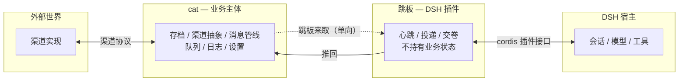

| 进程 | 语言 | 职责 | 不该管 |
|---|---|---|---|
| **cat** | Java · Spring Boot | 存档、渠道抽象、消息管线、队列、日志、设置 | DSH 的会话/工作区概念 |
| **跳板** | JS · cordis 插件 | 心跳、入站投递、出站交卷、无状态上下文 | 任何业务判断 |

### 为什么调用方向只能是单向

**所有跨进程调用都由跳板发起，cat 从不主动推给跳板。**

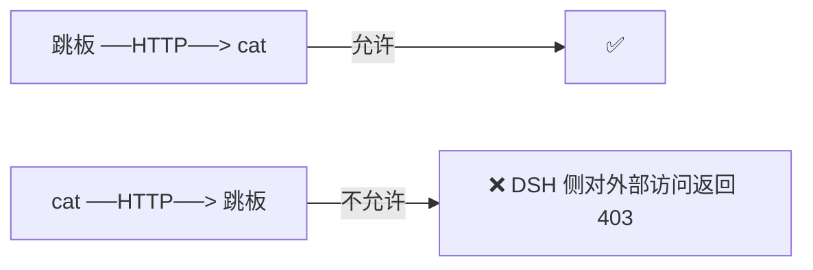

原因：DSH 宿主的 HTTP 服务对非渲染进程的访问一律拒绝。反向调用必然失败。

**这个约束决定了整个出站设计**：cat 只能把消息放进队列，等跳板来取。

### 为什么跳板必须薄

**DSH 是无状态推理引擎，它不该持有业务状态。**

判断标准：跳板重启后不该丢任何东西。丢了，说明状态放错了地方。

---

## 三、术语表

这些词在代码里都有对应的类，读代码时对照着看。

| 术语 | 代码里是什么 | 含义 |
|---|---|---|
| **存档** | `Archive` | 一个模拟人。包含记忆引用、绑定会话、外部连接、认识的聊天、装配单 |
| **跳板** | `dsh-wdd-cat-linker` | 连接 DSH 与 cat 的插件，只做搬运 |
| **链路** | 一次完整的「消息进 → 回复出」 | 没有对应类，是一个过程 |
| **消息** | `Message` 及其子类 | 见[消息模型](#五消息模型) |
| **入站** | `InboundMessage` | 从外部世界进到 DSH 的消息 |
| **出站** | `OutboundMessage` | 从 DSH 回到外部世界的一轮回复 |
| **渠道** | `ChannelKind` + 四个契约 | 消息进出的通道路由 |
| **外部连接** | `Archive.Link` | 一个存档在某渠道上的账号与地址 |
| **认识的聊天** | `Archive.contacts: List<ChatKey>` | 这个存档要盯哪些群和私聊 |
| **装配单** | `PipelineConfig` | 每个链路钩子用哪个实现 |
| **前处理** | `PreProcessor` 链 | 去重、理解、合并 |
| **思考** | `ThinkProcessor` 链 | 回忆、裁决、瘦身 |
| **后处理** | `PostProcessor` 链 | 润色、拆分、回顾 |
| **三我** | `ego/` 包 | 本我 / 超我 / 自我 |
| **水位** | `DeliveryState.watermarks` | 每个会话处理到哪个时间点了 |
| **pending** | 跳板 `MessageCache.pending` | 已投进 DSH、等这一轮回复的消息 |
| **交卷** | `submit_replies` 工具 | 模型把要发出去的话交上来 |
| **无状态上下文** | `stateless_context.js` | 每轮抹掉历史，只留本轮 |
| **冷启动** | 进程刚起来 | 跳板尚未心跳、cat 队列为空 |

---

## 四、分层结构

### 跳板：四层

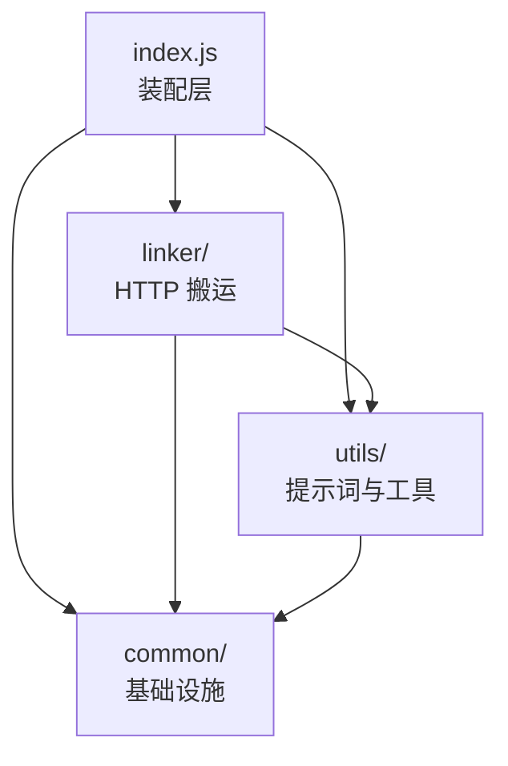

| 层 | 职责 | 能不能有业务判断 |
|---|---|---|
| `index.js` | 装配、定时器、事件监听 | 只能有"开关是否打开"这类 |
| `linker/` | HTTP 调用、轮询、ack | 不能 |
| `utils/` | 提示词拼装、工具定义、会话接管 | 提示词文案可以，业务规则不行 |
| `common/` | 配置、日志、缓存、工具函数 | 不能 |

### cat：五层

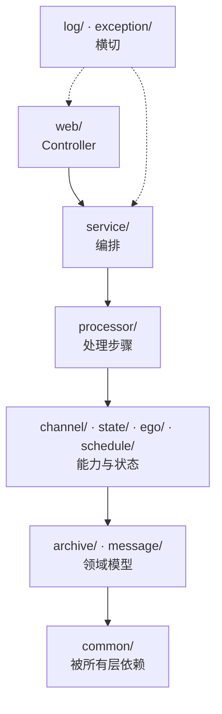

**三条硬约束**：

| # | 约束 | 理由 |
|---|---|---|
| 1 | `channel/` 不依赖 `archive/` | 渠道实现只拿到已备好的 `Link`，不自己查存档 |
| 2 | `processor/` 不依赖 `service/` | 处理器只处理传入的 `List<T>`，不触发别的 Service |
| 3 | `state/` 与 `ego/` 互不依赖 | `EgoDecider` 收的是值对象，不是 `MemorySystem` 接口 |

### 为什么前处理 / 思考 / 后处理要分开

| | 前处理 | 思考 | 后处理 |
|---|---|---|---|
| 输入 | 原始 `InboundMessage` | 加了上下文的 `InboundMessage` | DSH 回来的 `OutboundMessage` |
| 干什么 | 去重、合并 | 理解、回忆、裁决、瘦身 | 润色、拆分、回顾 |
| **过模型吗** | ❌ 纯代码 | ✅ 部分阶段调 DSH | ❌ 纯代码 |
| 能否丢消息 | ✅ 去重就是丢 | ❌ | ❌ |

> **后处理的"润色"是代码润色，不是模型润色。** 它做的是按渠道拆条、补标点、去多余换行、控制长度——全是确定性规则。

---

## 五、消息模型

三层继承：

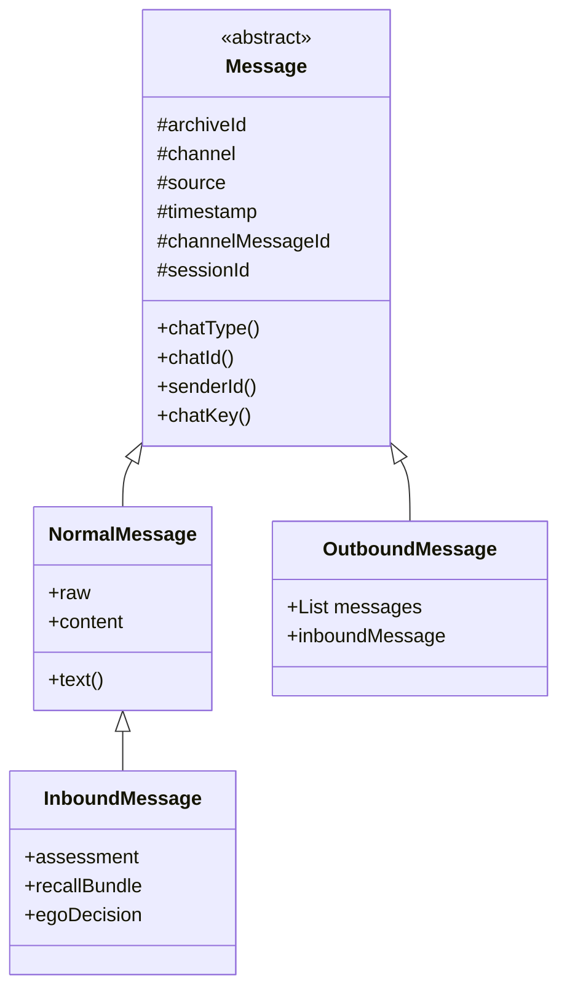

**关键设计：上下文写在消息里，不用参数传。**

`InboundMessage` 是"消息 + 上下文的积累体"：

```
刚从渠道出来：  InboundMessage { content="你好" }
理解阶段跑完：  + assessment = Assessment(...)
回忆阶段跑完：  + recallBundle = RecallBundle(...)
裁决阶段跑完：  + egoDecision = EgoDecision(...)
```

所以整条链每个处理器的签名都一样：`process(List<T> in)`，不需要额外传 ctx。

### 出站消息是"一轮完整往来"，不是"一条回复"

```java
OutboundMessage {
    List<NormalMessage> messages;   // 模型一次交卷拆出来的多条
    InboundMessage inboundMessage;  // 它当初在回谁
}
```

**为什么留着 `inboundMessage`**：后处理（回顾）要知道"我说这话是在回应什么"。

### Content 的四种形态

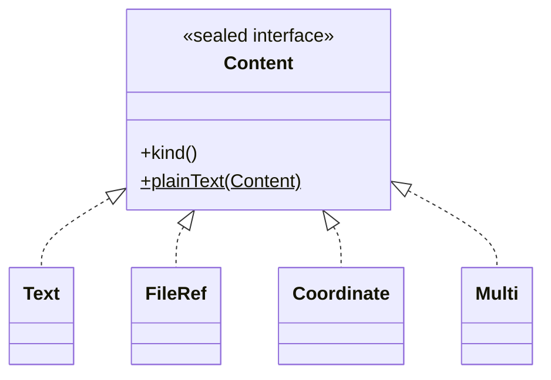

拼进提示词时统一走 `Content.plainText()`：文件变成 `[图片]` / `[语音]` 等占位符，坐标变成 `[坐标: x, y, z]`。

---

## 六、三处限流

**项目不做独立的限流器。限流体现在"队列每次取多少"上。**

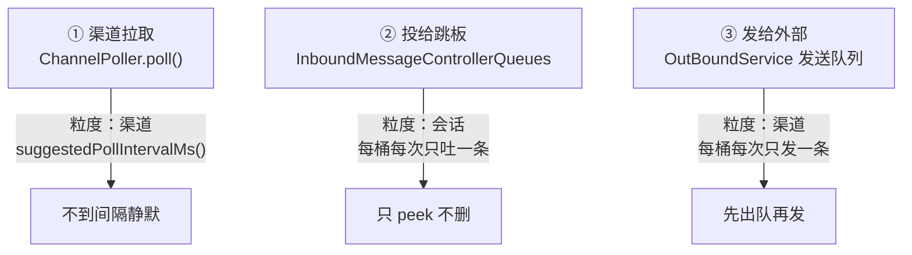

| # | 在哪 | 限什么 | 桶的粒度 | 超了怎么办 |
|---|---|---|---|---|
| 1 | `ChannelPoller.poll()` | 从外部拉取的频率 | **按渠道** | 不到间隔返回空表 |
| 2 | `InboundMessageControllerQueues` | 投给跳板的频率 | **按会话** | 每桶每次只吐一条 |
| 3 | `OutBoundService` | 发给外部的频率 | **按渠道** | 每桶每次只发一条 |

### 为什么不做统一限流类

**限流的本质是"对端能承受多大压力"，所以应该贴着对端做。**

- 第 1 处贴着外部渠道（有风控）
- 第 2 处贴着 DSH（模型调用贵，不该一次性灌一批）
- 第 3 处贴着外部发送（有频率限制，会封号）

三处的"桶"粒度不同（渠道 / 会话 / 渠道），合并会失去语义。

### 哪些频率可配

| 位置 | 配置项 | 默认 |
|---|---|---|
| 渠道拉取与发送 | `EditAbleDefaultConfig.qqPollAndSendIntervalMs` | 2000ms |
| Service 轮询周期 | `UnEditAbleDefaultConfig.TICK_MS` | 500ms（**不可配**） |
| 合并窗口 | `EditAbleDefaultConfig.mergeWindowMs` | 1200ms |
| 合并条数 | `EditAbleDefaultConfig.mergeMaxCount` | 8 |

> **Service 轮询周期不可配**：频率过低会漏消息、过高会被风控，属于系统级正确性问题，不是偏好。用户在设置页能改的是**渠道的收发节奏**与**合并参数**。

---

## 七、存档 = 一个模拟人

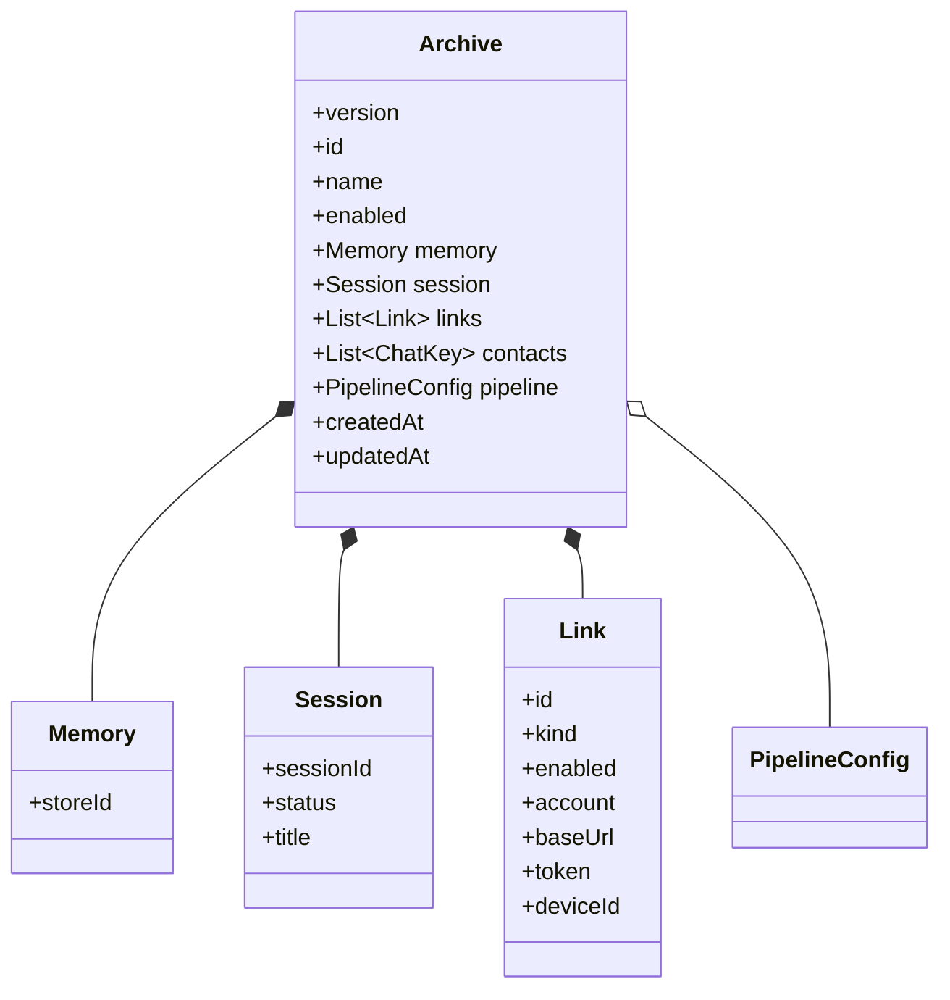

### 装配单：同一个人，不同的实现

`PipelineConfig` 是一张"**每个位置用哪个实现**"的表。**每个字段都是独立枚举，不是字符串。**

| 位置 | 类型 | 可选值 |
|---|---|---|
| `preset` | `PresetKind` | `ADVISOR` / `BLACK_CAT` / `NULL` |
| `memory` | `MemoryKind` | `SOUL_MD` / `FISH_MEMORY` / `LONG_SHORT_TERM` / `NONE` |
| `environment` | `EnvironmentKind` | `STATIC_HOME` / `STATIC_OFFICE` / `ESP32` |
| `physiology` | `PhysiologyKind` | `NONE` / `FEMALE_CYCLE` / `ENERGY_ONLY` |
| `understand` | `UnderstandKind` | `BASIC_RULES` |
| `intent` | `IntentKind` | `NEVER_INITIATE` / `DESIRE_V1` |
| `observe` | `ObserveKind` | `OFF` / `SHORT_TERM` / `AGGREGATED` |
| `missedSchedule` | `MissedPolicyKind` | `CATCH_UP` / `DROP_LOG` / `BOOST_NEED` / `IGNORE` |

> **每个字段一个独立枚举，不共用。** `MemoryKind` 里不可能出现 `ESP32`，填错编译不过——这是拒绝"种类字符串拼错"的根本办法。

**为什么需要装配单**：某个实现还没写时，用 `NONE` 就能跑起来；想换一种记忆实现，改一个字段就行。

### 一个存档一个文件夹

```
data/
├── {archiveId}/
│   ├── archive.json          存档信息
│   └── assets/               资产目录
├── rubbish/                  删除的存档移到这里
├── watermarks.json           全局：投递状态 + 水位
├── settings.json             全局：用户设置覆盖
└── logs/                     滚动日志
```

**落盘格式**：`writePretty()`（带缩进），因为文件人会打开看、会手改、出问题要排查。
**原子替换**：先写 `.tmp` 再 `move`，防止中途崩溃留下半个文件。

---

## 八、渠道抽象

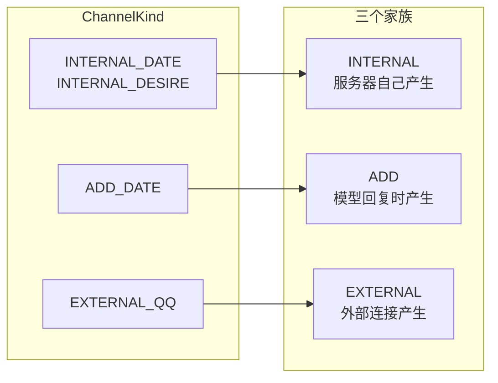

**每个枚举项自带 family，用 `getFamily()` 判断来源，不靠字符串前缀。**

### 三个家族的区别

| 家族 | 成员 | 谁产生 | 进 poller 吗 |
|---|---|---|---|
| `INTERNAL` | `INTERNAL_DATE`、`INTERNAL_DESIRE` | cat 自己（日程到点、欲望超标） | ❌ |
| `ADD` | `ADD_DATE` | 只有大模型 | ❌（从跳板进来） |
| `EXTERNAL` | `EXTERNAL_QQ` | 外部连接 | ✅ |

**`Archive.Link` 只接受 `EXTERNAL` 家族**，塞内部渠道进去直接抛异常。

### 四个契约接口

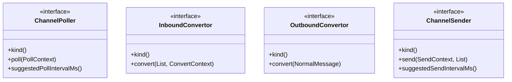

`ChannelRegistry` 按 `kind()` 配对：`poller ↔ convertor`（入站），`convertor ↔ sender`（出站）。

**核心不依赖任何具体实现。** `channel/onebot/` 只是一个外部渠道的实现包；换渠道 = 新增一个实现包，核心层零改动。

### 加一个新渠道要改的地方

1. `ChannelKind` 加一个枚举项（带 family）
2. 新包实现四个契约
3. `ChannelRegistry` 自动发现（`@Component` + `kind()` 配对）
4. 存档页就能选到这个渠道

---

## 九、无状态化

**这是 DSH 集成最关键的一点。**

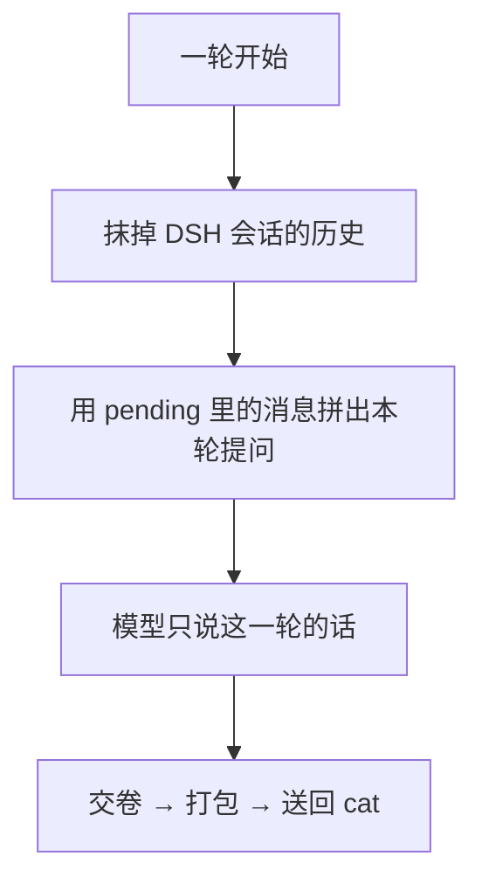

**为什么必须这样**：

1. DSH 是推理引擎，不该持有业务状态
2. 历史越长越贵，而且会漂移
3. **cat 才是记忆的主人**——该给模型看什么，由 cat 决定

**代价**：每轮都要重新拼提示词，`RecallBundle` 里必须东西够用，而且要够精简。

### 判据：pending 池

**跳板只对"外部消息触发的这一轮"做无状态接管。**

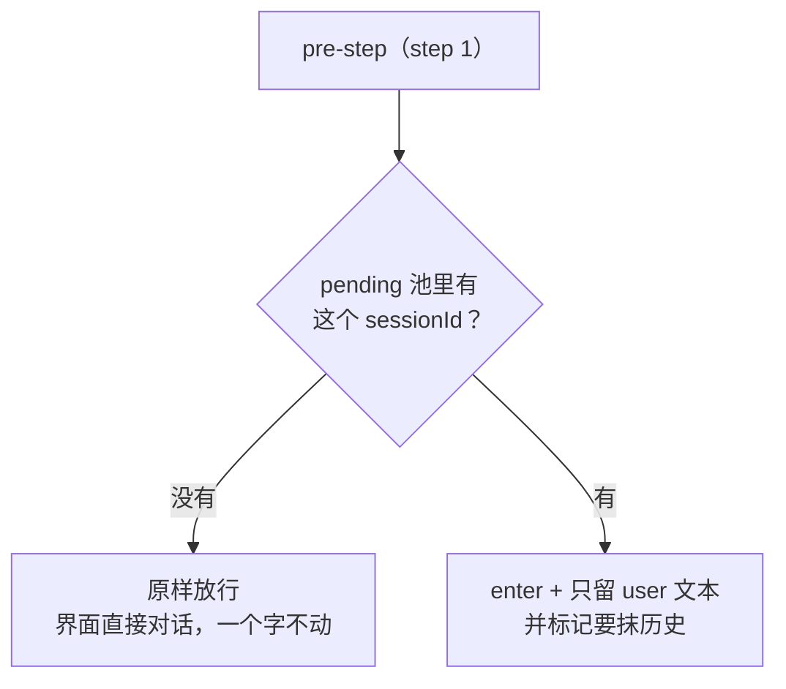

**已知副作用**（`stateless_context.js` 注释里写明并接受）：

> 模型某轮没调用 `submit_replies` 交卷时，`pending` 会一直留着，那个会话里用户在界面上手打的对话也会被当成外部轮、历史被抹。

---

## 十、三我

**本我 / 超我 / 自我不是处理器，是"角色"。**

| 角色 | 口号 | 看什么 | 不看什么 |
|---|---|---|---|
| **本我（Id）** | 我想要 | 需求池、冲动、情绪 | 现实 |
| **超我（Superego）** | 我该要 | 道德、人设、关系规则 | 欲望 |
| **自我（Ego）** | 我能要 | 两边 + 现实 | — |

### 裁决的产物是"数值"，不是"文本"

三我裁决**不做文字生成**，也**不做"沉默 / 软化"这种一刀切分类**。

```
输入：Assessment + RecallBundle + IdWant + SuperegoRule[]
   ↓
EgoDecider 算出一组可量化的压力值
   ↓
输出：EgoDecision { normalMessage, reconciliation, trace }
   ↓
这些数写进提示词，很大程度上影响模型的最终回答
```

**关键点**：裁决**不决定说什么**，只决定"多大压力 / 多大克制 / 多大泄漏"。说什么由模型负责——这样才有"忍不住"的味道，而不是代码写死的模板。

**要模拟的效果**：

1. 嘴上说着不理你，又忍不住叫你快睡
2. 想客气，但实在厌恶，于是恶语相向
3. 想挺身而出，可能恐惧压过勇气、也可能相反

共同点：**最终的话是"忍不住"出来的，不是"算"出来的。**

> 当前 `ego/` 包只有数据形状与接口签名，**没有任何实现**。

---

## 十一、四套状态系统

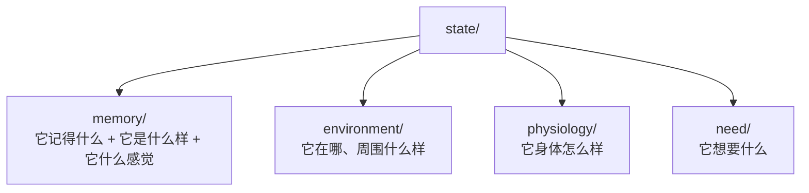

| 系统 | 接口 | 状态 |
|---|---|---|
| 记忆 | `MemorySystem` | ⬜ |
| 环境 | `EnvironmentSystem` | ⬜ |
| 生理 | `PhysiologySystem` | ⬜ |
| 需求 | `NeedPool` | ⬜ |

### 记忆：性格是记忆的视图

**性格不是独立存的一条数据，是对记忆的一种读法。**

```java
PersonalityView {
    selfImage / selfNarrative          // 自我认知：从"我关于自己的话"算
    behavior / behaviorNarrative       // 行为画像：从"我做过的事"算
    bias                               // 两个面差多少，0=一致 1=完全不符
}
```

**`bias` 是最有意思的地方**：存档可以有"自我认知偏差"，它以为自己说话直，其实很会照顾人。`hasBlindSpot()` 用 `bias > 0.4` 判定。

**渲染进提示词的铁律**：

> 不要写成"你是个傲娇的角色"，
> 要写成"你自认为只是说话直。但每次她难过，你都会找借口关心她。"
> **不给标签，给行为证据。**

### 情绪：PAD + 混合

```java
EmotionState {
    valence, arousal, dominance      // PAD 三维，连续量，能算能衰减
    Map<BasicEmotion, Double> mix    // 八种基本情绪各占多少
    List<String> complex             // ["心疼"] / ["无奈"]
}
```

**PAD 是给代码用的**（算权重、做衰减），**`mix` 和 `complex` 是给模型读的**。

### 环境：三层

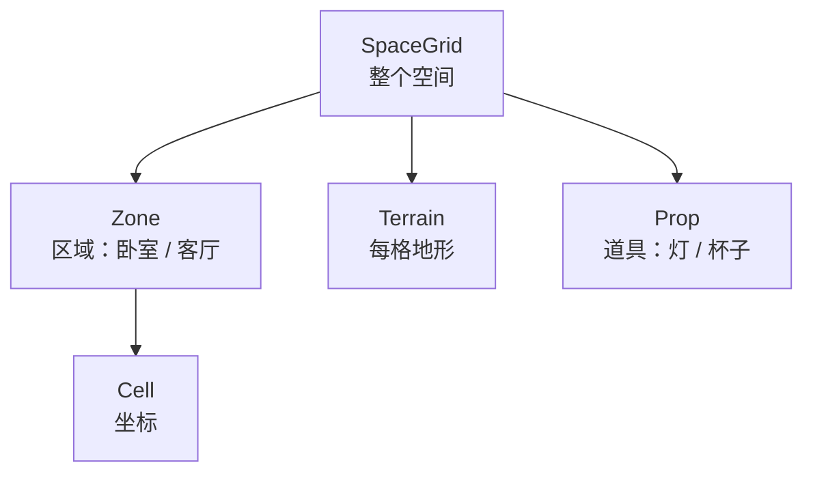

**上报和状态分开**：硬件报 `EnvironmentUpdate`（只有坐标和 id），`EnvironmentSystem` 校验、查表、补全，才变成 `EnvironmentState`。

### 需求：马斯洛十五项都建，首版启用五个

| 层 | 需求 |
|---|---|
| 生理 | `ENERGY` / `COMFORT` / `WARMTH` / `HEALTH` |
| 安全 | `CERTAINTY` / `CONTROL` |
| 归属 | `SOCIAL` / `BE_NEEDED` / `INTIMACY` |
| 尊重 | `RECOGNITION` / `AUTONOMY` |
| 自我实现 | `CURIOSITY` / `EXPRESSION` / `ORDER` |

`NeedKind.v1()` 返回首版启用的五个：`SOCIAL`、`CURIOSITY`、`ORDER`、`ENERGY`、`COMFORT`。其余十个保留枚举。

**为什么不是删掉**：枚举是稳定契约，删了以后加回来要改一堆 switch。

### 需求的涨落节奏

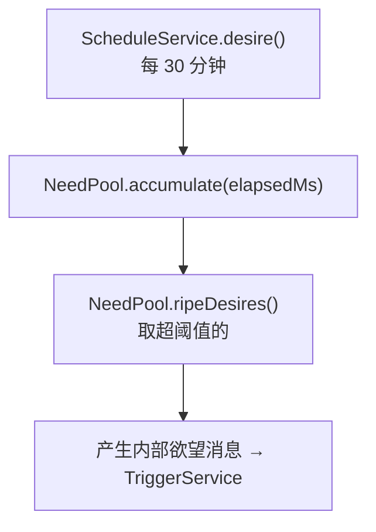

**需求不是连续涨的，是定时批处理的**——变化本来就慢，没必要每 500ms 算一次。

> 当前 `schedule/` 与 `NeedPool` 都只有签名，这一段是设计意图。

---

## 十二、可靠性约定

### at-least-once 投递

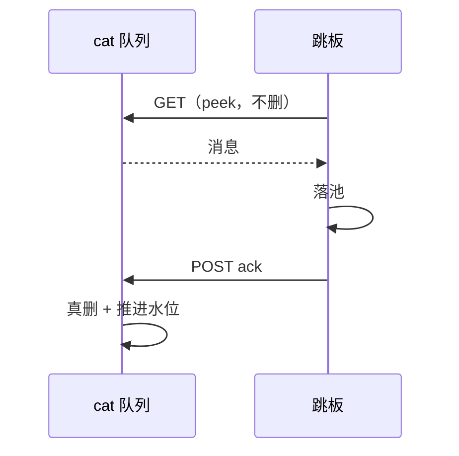

**`get` 只 peek 不删，`ack` 才真删。**

### 水位只在 ack 后推进

`DeliveryState.markDelivered()` 是唯一推进水位的入口。

### 处理中超时可重投

消息被标 `PROCESSING` 后，超过 `mergeWindowMs + 10000ms` 仍未被 ack，会被视为残留、允许重新接受。

### 重启不补投旧消息

首次见到的会话，水位初始化为"此刻"，不返回 0。

### 出站失败不重试

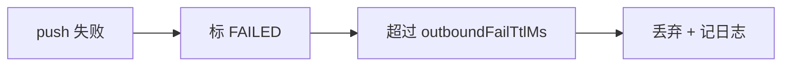

留着的意义只是"出问题时能在缓存里看到现场"。

### 发送失败直接丢

`OutBoundService` 里 `bucket.poll()` 在 `sendOne()` 之前，成不成功都出队。

---

## 十三、现状：哪些跑得通，哪些没写

### 已经跑得通的


**外加**：存档增删改查与落盘、设置页读写与热更新、日志两源合并与页面、渠道抽象与注册、失败出站清理。

### 整块空着的

| 包 | 内容 | 后果 |
|---|---|---|
| `state/` | 记忆 / 环境 / 生理 / 需求 | 提示词里没有人格、记忆、情绪 |
| `ego/` | 三我 | 没有"忍不住"的数值 |
| `schedule/` | 计划与存档时钟 | 没有主动行为 |
| 前处理的理解步 | `UnderstandProcessor` | `assessment` 恒为 null，合并拿不到"这条重不重要" |
| 思考链三步 | 回忆 / 裁决 / 瘦身 | `recallBundle` 与 `egoDecision` 恒为 null |
| 后处理两步 | 润色 / 回顾 | 回复不拆条、不记入记忆 |
| `ReflexService` | 反射链路 | 所有消息都走思考 |

### 处理器链的当前形态

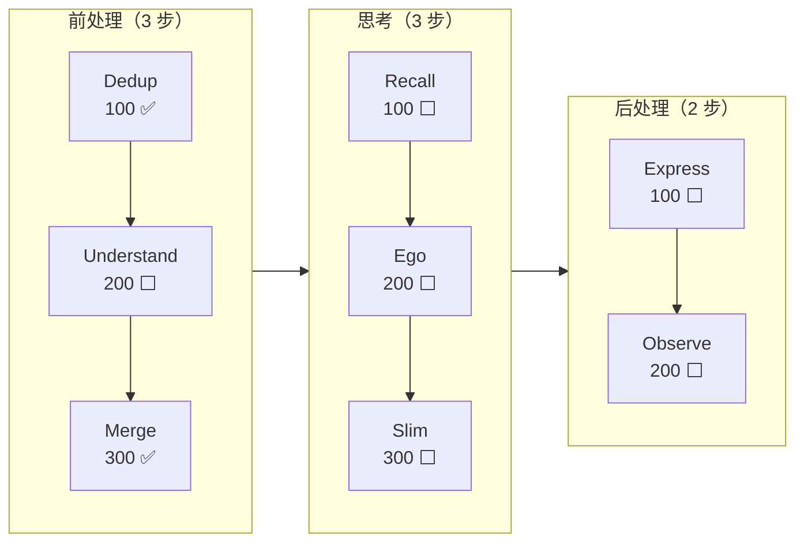

### 骨架与缺口对照

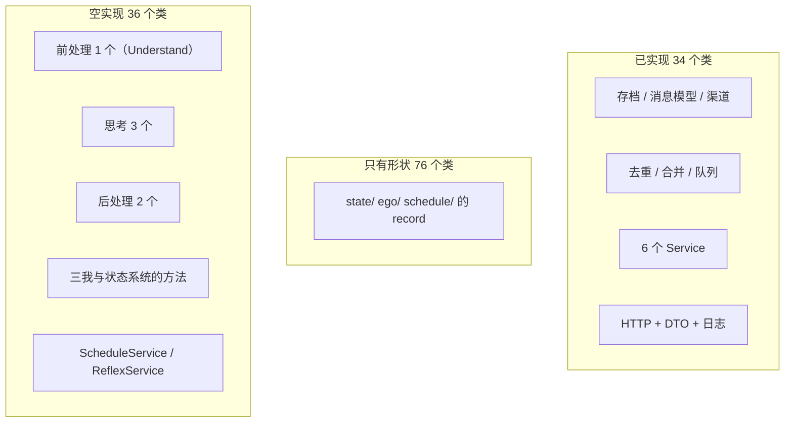

**下一步该做什么**，见 [`开发计划-短期.md`](./开发计划-短期.md)。

---

## 文档地图

| 想知道 | 看哪个 |
|---|---|
| **系统长什么样、术语是什么**（本文） | `架构总览.md` |
| 每个类有哪些字段和方法 | [`接口文档-cat.md`](./接口文档-cat.md) · [`接口文档-跳板.md`](./接口文档-跳板.md) |
| 包和类怎么摆、谁依赖谁 | [`图-类关系图.md`](./图-类关系图.md) |
| 一条消息的数据怎么变 | [`图-数据流图.md`](./图-数据流图.md) |
| 谁调谁、什么顺序 | [`图-时序图.md`](./图-时序图.md) |
| 下一步写什么 | [`开发计划-短期.md`](./开发计划-短期.md) |
| 远期往哪走 | [`开发计划-长期.md`](./开发计划-长期.md) |
| 怎么跑起来 | [`使用部署教程.md`](./使用部署教程.md) |
