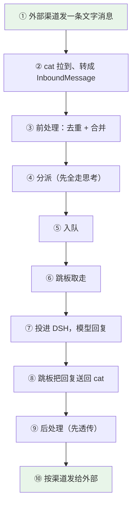
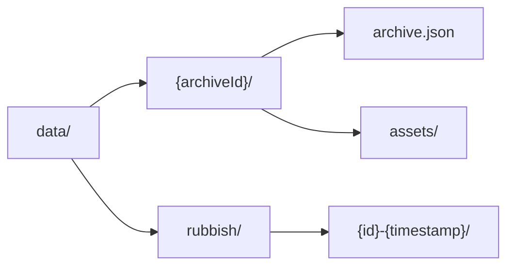
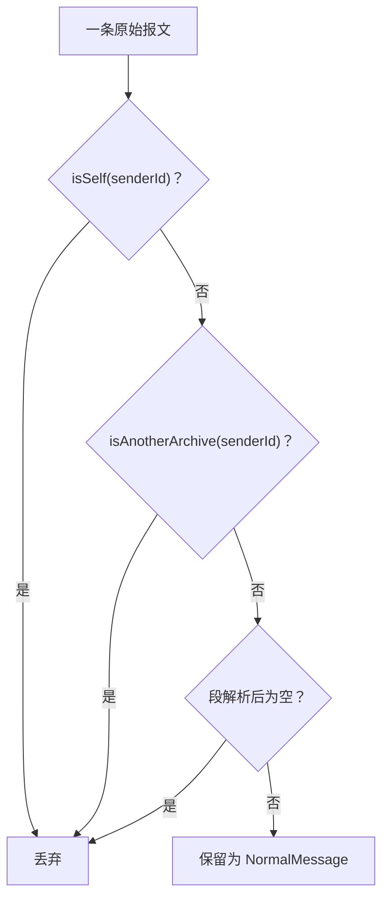
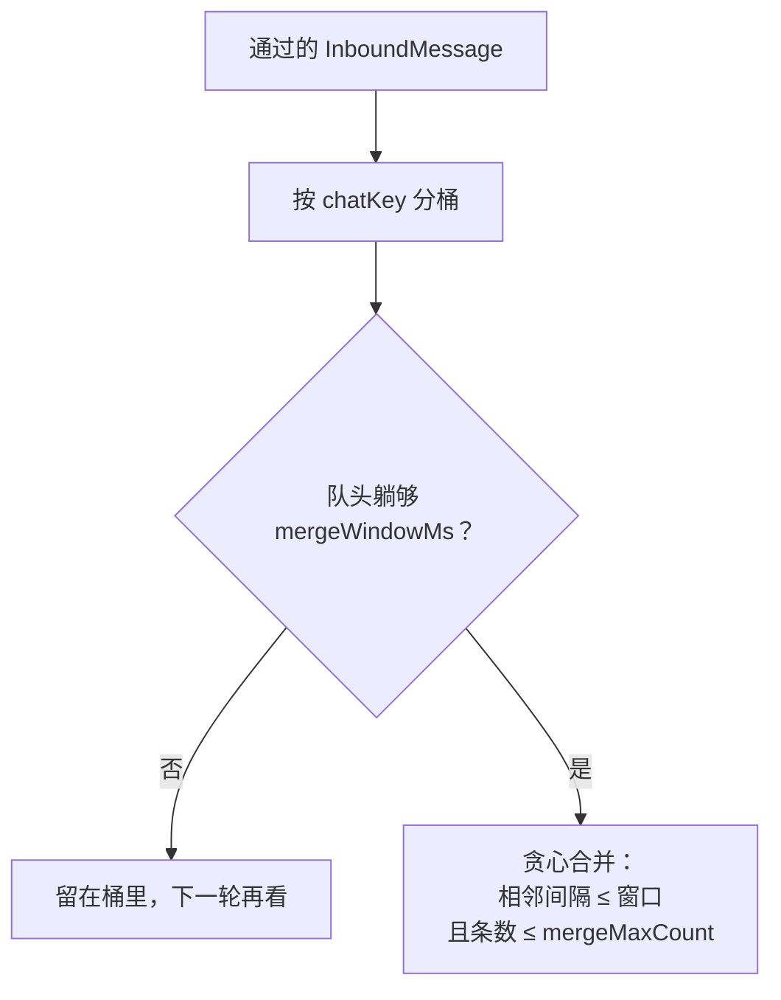
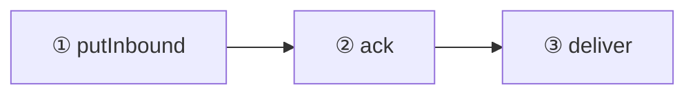
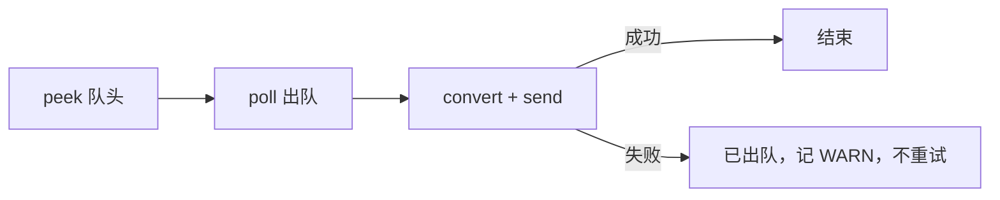

# 短期 ① · 链路跑通

> **这一阶段的目标**：外部世界发一条文字消息 → 走完所有链路 → 最后在外部世界看到回复。
>
> 返回索引：[`开发计划-短期.md`](开发计划-短期.md)
>
> **状态：✅ 已完成**

---

## 目标



**这一阶段刻意不做的事**：

| 不做 | 为什么 |
|---|---|
| 文件 / 图片 | 先只跑文本，把链路本身跑通 |
| 反射通道 | 先全部走思考链，少一条分支 |
| 三我裁决的真实逻辑 | 记忆/情绪还没实现，先给空值 |
| 记忆的真实检索 | 同上 |
| 日程 / 欲望 | 依赖队列和限流，必须后做 |
| 多存档抢话的智能行为 | 先把单存档跑稳 |
| 工具调用拦截的转发 | 只拦截不转发 |

---

## 分步记录

### 第 0 步：让项目能启动

**做了什么**：

1. `mvn spring-boot:run` 能起来
2. 定时任务真的在跑（启动时打印「已注册定时任务 xxx，周期 Nms」）
3. `/api/health` 能返回

**实际实现**：

| 类 | 说明 |
|---|---|
| `CatApplication` | 入口。**没有** `@EnableScheduling`——用的是自己写的 `CatScheduler` |
| `HeartBeatController.health()` | `GET /api/health` → `Result.ok("服务器运行中")` |
| `CatScheduler` | 基于 `ScheduledExecutorService`，任务抛异常不影响后续调度 |

**验证**：

```powershell
cd E:\程序代码\dsh\cat
mvn "-Dmaven.repo.local=E:\程序代码\dsh\.mvn-repo" spring-boot:run
```

```powershell
Invoke-RestMethod http://127.0.0.1:8080/api/health
# → {"code":200,"message":"ok","data":"服务器运行中","success":true}
```

控制台应能看到六行「已注册定时任务」：

```
已注册定时任务 inbound.handle，周期 500ms
已注册定时任务 outbound.handle，周期 500ms
已注册定时任务 post.handle，周期 500ms
已注册定时任务 pre.preprocess，周期 500ms
已注册定时任务 schedule.date，周期 20000ms
已注册定时任务 schedule.desire，周期 1800000ms
```

---

### 第 1 步：基础设施（三个工具类）

**做了什么**：

| 类 | 方法 | 状态 |
|---|---|---|
| `SnowflakeId` | `long next()` / `String nextString()` | ✅ 时钟回拨超过 3 秒拒绝发号 |
| `ChatKey` | `parse(String)` / `wire()` 往返 | ✅ 格式 `{channel}:{chatType}:{chatId}` |
| `Content.plainText(Content)` | 任意 Content → 字符串 | ✅ `instanceof` 链，不用 switch 模式匹配 |

**`ChatKey` 的线上格式**（跨进程传输用）：

```
external_qq:group:20001
```

**`Content.plainText()` 的映射**：

| 输入 | 输出 |
|---|---|
| `Text("看图")` | `看图` |
| `FileRef(..., IMAGE)` | `[图片]` |
| `Coordate(3, 2, 1)` | `[坐标: 3.0, 2.0, 1.0]` |
| `Multi([Text, FileRef])` | `看图 [图片]` |

**验证**：`SnowflakeIdTest`（4 个）、`ChatKeyTest`（8 个）、`ContentTest`（8 个）

---

### 第 2 步：存档系统 + 落盘

**做了什么**：

```
Archive               record + isEnabled() 的 null 处理 + contactsOf(channel)
PipelineConfig        preset(PresetKind) / defaultConfig()
ArchiveStore          9 个方法：all/find/enabled/allAccounts/maxCount/create/update/delete/markSession
ArchiveRegistry       4 个方法：replaceAll/rebuildFromStore/served/of/allChats
SnowflakeId           给存档分配 id
```

**落盘布局**：



**`archive.json` 用 `JsonCodec.writePretty()` 写**，原子替换（先 `.tmp` 再 `ATOMIC_MOVE`，失败降级为普通 move）。

**五条校验**：

| # | 校验 | 报错信息 |
|---|---|---|
| 1 | 存档名非空且唯一 | `存档名重复：xxx` |
| 2 | 会话不与其他存档共享 | `会话已被其他存档占用：xxx` |
| 3 | 同渠道账号不与其他存档重复 | `账号重复：[external_qq:10000]` |
| 4 | 同一次提交内账号不重复 | 同上 |
| 5 | 数量不超过 `archiveMaxCount` | `存档数量已达上限 N` |

**验证**：

```powershell
# 建一个存档
$utf8 = New-Object System.Text.UTF8Encoding($false)
$body = '{"name":"黑猫","links":[{"kind":"external_qq","account":"10000","baseUrl":"http://127.0.0.1:PORT","token":"XXXXXX"}]}'
Invoke-WebRequest -Uri 'http://127.0.0.1:8080/api/archives' -Method Post `
  -ContentType 'application/json; charset=utf-8' -Body ($utf8.GetBytes($body)) -UseBasicParsing
```

```
data\{id}\archive.json 与 data\{id}\assets\ 出现
重启 cat 后再查 /api/archives，存档还在
```

**测试**：`ArchiveStoreTest`（12 个）、`ArchivePersistenceTest`（1 个）

---

### 第 3 步：渠道拉取 + 转换

**做了什么**：

| 类 | 职责 |
|---|---|
| `OneBotClient` | HTTP action 调用，判 `status/retcode`，失败抛 `OneBotException` |
| `OneBotConnectionPool` | 每 `(archiveId, account)` 一条连接，url/token 变了重建 |
| `OneBotPoller` | 按 `suggestedPollIntervalMs()` 控频，只拉不过滤 |
| `OneBotInboundConvertor` | 事件 → `NormalMessage`，段翻译 + 过滤 |
| `InboundService` | 遍历启用存档 × 启用连接，拉 → 转 → 写缓存池 |

**`ConvertContext` 这一层的过滤是关键**：



> **不实现它，存档会自己跟自己说话**——自己发的消息被当成别人发的，无限循环。

**验证**：

- 在外部渠道发一条消息，cat 日志出现 `存档 xxx 拉到 N 条`
- 用存档自己的账号发一条，**拉不到**（被 `shouldSelf` 过滤）

**测试**：`OneBotInboundConvertorTest`（6 个）

---

### 第 4 步：前处理链（去重 + 合并）

#### 4.1 `DeliveryState`

**做了什么**：

| 存储 | 键 | 值 |
|---|---|---|
| `deliveries` | `archiveId:channelMessageId` | `{status, updatedAt}` |
| `watermarks` | `archiveId:chatKey` | 最大时间戳（秒） |

**落盘**：`data/watermarks.json`（全局，不分存档）

**三条不变量**：

1. 只有跳板 ack 之后才推进水位
2. 水位键必须带 `archiveId`
3. 首次见到的聊天返回「此刻」，不返回 0（避免补投历史）

#### 4.2 `DedupProcessor`（order 100）

五道判断依次进行：`chatKey` 为 null → 无 `sessionId` → 会话不在可用清单 → 比水位旧 → `tryAccept` 失败。

放行的标记为 `PROCESSING`。

#### 4.3 `MergeProcessor`（order 300）



**合并后的字段**：全部取**最后一条**的 `archiveId/channel/source/timestamp/channelMessageId/sessionId/raw`，`content` 拼成 `Content.Multi`。

#### 4.4 `PreService`

每 500ms：`drainTo` → 按 order 跑链 → `TriggerService.trigger()`。

> **即使没有新消息也要跑完整条链**——有状态的处理器（合并）靠每轮吐出积压。

**验证**：

```
连发 3 条「在吗」「在吗」「在不在」
→ cat 日志只出现 1 条合并后的消息
```

**测试**：`MergeProcessorTest`（7 个）、`MergeProcessorRealTimeTest`（3 个）

---

### 第 5 步：分派

**做了什么**：

```java
TriggerService.trigger(List<InboundMessage>)
PathDecider.decide()       // 恒返回 DELIBERATION
ReflexService              // 空着
ThinkService.run()
```

**`buildContext()` 返回空壳**——四套状态系统都还没实现。

**验证**：日志能看到消息进入思考链。

---

### 第 6 步：思考链（最简实现）

**做了什么**：四个处理器全部写通但内部给常量。

| 处理器 | 当时的 order | 应该填什么 |
|---|---|---|
| `UnderstandProcessor` | 思考 100 | `assessment` |
| `RecallProcessor` | 思考 200 | `recallBundle` |
| `EgoProcessor` | 思考 300 | `egoDecision` |
| `SlimProcessor` | 思考 400 | 裁字段 |

> **后续调整**：`UnderstandProcessor` 已移到**前处理**层（order 200，排在 `Merge` 之前），`ProcessorKind` 里思考链改为 `Recall(100) → Ego(200) → Slim(300)`。详情见 [`架构总览.md`](架构总览.md) 与 [`图-数据流图.md`](图-数据流图.md)。

**这一步的实际产出**：方法签名写通、数据能流过，但**四个都是 `return in`**，字段全为 null。

---

### 第 7 步：入队 + 跳板取

**做了什么**：

```java
// InboundMessageControllerQueues
Map<String, Queue<InboundMessage>> buckets;   // 键 = sessionId

GET  /api/inbound_message/get?sessionIds=a&sessionIds=b
POST /api/inbound_message/ack
```

**`get` 用 `peek` 不用 `poll`**——取了不删，等 `ack` 才真删。这是 at-least-once 的关键。

**DTO**：

| 类 | 用途 |
|---|---|
| `InboundMessageDto` | 入站消息视图（雪花 id 转字符串） |
| `InboundGetResponse` | `{messages: [...]}` |
| `AckRequest` | `{items: [{archiveId, sessionId, channelMessageId, chatKey, timestamp}]}` |

**验证**：

```
curl /api/inbound_message/get?sessionIds=xxx
→ 能拿到这条消息，JSON 里有 assessment / recallBundle / egoDecision（值为 null）
```

---

### 第 8 步：跳板（最小可用）

**做了什么**：

```
dsh-wdd-cat-linker/
├── package.json
├── index.js            插件入口：三个定时器 + 事件监听
├── client.js           DSH 设置页
└── src/
    ├── common/         api / constant / logger / media / message_cache / session_finder / setting_store
    ├── linker/         bridge / heartbeat / inbound / outbound
    └── utils/          deliver / submit_tool / stateless_context / schedule_guard
```

**入站**：`GET → 落池 → ack → 逐条 deliver`



---

### 第 9 步：提示词拼装

**做了什么**：`deliver.js` 里的 `buildPrompt(message)`。

**输出形状**（固定）：

```
【来自外部聊天】群聊 20001，发送者 用户10002：
今天好累啊

（回复必须调用 submit_replies 工具，否则对方收不到。）
```

**两条固定文案硬编码在函数里**，不抽成常量——只此一处出现。

> 原计划里这一步想拼的「【你现在的状态】」「【你记得】」「【你此刻的冲动】」等段落，**依赖第二阶段的上下文数据**，这一阶段没有。

---

### 第 10 步：DSH 回复送回 cat

**做了什么**：

```js
// outbound.js
submit_replies 工具 → drafts.set(sessionId, draft)
turn/end 事件 → 四条判断 → POST /api/outbound_message/push
```

**四条判断**：

| # | 条件 | 不满足时 |
|---|---|---|
| 1 | `reason.kind === 'completed'` | 不发 |
| 2 | 有草稿且 replies 非空 | 不发 |
| 3 | `takePending(sessionId)` 有值 | 不发（界面直接对话） |
| 4 | — | 推送 |

**cat 侧返回**：`{sessionId}`（一轮一个 ack）；`{sessionId: null}` 表示没入队。

**验证**：

```powershell
curl -X POST http://localhost:8080/api/outbound_message/push -d '{...}'
→ 返回 {"data":{"sessionId":"xxx"}}
```

---

### 第 11 步：后处理 + 发出

**做了什么**：

| 类 | 状态 |
|---|---|
| `PostService` | ✅ 每 500ms 跑链 |
| `ExpressProcessor` | ⬜ 空实现（原计划要拆条） |
| `ObserveProcessor` | ⬜ 空实现（原计划要回顾） |
| `OutBoundService` | ✅ 按渠道分桶，每桶每次一条 |
| `OneBotSender` | ✅ 队列 + 按频率出队 + 发送 |
| `OneBotOutboundConvertor` | ✅ `NormalMessage` → 消息段数组 |

**发送是先出队再发**：



---

### 第 12 步：第一阶段验收

**完整流程**：

1. 启动渠道后端（见 [`使用部署教程.md`](使用部署教程.md)）
2. 启动 cat（`:8080`）
3. 装好跳板，启动 DSH
4. 在渠道里以某个用户身份说一句话
5. DSH 会话里看到带 `【来自外部聊天】` 前缀的消息
6. 模型回复（会调 `submit_replies`）
7. 外部渠道里看到这条回复

**验收清单**：

| # | 检查项 | 结果 |
|---|---|---|
| 1 | 存档能建、重启后还在 | ✅ |
| 2 | 自己发的消息被过滤 | ✅ |
| 3 | 连发 3 条被合并成 1 条 | ✅ |
| 4 | 重复消息被去重 | ✅ |
| 5 | `curl /get` 能看到完整 JSON | ✅ |
| 6 | ack 后水位推进 | ✅ |
| 7 | DSH 里看到消息 | ✅ |
| 8 | 外部渠道里看到回复 | ✅ |
| 9 | 关闭 cat 再启动，存档都还在 | ✅ |

---

## 这一阶段产出的文件

### cat（Java）

| 包 | 文件 |
|---|---|
| `archive/` | `Archive` `ArchiveStore` `ArchiveRegistry` `PipelineConfig` |
| `message/` | `Message` `NormalMessage` `InboundMessage` `OutboundMessage` `Content` `ChatKey` `MessageSource` |
| `channel/` | 四个契约 + 三个上下文 + `ChannelRegistry` + `onebot/` 六个类 |
| `processor/` | 三个接口 + 八个实现（前处理 2 个完整、理解 1 个空、思考 3 个空、后处理 2 个空） |
| `service/` | 六个 Service + `SettingsService` |
| `web/` | 六个 Controller + 六个 DTO |
| `common/` | 缓存 3 个 + 配置 3 个 + 实体 1 个 + 枚举 22 个 + 工具 7 个 |
| `log/` | 5 个 |

### 跳板（JS）

| 目录 | 文件 |
|---|---|
| 根 | `index.js` `client.js` `package.json` `cordis.patch.yml` |
| `common/` | `api` `constant` `logger` `media` `message_cache` `session_finder` `setting_store` |
| `linker/` | `bridge` `heartbeat` `inbound` `outbound` |
| `utils/` | `deliver` `submit_tool` `stateless_context` `schedule_guard` |

---

## 留给后续阶段的

| 留给谁 | 什么 |
|---|---|
| ② 真实上下文与动作渠道 | 记忆系统；理解 / 回忆 / 裁决 / 瘦身四个处理器的真实逻辑；四套状态系统；能力清单下发与动作项接收；`schedule_guard` 的「拦截 → 转发」 |
| ③ 三我裁决 | `ego/` 包的五个类 |
| ④ 反射通道 | `ReflexService` + `PathDecider` 的真实判断 |
| ⑤ 日程与欲望 | `schedule/` 包的九个类（`ADD_DATE` 的参数解析在 ② 已做完） |
| ⑥ 文件与图片 | `MediaSupport` `ForwardExpander` |

---

## 文档地图

| 想知道 | 看哪个 |
|---|---|
| 回到索引 | [`开发计划-短期.md`](开发计划-短期.md) |
| 下一阶段 | [`短期02-真实上下文.md`](短期02-真实上下文.md) |
| 系统长什么样 | [`架构总览.md`](架构总览.md) |
| 每个类的字段与方法 | [`接口文档-cat.md`](接口文档-cat.md) · [`接口文档-跳板.md`](接口文档-跳板.md) |
