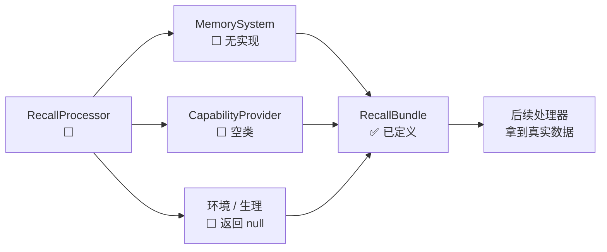
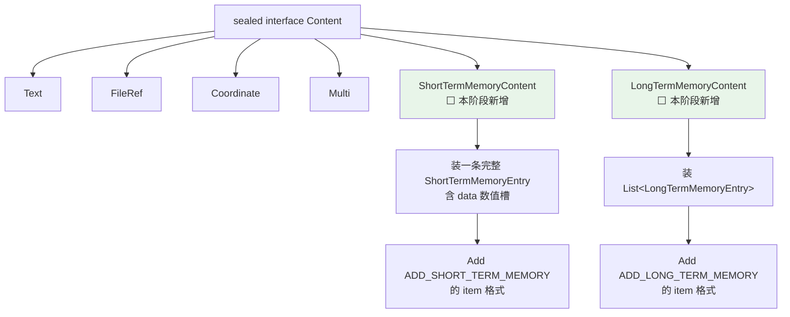
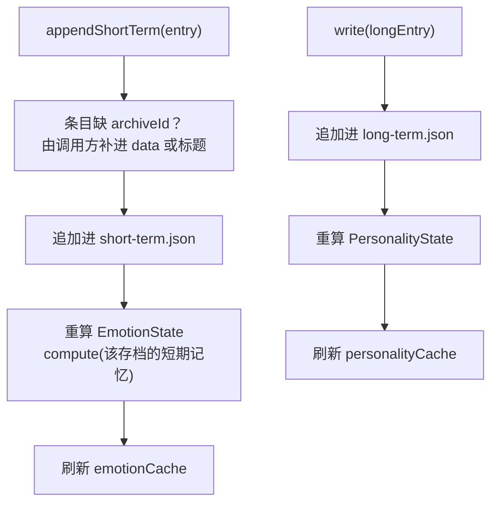
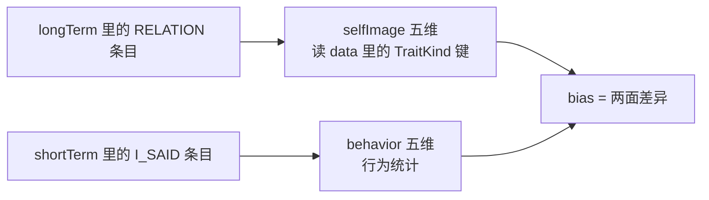
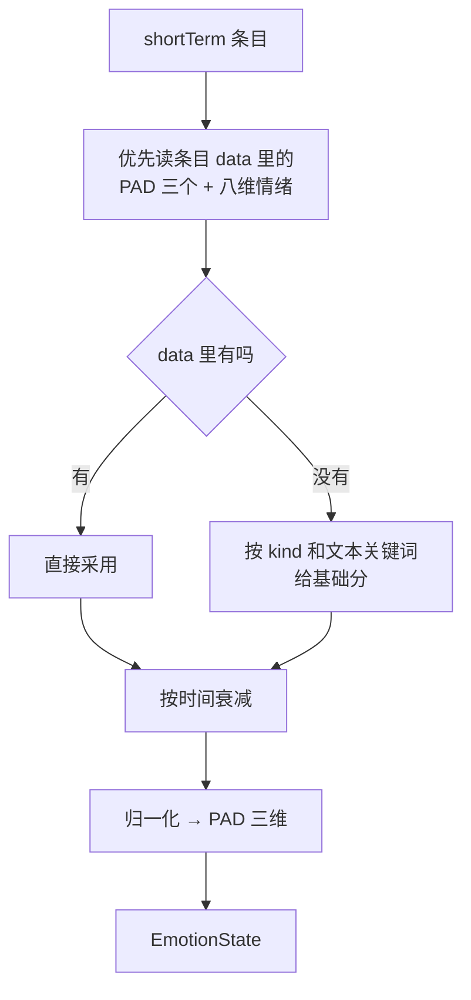
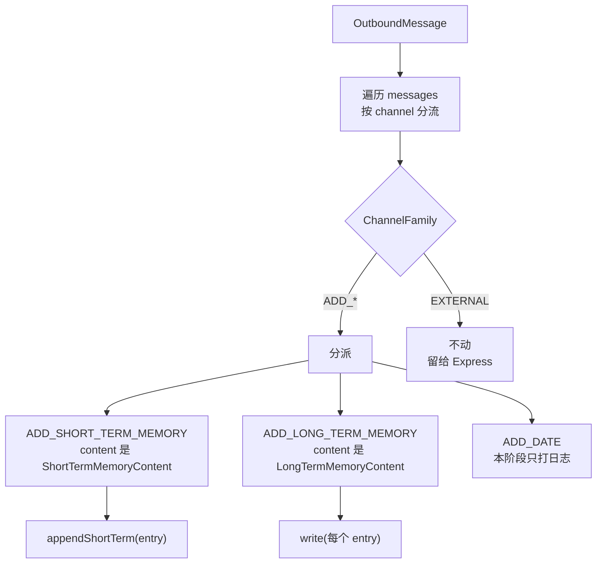
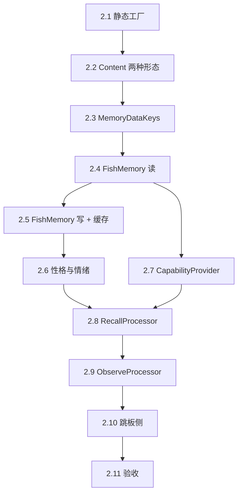

# 短期 ② · 真实上下文

> **目标**：记忆系统能存取，处理器能拼出真实上下文。
>
> **验收**：存档说的话跟着它自己的记忆变。
>
> 返回索引：[`开发计划-短期.md`](./开发计划-短期.md) ｜ 状态：🚧 进行中

---

## 一、这一阶段产出什么

处理器链上有六处空实现，缺的不是算法，是数据。这一阶段把数据填进去。



四块产出：

| 产出 | 是什么 |
|---|---|
| **记忆** | `FishMemory`，全局单例 Bean，按 `archiveId` 现算路径 |
| **内容形态** | `Content` 加两种记忆专用实现，给跳板当格式说明 |
| **能力** | `CapabilityProvider` 读 `data/capabilities.json`，按存档筛选注入 `RecallBundle` |
| **回顾** | `ObserveProcessor` 按 `ADD_*` 渠道分派，写进记忆 |

---

## 二、已定的口径

讨论过的结论，写代码时不再摇摆：

| 事项 | 决定 |
|---|---|
| 记忆实现 | 先做 `fish-memory`。`soul-md` 不做 |
| 实现类名 | `FishMemory`，`@Component`，**全局单例，不持有 `archiveId`** |
| 性格 / 情绪 | 从条目算出的纯函数，**算完缓存在 `FishMemory` 私有容器里**，按存档分桶，不落盘 |
| `data` 的键 | 集中在 `MemoryDataKeys` 常量类，配套单测防重复/冲突。**不散落字面量** |
| `CapabilityProvider` | `@Component`，`@PostConstruct` 读 `data/capabilities.json`（全局一份） |
| `contentTemplate` | 代码按 `contentKind` 现造的骨架，值随便填。**不做 json 序列化** |
| `NeedKind` 的 equals | **不重写**。enum 默认按实例相等，做 Map 键安全 |
| 能力筛选 | `Archive.links()` 里启用的 `EXTERNAL_*` ∪ 装配单支持的 `ADD_*` |
| 环境 / 生理 | 静态工厂返回固定数据，**不实现** `EnvironmentSystem` / `PhysiologySystem` |
| 兴趣视图 | 不做 |
| `ADD_SHORT_TERM_MEMORY` | **不可撤销**，**每轮有且只有一条**。它的 `Content` 是 `ShortTermMemoryContent`，带着情绪数值一起回来 |
| 短期记忆怎么来 | **必须由模型带回**，cat 端只校验不兜底 |
| 提示词硬要求 | ① 入站消息的 `ChannelKind` 对应 item ② `ADD_SHORT_TERM_MEMORY` 的 item。两者必须被回应；其余能力按情境自选 |

---

## 三、`Content` 的两种新形态

这两种是整个阶段的关键，先定清楚。



| 实现 | 字段 | `plainText` | 用在哪个渠道 |
|---|---|---|---|
| `ShortTermMemoryContent` | `ShortTermMemoryEntry entry` | 取 `entry.content` 的 `plainText` | `ADD_SHORT_TERM_MEMORY` |
| `LongTermMemoryContent` | `List<LongTermMemoryEntry> entries` | 逐条拼接，换行 | `ADD_LONG_TERM_MEMORY` |

```java
public record ShortTermMemoryContent(ShortTermMemoryEntry entry) implements Content {
    public ContentKind kind() { return ContentKind.SHORT_TERM_MEMORY; }
}

public record LongTermMemoryContent(List<LongTermMemoryEntry> entries) implements Content {
    public ContentKind kind() { return ContentKind.LONG_TERM_MEMORY; }
}
```

**为什么要这样设计**：`Capability.contentTemplate` 是给跳板看的格式说明。跳板要生成 `ADD_SHORT_TERM_MEMORY` 的 item，必须知道那个 item 的 `content` 长什么样 —— 它是一条完整的 `ShortTermMemoryEntry`，含 `data` 里的情绪数值。有了这个类型，格式就是**强约束**的，不是靠提示词里写一段散文去描述。

**这也解释了为什么 `ADD_SHORT_TERM_MEMORY` 不能撤销、不能多条**：它的 content 就是一条完整条目，多条无从判断谁覆盖谁。

---

## 四、分步

每步做完都要能编译通过，验证不过不进下一步。

---

### 2.1 四个静态工厂

`EmotionState.calm()`、`PersonalityState.neutral()`、`EnvironmentState.cozyHome()`、`PhysiologyState.rested()` 现在都 `return null`。

| 方法 | 返回 |
|---|---|
| `EmotionState.calm()` | `valence=0, arousal=0.2, dominance=0.5`，mix / complex 空，`fadeAt=now+衰减期` |
| `PersonalityState.neutral()` | 五维全 `0.5`，两个 narrative 空串，`bias=0` |
| `EnvironmentState.cozyHome()` | 固定「家」：卧室 `Zone`、`ambience`、`nearby` 空，`source="default"` |
| `PhysiologyState.rested()` | `health=1.0, energy=0.8, comfort=0.8`，其余空，`source="default"` |

**涉及**：四个已有 record 各加一个静态方法。**不新建类。**

**验证**：四个单测，断言非 null 且字段符合上表。

---

### 2.2 `Content` 加两种记忆形态

**做什么**：

1. `ContentKind` 加 `SHORT_TERM_MEMORY`、`LONG_TERM_MEMORY`
2. `Content` 加两个 record 实现
3. `Content.plainText()` 的两个分支

```java
if (c instanceof ShortTermMemoryContent s) {
    return plainText(s.entry() == null ? null : s.entry().content());
}
if (c instanceof LongTermMemoryContent l) {
    if (l.entries() == null) return "";
    return l.entries().stream()
            .map(e -> plainText(e.content()))
            .filter(s -> !s.isEmpty())
            .collect(Collectors.joining("\n"));
}
```

因为 `Content` 是 `sealed`，加实现会让编译器**逼**你补全所有 `switch` / `instanceof`。改动点编译器会全部指出来。

**注意递归**：`ShortTermMemoryContent` 里装着 `Content`，但那个 `Content` 通常是 `Text`，不会无限递归。加个防御：若条目 `content` 本身又是 `ShortTermMemoryContent`，返回空串。

**验证**：

```java
@Test void shortTermContentKind()
@Test void longTermContentKind()
@Test void plainTextOfShortTermContent()      // 取内嵌条目正文
@Test void plainTextOfLongTermContent()       // 多条换行拼接
@Test void longTermContentSkipsEmptyEntries()
```

---

### 2.3 `MemoryDataKeys` 常量类

**要解决的问题**：`ShortTermMemoryEntry.data` / `LongTermMemoryEntry.data` 是 `HashMap<String, Double>`，键名散落在代码里就是硬编码 —— 拼错不报错，只在运行时给 `null`。

**做什么**：`state/memory/MemoryDataKeys.java`，**16 个常量全在这里，一个方法都不放**。

```java
public final class MemoryDataKeys {

    // ── 短期条目的 data：PAD 三维 ──
    public static final String VALENCE   = "valence";    // 效价 -1~1
    public static final String AROUSAL   = "arousal";    // 唤醒 0~1
    public static final String DOMINANCE = "dominance";  // 掌控 0~1

    // ── 短期条目的 data：八种基本情绪 ──
    public static final String JOY           = "joy";
    public static final String SADNESS       = "sadness";
    public static final String ANGER         = "anger";
    public static final String FEAR          = "fear";
    public static final String DISGUST       = "disgust";
    public static final String SURPRISE      = "surprise";
    public static final String TRUST         = "trust";
    public static final String ANTICIPATION  = "anticipation";

    // ── 长期条目的 data：五维人格 ──
    public static final String OPENNESS          = "openness";
    public static final String CONSCIENTIOUSNESS = "conscientiousness";
    public static final String EXTRAVERSION      = "extraversion";
    public static final String AGREEABLENESS     = "agreeableness";
    public static final String NEUROTICISM       = "neuroticism";

    private MemoryDataKeys() {}
}
```

**为什么手写 13 个而不是从枚举派生**：派生要写 `of(BasicEmotion)` / `of(TraitKind)` 两个重载方法，读的地方变成 `data.get(of(BasicEmotion.JOY))` —— 多一层跳转、多一个方法散在外面。**常量就是常量**，读到 `data.get(MemoryDataKeys.JOY)` 一眼就知道取的是哪个键。多写的十行换来的是读代码时不用在脑子里跑一个方法。

**常量与枚举的对应关系靠单测钉住**，不靠人工记：

```java
@Test void everyBasicEmotionHasAKey()   // 反射遍历 BasicEmotion.values()，每个都能在 MemoryDataKeys 找到同名字段
@Test void everyTraitHasAKey()          // 同上，TraitKind
@Test void keysAreUnique()              // 16 个键两两不重复
@Test void keysMatchEnumNamesCaseInsensitive()   // JOY 常量的值 == "joy" == JOY.name().toLowerCase()
```

这样**加一个新枚举值忘了补常量**时，`everyBasicEmotionHasAKey` 立刻失败。这比我上一版的派生方案更直接 —— 派生方案里"键名对不对"是隐式的，这里显式写成断言。

---

### 2.4 `FishMemory` 的读

**做什么**：`state/memory/impl/FishMemory.java`，`@Component`，全局单例。

```java
@Component
public class FishMemory implements MemorySystem {
    private static final String ROOT    = "data";
    private static final String SUBDIR  = "memory/fish-memory";
    private static final String LONG_   = "long-term.json";
    private static final String SHORT_  = "short-term.json";

    private final JsonCodec json;

    private Path dirOf(long archiveId) {
        return Path.of(ROOT, Long.toString(archiveId), SUBDIR);
    }

    // 构造器只接 JsonCodec，不持有任何存档字段
}
```

**关键**：类里**没有任何 `archiveId` 字段**。每轮每次调用现算路径，所以一个 Bean 服务所有存档。

目录结构（首次访问时创建）：

```
data/{archiveId}/memory/fish-memory/
├── long-term.json      LongTermMemoryEntry[]
└── short-term.json     ShortTermMemoryEntry[]
```

只有两个文件。情绪和性格是算出来的，落进私有缓存，不落盘。

**这一步实现的方法**：

| 方法 | 返回 |
|---|---|
| `shortTerm(long archiveId)` | 读 `short-term.json`，按时间窗口过滤，`I_ASKED` 不过期 |
| `recall(RecallQuery)` | 读 `long-term.json`，打分排序后取前 `maxEntries` 条 |
| `personality(longTerm)` | 调 `PersonalityState.compute(...)`（2.5 再填真算法，这里先转 `neutral()`） |
| `emotion(shortTerm)` | 调 `EmotionState.compute(...)`（同上，先转 `calm()`） |
| `kind()` | `MemoryKind.FISH_MEMORY` |

**`recall` 的打分**（写进代码注释）：

```
score = 0.45 × 关键词命中率
      + 0.20 × 时间新鲜度
      + 0.20 × importance
      + 0.15 × |emotion|
```

关键词用**中文二元组**切分后求交集比例，不引分词库。`query.aboutWhom()` 非空时先按 `subject` 过滤。

**验证**：

```java
@Test void filesCreatedOnFirstUse()
@Test void recallFindsByKeyword()
@Test void recallRespectsSubjectFilter()
@Test void recallSortsByScoreDesc()
@Test void askedEntrySurvivesWindow()
@Test void oneBeanServesTwoArchives()      // 同一个 Bean 用两个 archiveId 得到不同数据
```

---

### 2.5 `FishMemory` 的写 + 私有缓存

**做什么**：补三个写方法，并加**按存档分桶的私有缓存**。

```java
/** 存档 → 上一轮算出的状态。进程内，不落盘。 */
private final Map<Long, PersonalityState> personalityCache = new ConcurrentHashMap<>();
private final Map<Long, EmotionState>     emotionCache     = new ConcurrentHashMap<>();

public PersonalityState cachedPersonality(long archiveId);   // 供 UnderstandProcessor
public EmotionState     cachedEmotion(long archiveId);
```

**三个写方法**：

```java
void write(LongTermMemoryEntry entry);              // 追加进该存档的 long-term.json
void appendShortTerm(ShortTermMemoryEntry entry);   // 追加进短-term.json + 刷新缓存
void resolveAsk(long archiveId, String entryId);    // 该存档某条 I_ASKED 置 resolved
```

**写的时候做什么**：



`resolveAsk` 的触发时机：收到新消息时，把之前没回应的 `I_ASKED` 全部置 true。

**落盘**：用 `JsonCodec.writePretty()`，先写 `.tmp` 再 `Files.move(REPLACE_EXISTING)`（`ArchiveStore` 已是这个写法）。

**为什么缓存要放在 `FishMemory` 里**：`UnderstandProcessor`（前处理 200）跑在 `RecallProcessor`（思考 100）**之前**，拿不到本轮 `RecallBundle`，但需要读情绪。缓存按 `archiveId` 分桶，理解阶段用 `msg.getArchiveId()` 取即可。

**验证**：

```java
@Test void longTermPersistsAcrossReload()
@Test void shortTermPersistsAcrossReload()
@Test void resolveAskMarksResolved()
@Test void cacheIsPerArchive()              // 两个存档互不串味
@Test void cacheRefreshedOnAppend()
```

---

### 2.6 性格与情绪的计算

**做什么**：给 `PersonalityState` 和 `EmotionState` 各加一个静态 `compute`。

```java
// PersonalityState
public static PersonalityState compute(List<LongTermMemoryEntry> longTerm,
                                       List<ShortTermMemoryEntry> shortTerm)

// EmotionState
public static EmotionState compute(List<ShortTermMemoryEntry> shortTerm)
```

**性格怎么算**：



| 面 | 从哪来 |
|---|---|
| `selfImage` | 长期条目的 `data`，键是 `MemoryDataKeys` 里的五维人格常量 |
| `behavior` | 短期 `I_SAID` 条目的四项统计：敬语比例、语气词密度、主动关心次数、平均句长，各手工线性映射到五维 |

条目 `data` 里缺某个维度时，该维度退回 `0.5`（不惩罚）。

**情绪怎么算**：



**模型给的情绪优先**（`data` 里有就用），cat 自己算的只是**兜底**。这条很关键：模型判得出"这句话是难过"，cat 的关键词表判不出。

**衰减**：`fadeAt` 到了之后往 `calm()` 回归，在读取时**现算**，不用定时器。

**验证**：

```java
@Test void personalityDefaultsToNeutralWhenEmpty()
@Test void personalityReadsTraitKeysFromData()
@Test void personalityShiftsWithBehavior()
@Test void emotionPrefersDataOverKeywords()
@Test void emotionFallsBackToKeywords()
@Test void emotionFadesTowardCalm()
```

---

### 2.7 `CapabilityProvider` + `capabilities.json`

**做什么**：新建 `data/capabilities.json`（全局一份），内容是 `Capability` 数组。`contentKind` 写枚举名：

```json
[
  {
    "capabilities": { "SOCIAL": 0.8, "BE_NEEDED": 0.6 },
    "action": "发消息",
    "channel": "EXTERNAL_QQ",
    "contentKind": "TEXT"
  },
  {
    "capabilities": { "ORDER": 0.5, "CERTAINTY": 0.4 },
    "action": "记短期记忆并带上情绪",
    "channel": "ADD_SHORT_TERM_MEMORY",
    "contentKind": "SHORT_TERM_MEMORY"
  },
  {
    "capabilities": { "EXPRESSION": 0.7 },
    "action": "记长期记忆",
    "channel": "ADD_LONG_TERM_MEMORY",
    "contentKind": "LONG_TERM_MEMORY"
  },
  {
    "capabilities": { "CONTROL": 0.6 },
    "action": "排日程",
    "channel": "ADD_DATE",
    "contentKind": "TEXT"
  }
]
```

`CapabilityProvider` 是 `@Component`：

```java
@Component
public class CapabilityProvider {
    private final List<Capability> cache;    // @PostConstruct 从 json 加载

    public List<Capability> forArchive(Archive archive);   // 按渠道并集筛选
}
```

**`contentTemplate` 怎么来**：json 里只写 `contentKind`，加载时按它造骨架填进去。**不做 json 序列化**。

```java
private static Content templateOf(ContentKind kind) {
    return switch (kind) {
        case TEXT           -> Content.text("");
        case FILE           -> new Content.FileRef("", "", "", FileKind.FILE);
        case COORDINATE     -> new Content.Coordinate(0, 0, 0);
        case MULTI          -> new Content.Multi(List.of());
        case SHORT_TERM_MEMORY -> new Content.ShortTermMemoryContent(null);
        case LONG_TERM_MEMORY  -> new Content.LongTermMemoryContent(List.of());
    };
}
```

**这个 switch 有一个好处**：`ContentKind` 以后再加值，编译器会在这里报"未覆盖"，逼你给新形态补模板。

**按存档筛选**：

```java
Set<ChannelKind> mine = archive.links() 里启用的 EXTERNAL_*
                     ∪ 装配单支持的 ADD_*
return cache.stream().filter(c -> mine.contains(c.channel())).toList();
```

`ADD_*` 谁算「装配单支持」：

| 渠道 | 条件 |
|---|---|
| `ADD_SHORT_TERM_MEMORY` | **恒有**（每轮都必须） |
| `ADD_DATE` | **恒有** |
| `ADD_LONG_TERM_MEMORY` | 当 `pipeline.memory() != NONE` 时才有 |

**验证**：

```java
@Test void loadsAllFromJson()
@Test void filtersByArchiveLinks()
@Test void omitsLongTermWhenMemoryIsNone()
@Test void shortTermAlwaysPresent()          // 装配单是 NONE 时它还在
@Test void templateMatchesContentKind()
```

---

### 2.8 `RecallProcessor` 拼 `RecallBundle`

思考链 order 100，把七个字段全部填上。

```java
@Override
public List<InboundMessage> process(List<InboundMessage> in) {
    for (InboundMessage msg : in) {
        Archive archive = archiveOf(msg);
        if (archive == null) continue;

        List<LongTermMemoryEntry>  longTerm  = memory.recall(queryOf(msg));
        List<ShortTermMemoryEntry> shortTerm = memory.shortTerm(archive.id());

        msg.setRecallBundle(new RecallBundle(
                longTerm,
                memory.personality(longTerm),      // 内部重算并刷新缓存
                memory.emotion(shortTerm),         // 同上
                shortTerm,
                EnvironmentState.cozyHome(),
                PhysiologyState.rested(),
                capabilityProvider.forArchive(archive)));
    }
    return in;
}
```

**`memory` 从哪来**：`FishMemory` 是 `@Component`，构造器注入一个即可，**不用 new**。装配单 `pipeline.memory()` 不是 `FISH_MEMORY` 时就跳过（不填 `recallBundle`）。

**`queryOf(msg)`** 要带上 `archiveId`：

```java
new RecallQuery(msg.getArchiveId(), msg.text(), topicHints, msg.senderId(),
                MAX_ENTRIES, MAX_CHARS)
```

**验证**：

```
往 long-term.json 写一条含"项目"的记忆
发一条「项目怎么样了」
→ 提示词里出现那条记忆
```

```java
@Test void recallBundleFilledForFishMemory()
@Test void recallBundleSkippedForNoneMemory()
@Test void understandReadsCachedEmotion()
```

---

### 2.9 `ObserveProcessor` 按渠道分派

后处理 order 200。



**短期记忆不做兜底**。按已定口径，它必须由模型带回。cat 端做的是**校验**：

| 情况 | 处理 |
|---|---|
| 这一轮没有 `ADD_SHORT_TERM_MEMORY` 项 | `log.warn`，不补 |
| 有但 `content` 不是 `ShortTermMemoryContent` | `log.warn`，丢弃该项 |
| 有且格式对 | `appendShortTerm(entry)` |

**长期记忆怎么转**：`LongTermMemoryContent.entries()` 里每条已经是完整的 `LongTermMemoryEntry`，模型填好了 `title` / `kind` / `subject` / `importance` / `data`。cat 端只补它填不了的：

| 字段 | 谁填 |
|---|---|
| `id` | cat（雪花 ID） |
| `createdAt` / `lastUsedAt` | cat（now） |
| `supersededBy` | cat（null） |
| `subject` | 模型没给就用入站消息的 `senderId()` |
| 其余 | 模型 |

**`ADD_DATE`** 本阶段只构造出来打日志，真正入队等第五阶段接 `ScheduleService`。

**验证**：

```java
@Test void shortTermActionAppendsEntry()
@Test void missingShortTermActionOnlyWarns()          // 不补，只记日志
@Test void wrongContentKindIsDiscarded()
@Test void longTermActionWritesEveryEntry()
@Test void dateActionOnlyLogs()
@Test void expressSkipsAddChannels()
```

手动验收：

```
说「你记住我叫小明」→ long-term.json 多一条
再问「我叫什么」→ 回复里出现「小明」
```

---

### 2.10 跳板侧

（`dsh-wdd-cat-linker`）

| 文件 | 改动 |
|---|---|
| `src/linker/heartbeat.js` | 读 `body.data.capabilities`，交给 cache |
| `src/common/message_cache.js` | 加 `capabilities` Map（`sessionId → List`） |
| `src/utils/deliver.js` | `buildPrompt` 加两块：必应段 + 可选段 |
| `src/utils/submit_tool.js` | item 的 `channel` 说明改成"按能力清单填"，不再硬编码只发文本 |

**cat 端配合**：`HeartBeatController` 返回值从 `Result.ok()` 改成带 `Map<String, List<Capability>>`。

**提示词新增的部分**（两个区块）：

```
【本轮你必须回应的】
1. 入站消息的渠道 → channel: "EXTERNAL_QQ"
2. 一条短期记忆 → channel: "ADD_SHORT_TERM_MEMORY"（每轮有且只有一条）

【本轮可以根据实际情况做的事情，不用一定做】
· 记长期记忆 → channel: "ADD_LONG_TERM_MEMORY"
· 排日程 → channel: "ADD_DATE"

[SHORT_TERM_MEMORY 的 content 格式]
{ id, title, at, kind, content, resolved, data: { valence, arousal, dominance, joy, sadness, ... } }
```

**第一块的渠道值不是写死的 `EXTERNAL_QQ`**：它是**入站消息自己的 `ChannelKind`**。这轮从哪个渠道来的消息，就必须往哪个渠道回。渲染时取 `inbound.channel` 的 wire 名。

**第二块的措辞刻意带上"不用一定做"**：`ADD_LONG_TERM_MEMORY` 和 `ADD_DATE` 是按情境选的，模型不该为了凑数硬塞。

**格式说明从哪来**：由 `Capability.contentTemplate` 渲染 —— 把模板实例的**字段名**列出来。跳板按 `contentKind` 决定怎么渲染（`SHORT_TERM_MEMORY` 展开条目的 `data` 键，`TEXT` 只写"文本"）。

**由数据驱动**：cat 返回几条就渲染几条，cat 没回就整段省略。跳板里不出现枚举硬编码 —— `contentKind` 的枚举名是**数据**，不是硬编码；入站渠道名也来自消息本身。

**验证**：

```
1. 关掉 cat → 提示词里没有这些段，仍能正常回复
2. 改 capabilities.json 去掉 ADD_DATE → 该项消失，但两块必应项还在
3. 装配单改成 NONE → ADD_LONG_TERM_MEMORY 消失，ADD_SHORT_TERM_MEMORY 还在
4. 从别的渠道进来一条消息 → 第一块的 channel 跟着变成那个渠道
```

---

### 2.11 验收

| # | 做什么 | 期望 |
|---|---|---|
| 1 | 手改 `long-term.json` 里一条记忆的措辞，再问同一个问题 | 回复内容跟着变 |
| 2 | 说「你记住我叫小明」，过几轮问「我叫什么」 | 答得出 |
| 3 | 换另一个联系人说话 | 召回到的是关于那个人的记忆 |
| 4 | 说「今天好累」，下一轮问「我昨天说了什么」 | 答得出，且情绪有变化 |

```powershell
# 存档目录应该长出两个文件
Get-ChildItem 'E:\程序代码\dsh\cat\data\{archiveId}\memory\fish-memory'

# 提示词里应该出现必应段和可选段
Select-String -Path 'D:\dsh\workspace\logs\desktop-next.log' -Pattern '本轮你必须回应的' | Select-Object -Last 3
```

---

## 五、顺序依赖



- **2.2 排前面**：`Content` 是 sealed，加实现会连带改所有 switch，早做完早暴露
- **2.3 排在 2.4 前**：`FishMemory` 一开工就要用键名
- 2.4 → 2.5 先读后写：读能立刻验收（手写一条看能否召回），写要等缓存
- 2.7 只依赖 2.2，可以和 2.4~2.6 并行

---

## 六、风险

| 风险 | 应对 |
|---|---|
| 记忆条目的 `content` 怎么落盘 | `FishMemory` 只认 `Text`，落盘时写 `plainText(content)`；`ShortTermMemoryContent` / `LongTermMemoryContent` 的外层结构按 `FishMemory` 自己的格式存，别的 `Content` 类型等第六阶段做多态序列化再扩 |
| `Content` 加实现要改很多 switch | 这是**好事** —— 编译器逼你全部补全，不会漏 |
| `UnderstandProcessor` 第一轮读不到缓存 | 用 `neutral()` / `calm()` 兜底 |
| 短期记忆无限增长 | 窗口按「最近 50 条 + 7 天」双限，写回时淘汰超出部分 |
| 模型不带 `ADD_SHORT_TERM_MEMORY` | 只 `warn` 不补。宁可缺一轮情绪，也不塞假数据 |

---

## 文档地图

| 想知道 | 看哪个 |
|---|---|
| 回到索引 | [`开发计划-短期.md`](./开发计划-短期.md) |
| 上一阶段 | [`短期01-链路跑通.md`](./短期01-链路跑通.md) |
| 下一阶段 | [`短期03-三我裁决.md`](./短期03-三我裁决.md) |
| `MemorySystem` 签名 | [`接口文档-cat.md`](./接口文档-cat.md) 第六节 |
| 提示词怎么拼 | [`接口文档-跳板.md`](./接口文档-跳板.md) `deliver.js` |
