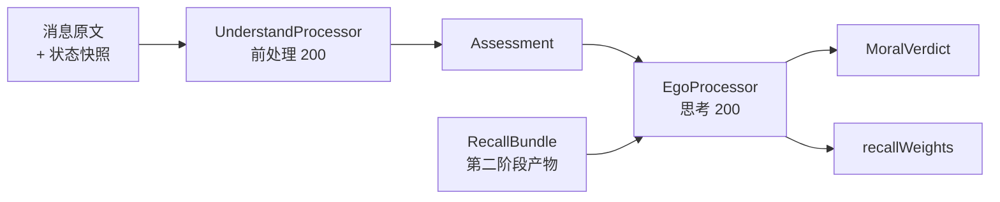
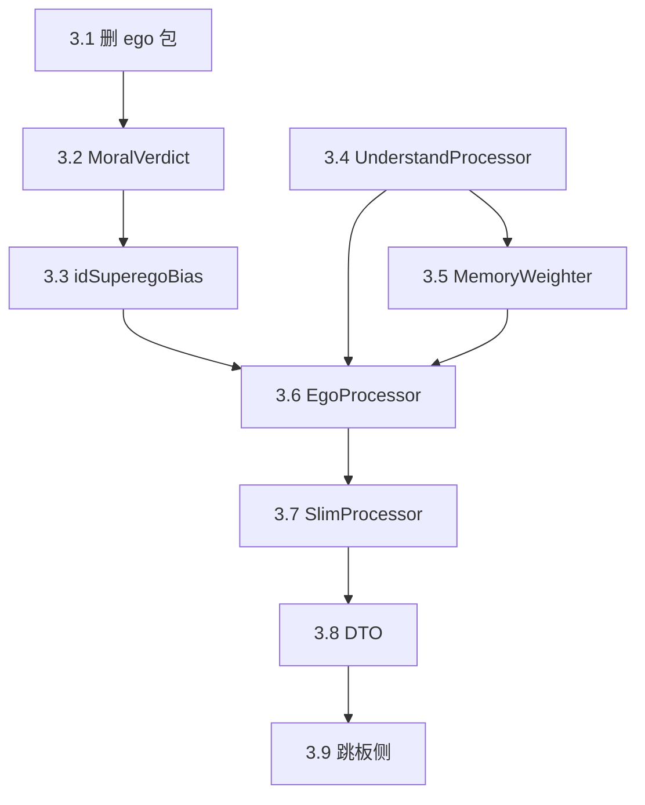

# 短期 ③ · 三我裁决

> **目标**：消息能被理解，状态能算成结论。
>
> **验收**：同一句话在不同情绪、不同人格下，`Assessment` 和 `MoralVerdict` 给出不同结果，记忆权重跟着排序变化。
>
> 返回索引：[`开发计划-短期.md`](./开发计划-短期.md) ｜ 状态：⏳ 未开始

---

## 一、这一阶段做什么

只做两件事：



| 件事 | 产出 |
|---|---|
| **把消息理解出来** | `Assessment` 六个字段全部有值 |
| **把状态算成结论** | `MoralVerdict` + 每条记忆的权重 |

**其余处理器保持空实现**，链路接线留到第四阶段。

---

## 二、已定的口径

| 事项 | 决定 |
|---|---|
| `ego/` 包 | **整个删掉**（五个类 + `SuperegoAction` 枚举） |
| 新建类 | 只有两个：`MoralVerdict`、`MemoryWeighter` |
| 复用还是裁决 | 不做“本我胜/超我胜”，改成算四个压强数 + 一个姿态 |
| 时代规范表 | 不做 |
| 美德维度枚举 | 不做 |
| `TriggerService` / `ReflexService` / `MergeProcessor` | **保持空实现**，第四阶段接 |
| 验证机制 | 第四阶段 |
| 权重与检索分数 | **分开算**，不乘 `score` |
| `SlimProcessor` 丢多少 | 按百分比，留前 80% |

---

## 三、`MoralVerdict`

```java
public record MoralVerdict(
        double idPressure,         // 本我压强 0~1：需求 + 情绪 + 急迫
        double superegoPressure,   // 超我压强 0~1：来自人格的自我约束
        double selfControl,        // 自我控制力 0~1：实际压得住多少
        double leakage,            // 溢出 0~1：压不住会漏多少

        Posture posture,
        String reconciliation,     // 一句人话
        Map<String, Object> trace
) {

    public enum Posture {
        RESTRAINED,   // 克制住了
        COMPROMISED,  // 压了一半，话里有话
        INDULGED,     // 没压住
        MUTED         // 直接走反射通道
    }
}
```

### 四个数怎么算

**输入全部来自 `InboundMessage`**：`assessment` 和 `recallBundle`。

| 数 | 公式 | 用到的字段 |
|---|---|---|
| `idPressure` | `0.5 × 最强能力满足度 + 0.3 × emotion.arousal + 0.2 × urgency权重` | `recallBundle.capabilities`、`emotionState.arousal`、`assessment.urgency` |
| `superegoPressure` | `0.5 × selfImage.CONSCIENTIOUSNESS + 0.3 × selfImage.AGREEABLENESS + 0.2 × selfImage.OPENNESS` | `personality.selfImage` |
| `selfControl` | `0.6 × behavior.CONSCIENTIOUSNESS + 0.4 × (2 - idMultiplier) / 2` | `personality.behavior`、`emotionState.idSuperegoBias()` |
| `leakage` | `max(0, idPressure - selfControl) + 0.3 × bias` | `personality.bias` |

> `superegoPressure` 与 `selfControl` 都读人格，区别在**自我认知和行为画像**：前者是“我以为我该多守规矩”，后者是“我实际守住了多少”。这两个面差得越多，`bias` 越大，`leakage` 越高。

`urgency` 权重映射：`HIGH=1.0` / `NORMAL=0.5` / `LOW=0.2` / `UNKNOWN=0.5`。

### `posture` 怎么定

```
leakage ≥ 0.6                → INDULGED
0.2 < leakage < 0.6          → COMPROMISED
leakage ≤ 0.2                → RESTRAINED

assessment.addressedToMe == false
  且 chatType == "group"     → MUTED（覆盖上面三项）
```

`MUTED` 的判据是**客观的**：这话不是冲我说的，那就不该出现在轮到我说话的场合。私聊不判 `MUTED`。

### `reconciliation` 怎么写

由 `posture` 和两个主压强拼一句人话：

| 姿态 | 模板 |
|---|---|
| `RESTRAINED` | “你有点想{冲动方向}，但你忍住了。” |
| `COMPROMISED` | “你压住了一半，话里多少会透出来一点。” |
| `INDULGED` | “你知道不该这样，但你现在有点控制不住。” |
| `MUTED` | “这话不是冲你说的，你不需要接。” |

`冲动方向` 取 `idPressure` 最高的那个 `NeedKind` 的中文名，映射表放常量类。

---

## 四、`MemoryWeighter`

### 权重公式

```
w(e) = 基础(e) × 调节(e)     最后夹到 0~1
```

**基础**（这条记忆自己是什么样）：

```
基础(e) = 0.5 × importance + 0.3 × |emotion| + 0.2 × 新鲜度
新鲜度  = exp(-Δ天 / 7)      // lastUsedAt 距今，7 天半衰
```

**调节**（这一轮怎么看它）：

| 因子 | 来源 | 作用 |
|---|---|---|
| 情感同向 | `leakage` | 溢出高时，和当前情绪**同向**的记忆加成，反向的减权 |
| 关系加深 | `superegoPressure` | 约束强时，`kind == RELATION` 的记忆加成 |
| 注意力收窄 | `idPressure` | 冲动强时，`importance > 0.5` 的更突出，`< 0.5` 的被压低 |
| **均匀化** | `selfControl` | **总闸**：控制力强时，上面三个调节往 1.0 压扁 |

```java
double sameDir = Math.signum(e.emotion()) == Math.signum(emotion.valence()) ? 1 : -0.5;
double 情感同向 = 1.0 + leakage * 0.5 * sameDir;
double 关系加深 = e.kind() == RELATION ? 1.0 + superegoPressure * 0.4 : 1.0;
double 注意力   = 1.0 + idPressure * 0.6 * (e.importance() - 0.5);

double 均匀 = 1.0 - selfControl * 0.5;
double 调节 = 1.0 + 均匀 * ((情感同向 - 1) + (关系加深 - 1) + (注意力 - 1));

double w = clamp01(基础 * 调节);
```

`selfControl` 高 → `均匀` 接近 0 → `调节` 接近 1 → 权重就是客观的基础值。这就是“看得清”。

### 短期记忆也用同一套

`ShortTermMemoryEntry` 没有 `importance` 和 `emotion` 字段，基础值简化为：

```
基础(e) = 0.5 + 0.3 × I_ASKED权重 + 0.2 × 新鲜度
```

`I_ASKED` 且未 resolved 的给 1.0，其余 0.5——**问过还没回音的事最该被惦记**。

---

## 五、`InboundMessage` 的字段变化

```java
public class InboundMessage extends NormalMessage {

    private RecallBundle recallBundle;                    // 第二阶段已有
    private Assessment   assessment;                      // 本阶段填满
    private MoralVerdict moralVerdict;                    // 新增，替代 egoDecision

    /** 这一轮每条记忆的权重：条目 id → 权重。 */
    private Map<String, Double> recallWeights;            // 新增
}
```

**`egoDecision` 字段删除**，随 `ego/` 包一起。

---

## 六、分步

---

### 3.1 删掉 `ego/` 包

删六个文件：`IdWant`、`SuperegoRule`、`SuperegoEngine`、`EgoDecider`、`EgoDecision`、`SuperegoAction`。

连带改动（编译器会全部指出来）：

| 位置 | 改成 |
|---|---|
| `InboundMessage.egoDecision` 字段 + getter/setter | 换成 `moralVerdict` |
| `EgoProcessor` | 不再 import `EgoDecision` |
| `InboundMessageDto` | `EgoDecisionView` 换成 `MoralVerdict` 的只读视图 |

**验证**：

```java
@Test void egoPackageIsGone()   // 编译通过即是
```

---

### 3.2 `MoralVerdict`

新建 `ego/MoralVerdict.java`。

注意包名：`ego/` 原来那五个类删了，但**目录可以留下来放这两个新类**，避免 `message/child/` 变得臃肿。

```java
package com.wdd.cat.ego;

public record MoralVerdict(...) { public enum Posture {...} }
```

**验证**：

```java
@Test void postureByLeakage()            // 三档边界
@Test void mutedWhenNotAddressedInGroup()
@Test void privateChatNeverMuted()
```

---

### 3.3 `EmotionState.idSuperegoBias()`

现在返回 `null`。

```java
public IdSuperegoBias idSuperegoBias() {
    // 唤醒度高 → 本我放大、超我压低
    double arousalE = clamp01(arousal);
    return new IdSuperegoBias(
            1.0 + arousalE * 0.5,      // 1.0 ~ 1.5
            1.0 - arousalE * 0.4);     // 1.0 ~ 0.6
}
```

**验证**：

```java
@Test void calmEmotionHasNeutralBias()   // arousal=0.2 → id≈1.1, superego≈0.92
@Test void arousedEmotionFavorsId()
```

---

### 3.4 `UnderstandProcessor` 填满 `Assessment`

前处理 order 200，本阶段唯一有真实实现的处理器。

```java
@Override
public List<InboundMessage> process(List<InboundMessage> in) {
    for (InboundMessage msg : in) {
        msg.setAssessment(analyze(msg));
    }
    return in;
}
```

**六个字段怎么算**：

| 字段 | 算法 |
|---|---|
| `text` | `msg.text()` |
| `isLateNight` | `timestamp` 落在 23:00–06:00 |
| `addressedToMe` | 私聊恒 `true`；群聊看昵称是否被提及、是否引用我、是否 @我 |
| `urgency` | 问号/感叹号/“快/急/马上”等词 → `HIGH`；问句 → `NORMAL`；纯陈述 → `LOW` |
| `arousalGuess` | 感叹号密度 × 0.5 + 重复字密度 × 0.3 + 短句比例 × 0.2 |
| `valenceGuess` | 负面词表命中数 − 正面词表命中数，归一化到 -1~1 |

**状态快照怎么用**：`addressedToMe` 和 `isLateNight` 只靠消息本身；另外三个（`urgency` / `arousalGuess` / `valenceGuess`）**借鉴上一轮缓存**——

```java
EmotionState cached = fishMemory.cachedEmotion(msg.getArchiveId());
double baseline = cached == null ? 0.2 : cached.arousal();
arousalGuess = clamp01(文本算出的值 * 0.7 + baseline * 0.3);
```

**这是本阶段唯一碰缓存的地方**：理解时参考上一轮的情绪基线，判断“这句话是让人上火，还是我本来就在上火”。

**词表放哪**：`UnEditAbleDefaultConfig` 旁边新建一个 `UnderstandLexicon` 常量类，和 `MemoryDataKeys` 同一个风格——**全是常量，不放方法**。

**验证**：

```java
@Test void lateNightFlagged()
@Test void privateChatAlwaysAddressed()
@Test void groupChatWithoutMentionIsNotAddressed()
@Test void questionMarkRaisesUrgency()
@Test void negativeWordsLowerValence()
@Test void arousalUsesCachedBaseline()
```

---

### 3.5 `MemoryWeighter`

新建 `ego/MemoryWeighter.java`，`@Component`。

```java
@Component
public class MemoryWeighter {

    /** 给一批长期记忆算权重。 */
    public Map<String, Double> weighLongTerm(List<LongTermMemoryEntry> entries,
                                             MoralVerdict verdict,
                                             EmotionState emotion);

    /** 给一批短期记忆算权重。 */
    public Map<String, Double> weighShortTerm(List<ShortTermMemoryEntry> entries,
                                              MoralVerdict verdict,
                                              EmotionState emotion);
}
```

系数全部收进 `UnEditAbleDefaultConfig` 的常量，不在方法里写魔法数字。

**验证**：

```java
@Test void highLeakageBoostsSameDirectionEmotion()
@Test void highLeakageSuppressesOppositeEmotion()
@Test void highSelfControlFlattensAdjustment()
@Test void relationEntriesBoostedWhenSuperegoHigh()
@Test void unresolvedAskWeighsMost()
@Test void weightsAreClamped()
```

---

### 3.6 `EgoProcessor` 落地

思考 order 200。

```java
@Override
public List<InboundMessage> process(List<InboundMessage> in) {
    for (InboundMessage msg : in) {
        RecallBundle bundle = msg.getRecallBundle();
        if (bundle == null) continue;      // 装配单是 NONE，跳过

        MoralVerdict verdict = decide(msg, bundle);
        msg.setMoralVerdict(verdict);

        Map<String, Double> weights = new HashMap<>();
        weights.putAll(weighter.weighLongTerm(bundle.longTermMemories(), verdict, bundle.emotionState()));
        weights.putAll(weighter.weighShortTerm(bundle.shortTermMemories(), verdict, bundle.emotionState()));
        msg.setRecallWeights(weights);
    }
    return in;
}
```

`decide()` 就是第三节那四个公式，写成一个私有方法。

**验证**：

```java
@Test void verdictFilledWhenRecallBundlePresent()
@Test void skippedWhenRecallBundleNull()
@Test void weightsCoverEveryEntry()
```

---

### 3.7 `SlimProcessor` 按权重裁

思考 order 300。

```java
@Override
public List<InboundMessage> process(List<InboundMessage> in) {
    for (InboundMessage msg : in) {
        RecallBundle bundle = msg.getRecallBundle();
        Map<String, Double> weights = msg.getRecallWeights();
        if (bundle == null || weights == null || weights.isEmpty()) continue;

        keepTop(bundle.longTermMemories(), weights, KEEP_RATIO);
        keepTop(bundle.shortTermMemories(), weights, KEEP_RATIO);
    }
    return in;
}

/** 按权重保留前 ratio 比例，原地替换。 */
private static <T> void keepTop(List<T> list, Map<String, Double> weights, double ratio);
```

`KEEP_RATIO = 0.8`，放 `UnEditAbleDefaultConfig`。

**注意**：`RecallBundle` 是 record，内部 List 如果不可变就替换不了。这一步要确认 `RecallBundle` 的构造是否 `List.copyOf`——如果是，`SlimProcessor` 得重建 record 塞回去。

> **待验证**：实现时看 `RecallBundle` 的构造器，再决定是原地改还是重建。这是本阶段唯一可能需要动 `RecallBundle` 的地方。

**验证**：

```java
@Test void keepsTopEightyPercent()
@Test void preservesOrder()
@Test void noopWhenWeightsEmpty()
```

---

### 3.8 `InboundMessageDto` 换视图

`EgoDecisionView` 换成：

```java
public record MoralVerdictView(
        double idPressure,
        double superegoPressure,
        double selfControl,
        double leakage,
        String posture,
        String reconciliation
) {}
```

**`trace` 不再导出**——它是排障用的，不该出现在跳板协议里。

`recallWeights` 也要导出，跳板拼提示词时要用。

**验证**：

```java
@Test void dtoCarriesVerdict()
@Test void dtoCarriesWeights()
```

---

### 3.9 跳板侧

| 文件 | 改动 |
|---|---|
| `src/utils/deliver.js` | 记忆渲染时按 `recallWeights` 打方括号，并加一句数字含义说明 |

**提示词里长这样**：

```
【你记得的事】
· [0.82] 她说过会来的
· [0.41] 上周她提到想换工作
· [0.09] 她喜欢喝美式

（括号里的数，是这些记忆此刻在你心里的分量——越高的，越容易被你想起来）

【你此刻】
你有点想怼回去，但你忍住了。（reconciliation）
```

**功能开关**：cat 没下发 `recallWeights` 时整段省略，不影响原有渲染。

**验证**：

```
1. cat 没下发权重 → 提示词里没有方括号
2. 改情绪状态 → 同一批记忆的方括号数字跟着变
```

---

## 七、顺序依赖



- **3.1 排最前**：删类会连带断一批引用，编译器会一次指出来
- **3.4 和 3.5 可以并行**：它们互不依赖
- `EgoProcessor` 依赖 `Assessment`（3.4）和 `MemoryWeighter`（3.5），所以排在它们之后

---

## 八、本阶段不做的

| 不做 | 留给谁 |
|---|---|
| `TriggerService` 真判断 | ④ 反射通道 |
| `ReflexService` 造 `OutboundMessage` | ④ 反射通道 |
| `MergeProcessor` 改名 + 判沉默 | ④ 反射通道 |
| `Posture.MUTED` 真走反射 | ④ 反射通道（本阶段只产出枚举值） |
| 验证机制（token 测试消息） | ④ 反射通道 |
| `NeedPool` / 欲望 | ⑤ 日程与欲望 |

---

## 九、风险

| 风险 | 应对 |
|---|---|
| 四个压强的系数拍脑袋定，跑出来全是一个值 | 系数收进 `UnEditAbleDefaultConfig`，先各给 0.5 附近的中性初值，跑真实对话看分布再调 |
| `List.of()` 造成的不可变 List 改不了 | 3.7 实现时先看 `RecallBundle` 构造器，必要时重建 record |
| `MUTED` 产出了但没人消费 | 本阶段接受。`MoralVerdict.posture` 会被记录和导出，第四阶段接上反射链路时才真正生效 |
| `UnderstandProcessor` 的词表太粗 | 先做能跑的最小版本，词表扩充是长期工作 |

---

## 文档地图

| 想知道 | 看哪个 |
|---|---|
| 回到索引 | [`开发计划-短期.md`](./开发计划-短期.md) |
| 上一阶段 | [`短期02-真实上下文.md`](./短期02-真实上下文.md) |
| 下一阶段 | [`短期04-反射通道.md`](./短期04-反射通道.md) |
| `MemorySystem` 签名 | [`接口文档-cat.md`](./接口文档-cat.md) 第六节 |
| 提示词怎么拼 | [`接口文档-跳板.md`](./接口文档-跳板.md) `deliver.js` |
