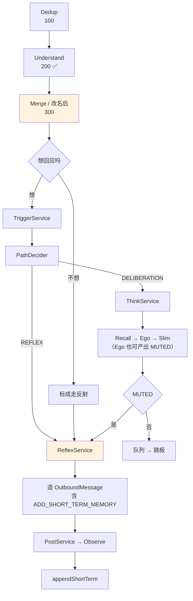
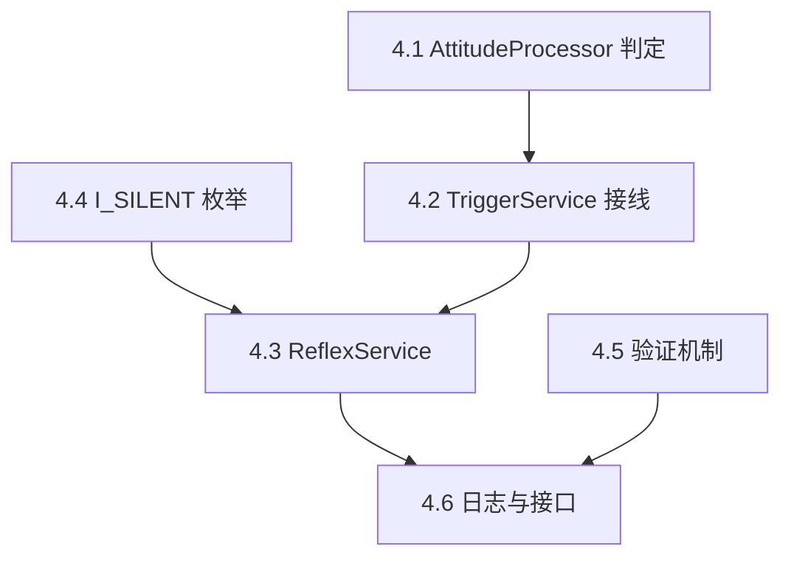

# 短期 ④ · 反射通道

> **目标**：不想回的消息不经过模型，也能被记下来。
>
> **验收**：群里一句没点名的闲聊，模型没被调用，但短期记忆里多了一条"我没回"。
>
> 返回索引：[`开发计划-短期.md`](./开发计划-短期.md) ｜ 状态：⏳ 未开始

---

## 一、这一阶段做什么

第三阶段把 `Assessment` 和 `MoralVerdict` 算出来了，`Posture.MUTED` 也产出了，但**没人消费它**。这一阶段把通路接上。



**三块：**

| 块 | 干什么 |
|---|---|
| **① 判定** | `MergeProcessor` 改名，加"该不该回"的判断 |
| **② 分派** | `TriggerService` / `PathDecider` 真判断 |
| **③ 执行** | `ReflexService` 造 `OutboundMessage`，走 `ObserveProcessor` 记账 |

---

## 二、三个判定点，各自的判据

**这是本阶段最容易做乱的地方，先说清楚。**

| 位置 | 层 | 判据 | 依据 |
|---|---|---|---|
| `MergeProcessor` | 前处理 300 | 客观：**这话不是冲我说的** | 只有 `Assessment` |
| `PathDecider` | `TriggerService` 内 | 客观 + 反射规则表 | `DecisionContext` |
| `EgoProcessor` | 思考 200 | 主观：**我有情绪、有记忆，所以不想回** | 完整 `RecallBundle` |

**前处理只能做客观判断**，因为它拿不到记忆和情绪。主观判断必须在思考层。两条路都能触发 `MUTED`，殊途同归到 `ReflexService`。

---

## 三、分步

---

### 4.1 `MergeProcessor` 改名 + 加判定

**改名**：`MergeProcessor` → **`AttitudeProcessor`**（判断"我"对这条消息是什么态度）。

**为什么改名**：它不再只做合并，还判断该不该回。名字得说出这件事。

**加什么**：

```java
// 判断这条合并后的消息，我该不该回
private boolean shouldReply(InboundMessage msg) {
    Assessment a = msg.getAssessment();
    if (a == null) return true;                       // 没理解结果，保守起见回
    if (a.addressedToMe()) return true;               // 冲我说的，一定回
    return !"group".equals(msg.chatType());           // 群聊里没点名 → 不回；私聊 → 回
}
```

不想回的处理：

```java
msg.setThinkingPath(ThinkingPath.REFLEX);   // 新增字段
```

**`InboundMessage` 加一个 `ThinkingPath thinkingPath` 字段**（`ThinkingPath` 枚举已存在），默认 `null` 表示未定，由 `TriggerService` 决定。

**验证**：

```java
@Test void groupChatWithoutMentionIsReflex()
@Test void privateChatAlwaysDeliberates()
@Test void noAssessmentDefaultsToReply()
```

---

### 4.2 `TriggerService` / `PathDecider` 接线

**`PathDecider.decide()`** 现在是 `return DELIBERATION`。改成：

```java
public ThinkingPath decide(InboundMessage msg, DecisionContext ctx) {
    // 前处理已经定了，就听它的
    if (msg.getThinkingPath() != null) return msg.getThinkingPath();

    // 否则按反射规则表判
    for (ReflexRule rule : ctx.reflexRules()) {
        if (rule.matches(msg, ctx)) return ThinkingPath.REFLEX;
    }
    return ThinkingPath.DELIBERATION;
}
```

**`TriggerService.buildContext()`** 五个空占位里，这一阶段只填两个：

| 字段 | 从哪来 |
|---|---|
| `emotion` | `fishMemory.cachedEmotion(archiveId)`（第三阶段已有缓存） |
| `reflexRules` | 新增 `data/reflex_rules.json`，跟 `capabilities.json` 同一模式 |
| `needs` / `environment` / `physiology` | 仍然是空（第五阶段做） |

**`ReflexRule`** 现在是个空类，要改成 record：

```java
public record ReflexRule(
        String id,
        String condition,     // 人话描述，给人看的
        ThinkingPath target   // 命中后走哪
) {}
```

**这一阶段规则表先留空数组**。`PathDecider` 的空规则表返回 `DELIBERATION`，等于不改变现状——**先让通路跑通，规则后加。**

**验证**：

```java
@Test void preprocessorDecisionWins()
@Test void emptyRuleTableDefaultsToDeliberation()
@Test void queuedModelMessagesGoToThink()
```

---

### 4.3 `ReflexService` 造 `OutboundMessage`

**现在的空壳**：

```java
public void run(InboundMessage message, DecisionContext ctx) {
    // TODO 命中反射规则 → 直接产回复 → 交给 PostService
}
```

**改成**：

```java
public void run(InboundMessage message, DecisionContext ctx) {
    OutboundMessage out = buildSilentOutbound(message);
    postService.enqueue(out);
}
```

**`buildSilentOutbound` 造什么**：

```
OutboundMessage
  ├─ archiveId / sessionId / channel：从 message 复制
  ├─ inboundMessage：message 本身（Observe 要用）
  └─ messages: [
       NormalMessage {
         channel: ADD_SHORT_TERM_MEMORY,
         content: ShortTermMemoryContent(entry)
       }
     ]
```

`entry` 就是一条 `ShortTermMemoryEntry`：

| 字段 | 值 |
|---|---|
| `title` | "没有回话" |
| `kind` | **`I_SILENT`**（新增枚举值） |
| `content` | `Text("我没有回复这条消息")` |
| `resolved` | false |
| `data` | 空 |

**为什么要包成 `ShortTermMemoryContent`**：第二阶段定的 `ADD_SHORT_TERM_MEMORY` 的 content 就是这个类型，走同一条路 `ObserveProcessor` 不用加分支。

**验证**：

```java
@Test void silentOutboundHasShortTermAction()
@Test void silentEntryKindIsISilent()
@Test void observeAppendsSilentEntry()
```

---

### 4.4 `ShortTermEntryKind` 加 `I_SILENT`

现有五个值（`USER_SAID` / `I_SAID` / `I_ASKED` / `I_DID` / `SENSED`）没有一个表示"我决定不回"。

```java
/** 我看到了但选择不回。由 cat 自己产生，不来自模型。 */
I_SILENT
```

**注意**：它和 `I_ASKED` 一样，是**cat 主动写**的，不是模型带回的。但 `I_SILENT`**按窗口过期**（不像 `I_ASKED` 永远留着）——"上次没回"不该一直占着位置。

---

### 4.5 验证机制

`.README.md` 第 33–34 段说的：用户要能确认"它是真不想回"还是"消息丢了"。

**做法**：

```
用户在私聊里发一段含 token 的特定格式消息
   ↓
ValidationProcessor（前处理，order 150，在 Understand 之前）
   ↓ 识别出这是测试消息
强制走跳板 → 拿到真实输出
   ↓ 篡改输出格式
回到用户的外部连接，且格式让其他存档知道这是测试结果
```

**这一步的细节要在实现前定**：

| 问题 | 待定 |
|---|---|
| token 存哪 | `archive.json` 加字段？还是全局配置？ |
| 消息格式 | 前缀？还是独立指令？ |
| "篡改成什么形式" | 加标记前缀？包一层信封？ |
| 其他存档怎么识别 | 靠那个标记 |

**这一块我建议单独做一小步 4.6，不混在反射里** —— 它和反射没有代码依赖，只是同属"回不回"这个主题。

---

### 4.6 前端/接口

| 改动 | 说明 |
|---|---|
| `InboundMessageDto` | 加 `thinkingPath` 字段，让跳板日志能看到这条走了哪条路 |
| 日志 | `ReflexService` 打一条 info：哪个存档、哪条消息、为什么没回 |

**"为什么没回"要写进日志**，这是排查"消息丢了还是不想回"的第一手线索。

---

## 四、顺序依赖



- **4.4 和 4.1 可以并行**
- **4.3 依赖 4.4**（要用 `I_SILENT`）和 **4.2**（要有东西调它）
- **4.5 独立**，可以在任何位置插

---

## 五、本阶段不做的

| 不做 | 留给谁 |
|---|---|
| 欲望驱动主动发消息 | ⑤ 日程与欲望 |
| `DecisionContext.needs` / `environment` / `physiology` | ⑤ |
| 反射规则表填内容 | 以后（本阶段只留空数组） |
| `MergeProcessor` 里那段合并逻辑删不删 | **本阶段先留着**，改名后合并和判定并存，确认没影响再删 |

---

## 六、风险

| 风险 | 应对 |
|---|---|
| 沉默的消息用户完全无感知，看起来像丢消息 | 日志必须写清"没回 + 原因"；验证机制（4.5）就是治这个的 |
| 规则表留空时 `PathDecider` 形同虚设 | 本阶段接受。真正的判据来自 `AttitudeProcessor`，规则表只是补充 |
| `MergedProcessor` 改名后合并逻辑还留着，名不副实 | 先并存，第五阶段前再决定删不删 |
| `ReflexService` 造的 `OutboundMessage` 没有真实的模型输出 | 它本来就只有一条记账消息，`ExpressProcessor` 要能正确地"没有话要发"就跳过 |

---

## 文档地图

| 想知道 | 看哪个 |
|---|---|
| 回到索引 | [`开发计划-短期.md`](./开发计划-短期.md) |
| 上一阶段 | [`短期03-三我裁决.md`](./短期03-三我裁决.md) |
| 下一阶段 | [`短期05-日程与欲望.md`](./短期05-日程与欲望.md) |
| `TriggerService` 的职责 | [`接口文档-cat.md`](./接口文档-cat.md) |
